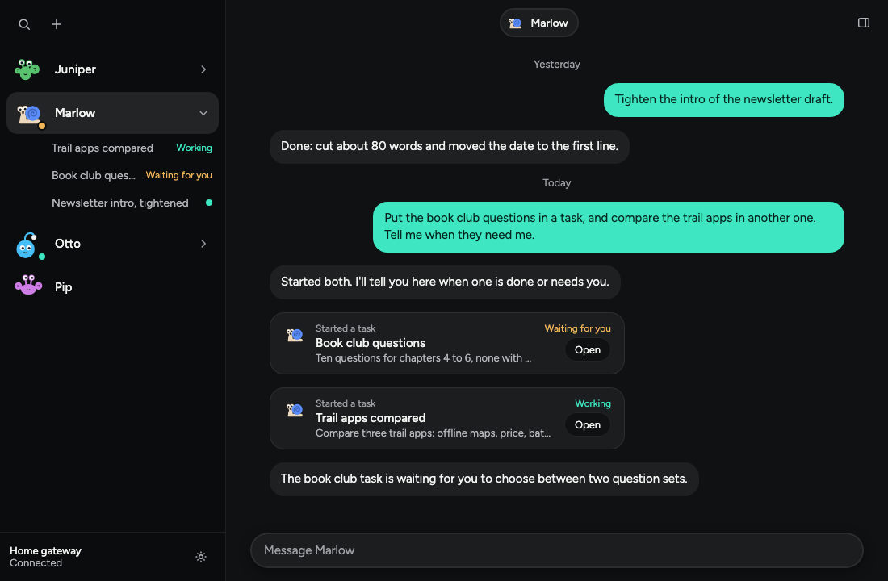
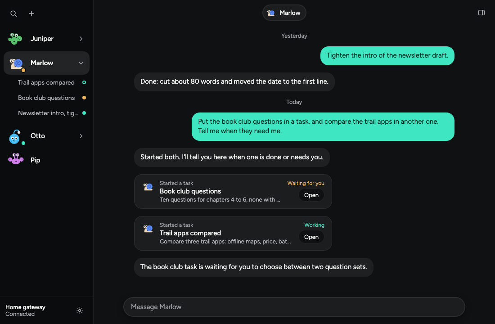
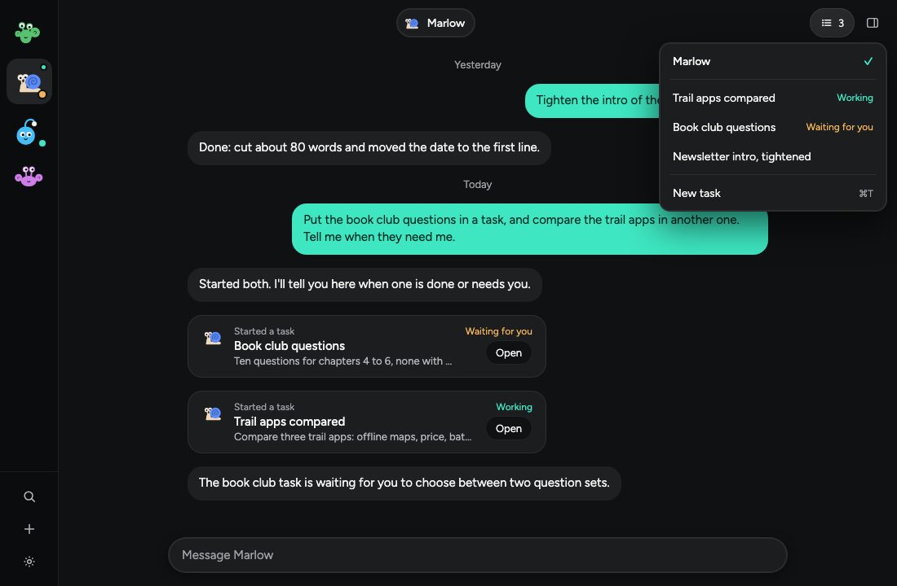
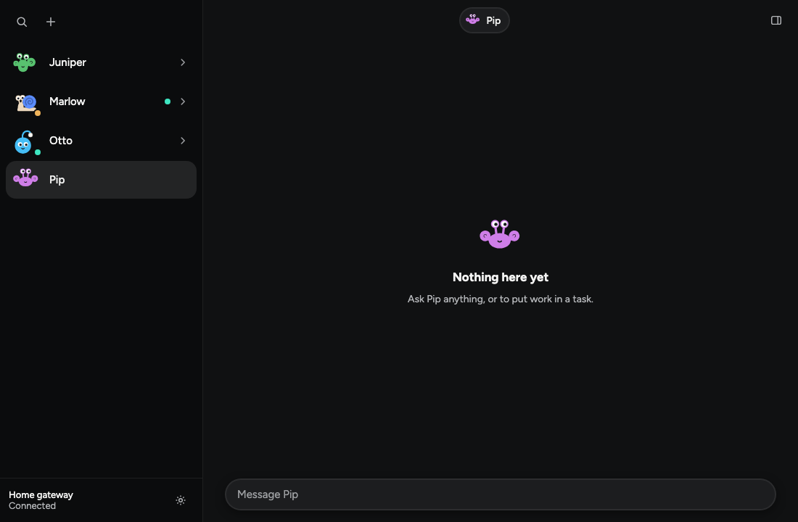
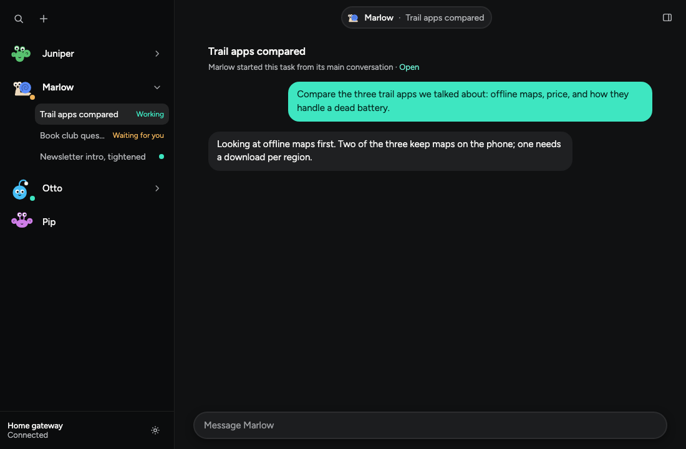
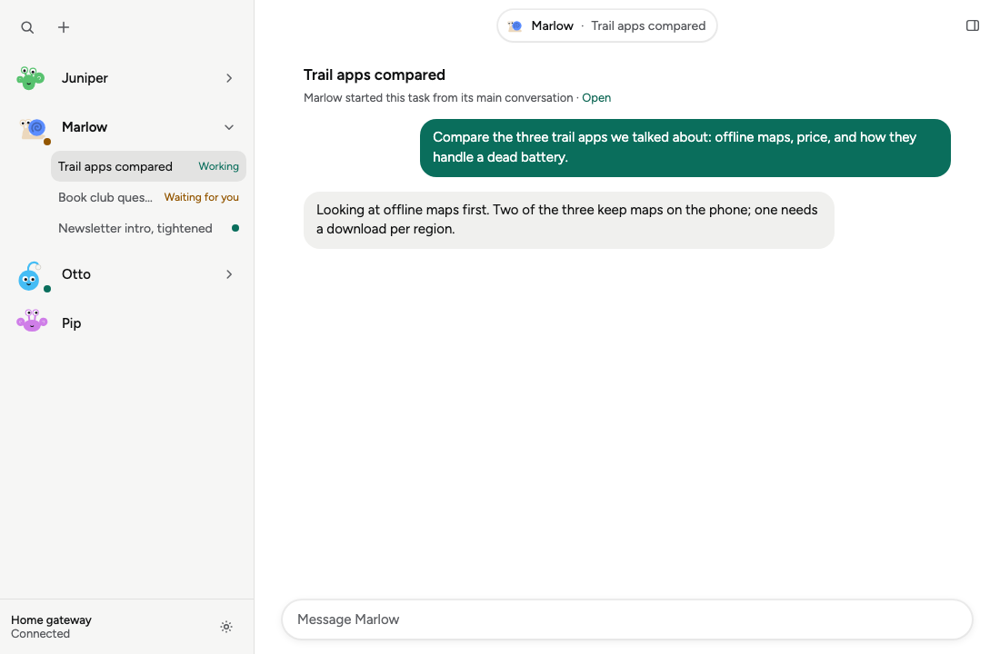
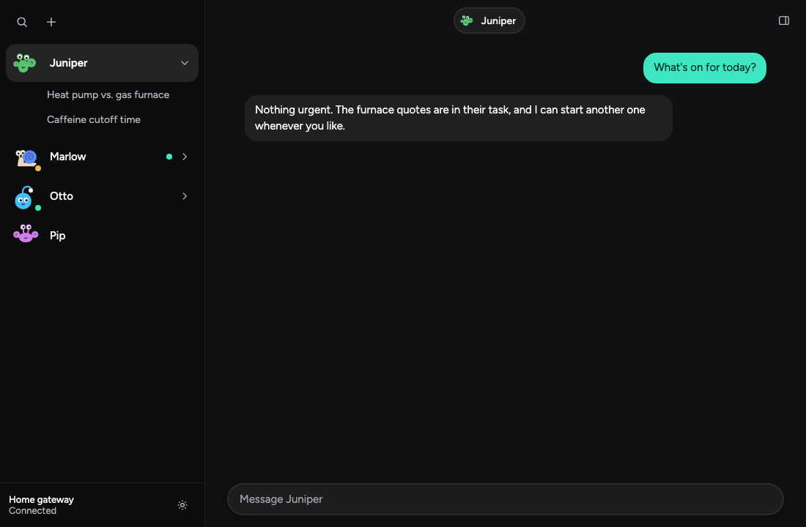
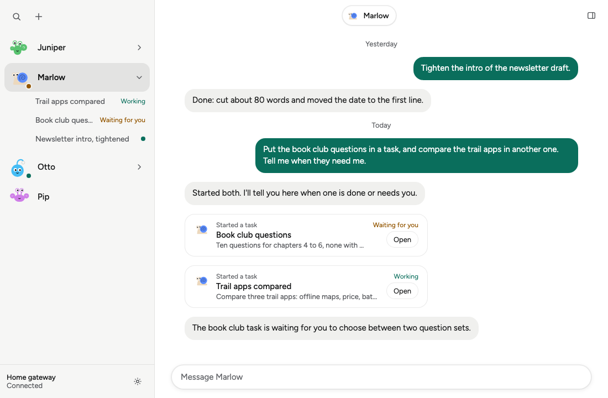
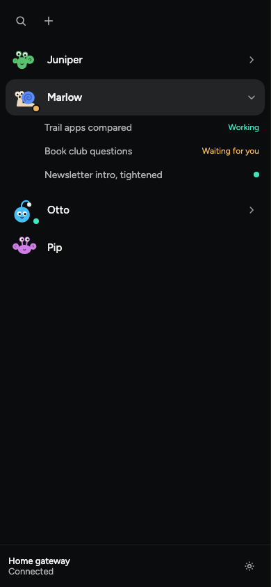
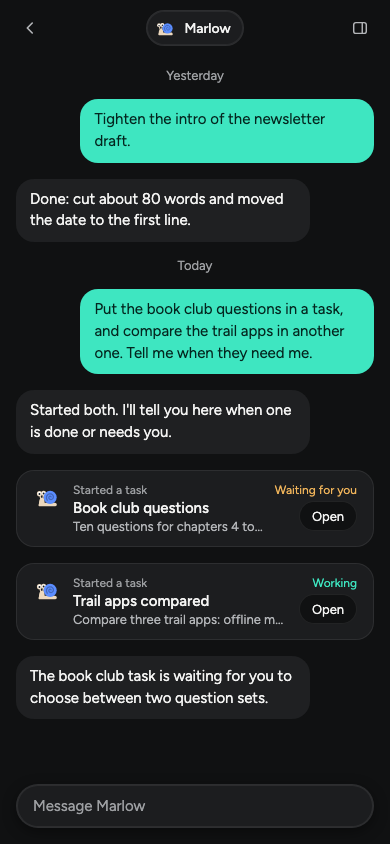

# A bot's row opens its main conversation

Clicking a bot in the sidebar opens its main conversation at once. "Main" stops being a row in the bot's list; the bot's other tasks stay listed under it. The main conversation is where a person asks the bot to start, check and manage its tasks (issue #791). This is a design for sign-off: it builds nothing. Its prototype is [`prototype/bot-main.html`](prototype/bot-main.html); section 12 lists its states and `tools/checks/bot-main.mjs` checks them.

**Established** marks what the repository or OpenClaw's own source and documentation show today. **Proposed** marks this design's choice. **Not established** marks what could not be shown here (section 14). OpenClaw facts are from the published packages `openclaw@2026.10.6` and `openclaw@2026.11.10`; `<1006>/…` and `<1110>/…` are paths inside each package.

It builds on, and doesn't redesign:

- **The bots design** (`bots-in-clawtrate.md`): the tools a bot has to start, check and manage its tasks, the plugin that brings the ones it lacks (#691 and #692 are its step 2), and the notice that tells a bot when a task waits (its C4).
- **The sidebar's rows** (#790: the bot's name and a larger picture, no preview line) and **its widths** (#792: dragged to any width, down to a rail of pictures). This design says what each width does with a bot's tasks; #792 owns the widths themselves.
- **The first run** (`main-bot-onboarding.md`): it already talks in the Main Bot's main conversation. Nothing here changes it.

## The page to decide from

- **A bot's row is the bot's main conversation.** One click, Enter or ⌘1–9 opens it, from anywhere, including from one of the bot's own tasks. There is no "Main" row.
- **Its tasks are listed under it while the bot is open**, as tasks are today. A small fold at the row's end (Right and Left on the keyboard) shows or hides another bot's tasks without opening it.
- **The header names where you are**: the bot alone in its main conversation, the bot and the task in a task.
- **In the rail of pictures,** the open bot's tasks move into the header, behind one Tasks button that appears only there.
- **New task stays** (⌘T, the bot's menu, and "Start as new task" from the composer), for a person who wants an empty task without asking.
- **What the main conversation shows of tasks** is what exists today: the "Started a task" card, live with the task's state, and the bot's own report when a task ends. Two things wait for the bots plugin: the bot saying once that a task waits for you, and the bot opening a task beside the conversation.
- **On update nothing is lost or renamed** on anyone's gateway. The "Main" row is gone, and the bot's row takes its place.

**The first pull request a person sees** is the smallest of section 13: a bot's row opens its main conversation, and "Main" is no longer a row. Everything else follows from it.

## Contents

1. What is true today
2. The sidebar
3. New task
4. The main conversation as the place tasks are managed
5. Starting a task from a conversation that fails for its model (#799)
6. Bots with no main conversation, new bots, long ones, and the gateway's own bot
7. What each place calls the main conversation
8. Keyboard and screen reader
9. The iPhone app
10. What existing people meet on update
11. Not doing
12. The prototype's states
13. The order of pull requests
14. Not established
15. Proposed checklist changes

## 1. What is true today

### How a click on a bot is decided

- **The row.** `clickBot` (`packages/ui/src/Rail.tsx:1019`) is called with the bot's number of tasks. With fewer than two it selects the bot (`selection.selectBot`); with two or more it folds or unfolds the bot when there is one pane or the bot is already open, and otherwise selects it. The row is a button with `aria-expanded` when the bot has several tasks (`Rail.tsx:1978`) and `aria-current` only while it is open and folded (`Rail.tsx:1977`).
- **What opening a bot opens.** `selectBot` (`packages/ui/src/selection.ts:405`) does nothing for the bot already open, and otherwise opens the bot's remembered task or, failing that, its first listed task (`selection.ts:328-336`). So a bot opens to whatever the person last had open there, not to its main conversation.
- **Folding.** A bot's tasks show while it is open, when it has more than one task (`isOpen`, `selection.ts:450`), six at most before "Show all" (`TASK_CAP`, `selection.ts:31`), three in one pane (`selection.ts:156`). Right and Left on a row unfold and fold it, and Left on a task goes to its bot (`Rail.tsx:1276-1290`).

### Where the main conversation is a task

- **The task list.** The main conversation is an ordinary row of `sessions.list`, mapped like any task with `isMain: true` (`packages/core/src/mapping.ts:327`, the row's `isMain` or `classification: "main"` first and the `agent:<bot>:main` key as a fallback, as `isMainSession` in `packages/core/src/channels.ts:55` does). A row that names no title is called "Main" (`fallbackTitle`, `mapping.ts:196-205`).
- **New bot** makes the main conversation at once with the label "Main" (`createMainTask`, `packages/core/src/client.ts:1917-1925`; `bots.md`'s "Created" row).
- **F-424** (`docs/parity.md`): a bot always has a task. The gateway refuses to archive or delete a main session, and Clawtrate offers neither (`task-actions.ts:24-31`, the menus at `Rail.tsx:1658` and `:1819`). Archiving or deleting the last other task makes the canonical main again, empty and selected (`newMainTask`, `task-actions.ts:351-366`).
- **The header.** The title pill shows the bot's picture and name and then the task's title, "Main" included (`packages/ui/src/Conversation.tsx:1253-1263`); its accessible name is "<bot>, <task>. Show details." (`Conversation.tsx:968`). The transcript's heading is the task's title (`Conversation.tsx:509`, `:1159`).
- **The line in a started task** says "Pip started this task from Main · Open Main", or across bots "Pip's Main", because every bot's main is "Main" (`packages/ui/src/StartedBy.tsx:18-43`, F-565).
- **Links** (`docs/design/links.md`, F-248) open a bot's "last selected task if still available, or its most recent task otherwise". Search opens a bot result with `selectBot` and a task or message result with `selectTask` (`packages/ui/src/Shell.tsx:622-623`); the main conversation is found as a task titled "Main".
- **Unread.** A bot's row is unread when any of its tasks other than the one on screen is (`summarize`, `selection.ts:89`), and its spoken name counts its tasks, the main conversation among them: "Otto, working, 14 tasks, unread" (`botLabel`, `selection.ts:125`). The dock badge counts unread conversations. There are no system notifications.
- **The archived list** never holds a main conversation (the gateway refuses to archive it).
- **Shortcuts** (`packages/ui/src/Shortcuts.tsx:4-25`): ⌘1–9 open the bot in that place, ⌥↑ ⌥↓ and ⌃Tab the bot above or below; ⌘T a new task for the open bot (⌥T in a browser); ⇧⌘↵ sends the composer's message as a new task. ⌥⇧↑ ⌥⇧↓ on a bot's row move it in the manual order (`Rail.tsx:1250-1264`).
- **Other places** that look the main conversation up by `isMain`: the gateway's update notice (`packages/core/src/update-notice.ts:121-127`), Routines' "Open conversation" (`packages/ui/src/routines/RoutinesView.tsx:1089`), and what a bot may do about tasks (`botStartTasks`, `packages/core/src/start-tasks.ts:61-69`).
- **The web viewer** draws the same `packages/ui`, so it changes with the desktop app. **The iPhone app** (`apps/mobile`) uses only `@clawtrate/core`: Home lists bots, a bot opens its task list, and a task opens its chat (`apps/mobile/src/navigation.ts`, three screens deep).

### What the gateway calls a bot's main conversation

- **The same on both versions.** "The main session is an ordinary session with the canonical key `agent:<agentId>:main` … The suffix is fixed; custom `session.mainKey` values are ignored" (`<1006>/docs/concepts/main-session.md:16-21`; `<1110>/…` the same, "standard key"). Every direct message from every channel lands in it by default; "heartbeats wake it, background work reports back to it" (`:19-21`, `:75-79`). Rows carry `isMain` and `classification: "main"` (`docs/research/gateway-capabilities.md`, the session rows).
- **One exception:** with `session.scope: "global"`, the main key is `global` rather than `agent:<id>:main` (`resolveCanonicalMainSessionKey`, `<1006>/dist/main-session-key-C_jT8gfN.mjs`; the same in `<1110>/dist/main-session-key-f4Vqtjb_.mjs`). What a row says there is not established (section 14).
- **Not every bot has one.** A session exists once something made it. New bot makes it; a bot made elsewhere that nobody has written to, or one whose only conversations are Clawtrate's own tasks (`agent:<bot>:dashboard:<id>`), has no main row. In the repository's fixture, only Marlow has one (`apps/desktop/src/fixture/data.ts:137-145`). A `chat.send` to `agent:<bot>:main` makes it (`docs/research/session-origins.md`, "An operator's `chat.send` to a new key").

### What today's pictures and tests pin

`visual/shell-frame.visual.spec.ts:116-158` expects the heading "Main" for Marlow; `visual/rail-tasks-behaviour.visual.spec.ts:710` and `e2e/rail-tasks.spec.ts:931-1025` pin F-424's empty "Main", selected; `packages/ui/test/started-by.test.ts` pins "Pip's Main"; `visual/bot-delete.visual.spec.ts` names it in its dialog; the `update-notice-*`, `context-not-reported-*` and `bot-name-*` baselines' accessibility snapshots carry "Main" in the title pill.

## 2. The sidebar

**A bot's row.** _Decision:_ the row is one control that opens the bot's main conversation, every time: a click, Enter, ⌘1–9, ⌥↑ ⌥↓, ⌃Tab, a link and a search result for the bot all land there, also when the bot is already open on one of its tasks. _Reason:_ that is the whole ask, and a row that sometimes folds and sometimes opens (today's `clickBot`) can't also be the way back to the main conversation.

**Where its tasks show.** _Decision:_ under the bot, while the bot is open (its main conversation or one of its tasks), with today's caps and "Show all". Any other bot's tasks show under it by its fold: a chevron button at the row's end, "Show <bot>'s tasks", with Right and Left on the row doing the same. A bot with no tasks has no fold. Folding by clicking the row goes. What was unfolded by hand stays unfolded, as today. _Reason:_ a person sees the open bot's work without a click, and nothing else about the list moves; only the row's click changes meaning, so the fold needs its own place.

**From a task back to the main conversation.** _Decision:_ the bot's row (or its picture in the rail), which is always on screen beside the task, and on the keyboard Left from the task's row, then Enter. The line at the top of a task a bot started says "from its main conversation · Open". No new shortcut. _Reason:_ the way back is the same thing that opens the bot; a second path would be one more thing to learn.

**What shows which bot and which task is open.** _Decision:_ the open bot's name is in full weight. Its row is filled while its main conversation is on screen; while a task is open, the task's row is filled and the bot's is not. The header says the same in words. _Reason:_ exactly one row is filled at a time, and it is the conversation on screen.

**At each width** (#792 owns the widths and where the rail begins):

| Width                     | A bot's row                                   | Its tasks                                                                                                                                                                                     |
| ------------------------- | --------------------------------------------- | --------------------------------------------------------------------------------------------------------------------------------------------------------------------------------------------- |
| Wide (the default and up) | Picture, name, unread dot, fold               | Under it: title, then the state in words (Working, Waiting for you)                                                                                                                           |
| Narrow (down to the rail) | The same; the name shortens with an ellipsis  | Under it, less indented: the title keeps the room and the state is a mark (a ring for working, a dot for waiting; the words in the row's name and its tooltip)                                |
| The rail                  | The picture, its state mark and unread corner | Not in the sidebar. The header shows a Tasks button ("3") for the open bot; its menu lists the main conversation first (checked when open), then each task with its state, then New task (⌘T) |
| Phone (one pane)          | As wide, full width                           | As wide. Opening a bot shows its main conversation; Back shows the list with the bot's tasks under it                                                                                         |

_Reason for the rail:_ the rail has no room for titles, and a menu that appears only there keeps the wider sidebar free of a second way to the same rows. It is looked at again once #792's resizable sidebar exists.

## 3. New task

_Decision:_ New task stays as it is: ⌘T (⌥T in a browser) and the bot's menu make an empty task under the open bot and put the cursor in it; "Start as new task" (⇧⌘↵, and the send menu) sends what is in the composer as a new task. The rail's Tasks menu ends with New task. Nothing is added. The empty main conversation says, in one line, "Ask <bot> anything, or to put work in a task."

_Reason:_ the main conversation is the place to ask for a task, but a person who already knows they want a clean task shouldn't have to ask the bot for one. Both ways exist today and work on every gateway with no plugin.

## 4. The main conversation as the place tasks are managed

### What a person sees (Established unless marked)

| When                                              | In the main conversation                                                                                                                           | In the sidebar                                              |
| ------------------------------------------------- | -------------------------------------------------------------------------------------------------------------------------------------------------- | ----------------------------------------------------------- |
| The bot starts a task                             | The "Started a task" card where it was asked: the bot, the task's title, the first line of the brief, its state, Open (F-587)                      | The task's row appears under the bot                        |
| The task works                                    | The card says Working, kept current from the task list                                                                                             | The row says Working; the picture's mark is working         |
| It waits for the person (an approval, a question) | The card says Waiting for you. **The bot says nothing**: it isn't told (bots design C4)                                                            | The row says Waiting for you; the picture's mark is waiting |
| It finishes                                       | The card says Done; the gateway wakes the bot that started it (`announce:v1:…`, F-587's report-back), and the bot answers in the main conversation | The row loses its state; its unread dot shows until opened  |
| It fails                                          | The card says Failed. The report-back carries the outcome; what the bot says about a failure depends on the model                                  | The row says Failed                                         |
| It can't start                                    | The card says why, in the gateway's words ("couldnt-start", `started-task-card.ts`)                                                                | Nothing                                                     |

**What is missing, and what this design does about it** (Proposed):

- **The bot telling its person, once, that a task waits for them.** That is the bots design's C4, its step 3. Nothing is added to the conversation before it: the card and the row already show the wait.
- **No new lines, panels, strips or summaries for task states** (decided: not even one line above the message box). A long main conversation scrolls its cards away, but the open bot's task rows, right beside it, carry the same states, and ⌘J goes to what needs the person. Adding a strip would put the same state on screen three times.
- **A task the person started directly** (New task) doesn't appear in the main conversation. The main conversation shows what the bot did there; the sidebar lists every task.

### What the bot can do, tool by tool

| A person asks the bot to…           | The tool                                       | Without Clawtrate's plugin, on both versions                     | What the plugin adds, and when                                               |
| ----------------------------------- | ---------------------------------------------- | ---------------------------------------------------------------- | ---------------------------------------------------------------------------- |
| Start a task                        | The gateway's `sessions_spawn {visible: true}` | Works; the card shows it (F-566, F-587)                          | Nothing needed                                                               |
| Hand work to another bot            | `sessions_spawn {agentId}`                     | Refused until `subagents.allowAgents` names the other bot (#532) | Reach added at once on the person's first ask (bots design 3.1, its step 6)  |
| Say how its tasks are going         | `sessions_list`, `subagents`                   | Running and done; never "waiting for you"                        | `clawtrate_tasks` (#691) lists them; Waiting for you in it comes with step 3 |
| Read what a task produced           | `sessions_history`                             | Works                                                            | Nothing needed                                                               |
| Follow up in a task                 | `sessions_send`                                | Works from the main conversation                                 | Nothing needed                                                               |
| Stop a task                         | `subagents` (`kill`)                           | Works                                                            | Nothing needed                                                               |
| Tell the person a task waits        | (a notice, not a tool)                         | Not possible                                                     | The plugin's notice, step 3 (C4)                                             |
| Open a task beside the conversation | `clawtrate_show`                               | Not possible; the card's Open does it for the person             | Step 3                                                                       |
| Delete a task                       | `clawtrate_delete`                             | Not offered                                                      | Step 6, with its one confirmation                                            |
| Rename a task                       | none                                           | Not offered                                                      | Not designed (bots design section 13)                                        |

**The day this ships** (Established, both versions, no plugin): a person asks in the main conversation; the bot starts, follows up on, reads and stops its tasks; each start shows as a card with the task's live state; a finished task reports back and the bot answers there; the sidebar lists every task under the bot. **What waits for the plugin:** the bot knowing a task waits for its person and saying so once, the bot opening a task beside the conversation, deleting a task, and handing work to another bot without the gateway's own configuration. #691 and #692 add none of these by themselves: they are the plugin's step 2 (where a run came from, the read tools, and the holds), which the steps that add them need.

## 5. Starting a task from a conversation that fails for its model (#799)

**Established** (both versions' docs, read): a task a bot starts runs on "the caller's active model, including session and one-shot overrides", unless the bot sets a model for its tasks (`agents.*.subagents.model`) or the call names one (`<1006>/docs/tools/subagents/tool-reference.md:65`; `<1110>/…:68`). The gateway's model allowlist is `agents.defaults.modelPolicy.allow`, replaced per bot by `agents.entries.<bot>.modelPolicy.allow`; when it isn't empty, "selecting a model outside that allowlist returns before any normal reply", with the error `Model override "provider/model" is not allowed by agents.defaults.modelPolicy.allow.` (`<1006>/docs/concepts/models.md:225-236`; `<1110>/docs/concepts/models.md:275-285`). An explicit `sessions_spawn.model` that is invalid "is skipped and the sub-agent runs on the default model with a warning" (`tool-reference.md:207-208`).

**Not established:** that this is what failed in the one observation #799 records. The likely path is a main conversation pinned to a model outside the bot's allowlist, whose task inherits the pin and is refused. A run on development gateways of both versions settles it: a bot with `modelPolicy.allow` set, a main conversation pinned to a model outside it, and `sessions_spawn {visible: true}` with no `model`; read the call's result.

**Proposed:**

- **Day one, no plugin:** the card's "can't start" state already shows the gateway's reason. Nothing else is added.
- **First, establish it** (pull request 5 below, before any rule).
- **Then, if it is that path, in the plugin:** `before_tool_call` on a `sessions_spawn` with no `model`, from a conversation whose active model the bot's allowlist refuses, sets `model` to the bot's own configured model when the allowlist allows that one. The card then says "Started on <model>, the model this gateway allows for tasks". When no allowed model is known, the call goes through unchanged and the card shows the gateway's reason. _Reason:_ the person asked for a task, not for a model; choosing the one model the gateway allows does what they asked, and the line says so.

## 6. Bots with no main conversation, new bots, long ones, and the gateway's own bot

- **No main conversation yet** (a bot made elsewhere, or one whose only conversations are tasks). _Decision:_ opening the bot shows its main conversation empty, "Nothing here yet" and "Ask <bot> anything, or to put work in a task.", with the composer. Nothing is written to the gateway until the person sends; the first message makes the session (`chat.send` to `agent:<bot>:main`). On a read-only connection it is empty with no composer, as any conversation there. _Reason:_ opening must never write; a row that opened something different for these bots would make the rule untrue for most bots people bring.
- **A brand-new bot.** _Decision:_ New bot keeps making the main conversation and opens it, empty, with the cursor in the composer, but stops writing the label "Main" (`client.ts:1923`). _Reason:_ the label was there to name a row that no longer exists; the gateway's own surfaces then name it their own way.
- **A long main conversation.** _Decision:_ the same as any conversation: it opens at its end, with the latest 200 messages read (`HISTORY_LIMIT`, `client.ts:669`) and the gateway's compaction lines as today. Cards scrolled away keep their state in the sidebar. _Reason:_ the main conversation is the one that grows longest, but nothing about loading it is new; reading older messages is its own question for every conversation.
- **The gateway's own default bot, kept out of view** (F-562; #757 adds such a bot, `main`, to the fixture). _Decision:_ nothing changes about when it is shown. When it is opened (a link, a search result, or its row while it waits), it opens its main conversation like any bot, which on many gateways is where its chat apps' direct messages land. _Reason:_ the rule is one rule for every bot.
- **F-424** changes meaning: a bot no longer needs a task. Archiving or deleting its last task leaves it with its main conversation, which opens. Clawtrate stops making an empty main conversation in that case; it makes one when the person sends (as above).

## 7. What each place calls the main conversation

_Decision:_ the bot's name, wherever the bot is named anyway; "main conversation" only where it must be told apart from a task. No new word. _Reason:_ a person thinks of talking to Marlow, not of a conversation called Main; Routines and the guide already say "main conversation" where they need it.

| Place                                         | Today                                                    | Proposed                                                                                         |
| --------------------------------------------- | -------------------------------------------------------- | ------------------------------------------------------------------------------------------------ |
| The header's pill                             | Marlow · Main                                            | Marlow (name "Marlow. Show details."); a task: "Marlow · Trail apps compared"                    |
| The transcript's heading                      | Main                                                     | The bot's name, for screen readers only; a task keeps its visible title                          |
| A task a bot started                          | Pip started this task from Main · Open Main              | Pip started this task from its main conversation · Open                                          |
| The same, under another bot                   | … from Pip's Main · Open Pip's Main                      | … from Pip's main conversation · Open                                                            |
| Search: the bot                               | Opens its remembered task                                | Opens its main conversation                                                                      |
| Search: a message in it                       | "Main" as where it is                                    | The bot's name as where it is                                                                    |
| Search: tasks                                 | "Main" is one                                            | Never; the bot's own result is the way there                                                     |
| Links (`clawtrate://chat?bot=…`)              | Last selected or most recent task                        | The main conversation                                                                            |
| Routines ("Posts in Pip's main conversation") | As is                                                    | As is                                                                                            |
| Unread                                        | The bot's dot: any task other than the open one          | The bot's dot: its main conversation, or a task not shown under it. A shown task has its own dot |
| The bot's spoken name                         | "Marlow, 3 tasks" counts Main                            | Counts tasks only; no count when it has none                                                     |
| The dock badge                                | Unread conversations                                     | Unchanged: the main conversation is one of them                                                  |
| Notifications                                 | None exist                                               | None                                                                                             |
| The bot's guide (`guide-text.ts:32`)          | "…your main conversation is one of them" (of your tasks) | "…listed under your name. Your main conversation is where your person talks with you."           |

## 8. Keyboard and screen reader

_Decision:_

- **The rows stay buttons, and the fold is a disclosure.** A bot's row is a button that opens its main conversation on Enter or Space; its name says nothing about folding. The chevron is a button of its own, "Show Marlow's tasks" or "Hide Marlow's tasks", with `aria-expanded` and `aria-controls` naming the list of that bot's tasks. `aria-current="page"` is on the one row whose conversation is on screen. _Reason:_ each control does one thing and says it; it is the smaller correct pattern, and it leaves the rail's rows as they are rather than rebuilding them as a tree.
- **Focus order:** the sidebar's buttons, then each bot's row followed by its fold, then the tasks shown under it, then the next bot; then the conversation. Up, Down, Home and End keep moving between rows as today. Right on a folded bot's row shows its tasks and Left on an unfolded one hides them, as the fold does; Left on a task goes to its bot. ⌥⇧↑ ⌥⇧↓ keep moving a bot in the manual order.
- **Names:** a bot is "Marlow, waiting for you, 3 tasks, unread" (state, tasks, then unread for its main conversation or a task not shown); a task is "Trail apps compared, working"; the rail's button is "Marlow's tasks, 3" and opens a menu named "Marlow's tasks" whose first item is "Marlow", checked when the main conversation is open.
- **After opening** a bot or a task, focus goes to the conversation's heading, as today, and the change is announced as "Marlow, main conversation" or "Marlow, Trail apps compared".
- **Shortcuts:** ⌘1–9, ⌥↑ ⌥↓ and ⌃Tab open bots' main conversations; ⌘T stays New task; ⌘J goes to what needs you. No new shortcut: the rows' arrows move between a bot's main conversation and its tasks.

## 9. The iPhone app

For the iPhone app's builders (`apps/mobile` is theirs; nothing there changes in this design's pull requests):

- **Tapping a bot on Home opens its main conversation**, not its task list. Back from it goes to Home.
- **The bot's tasks** are one tap from its main conversation: a Tasks button in the chat's header, with their count, opens the task list (the main conversation is not in it). Back from a task goes to that list, and from the list to the main conversation.
- **Unfolded (two panes):** the list pane shows the bot's tasks with the bot's own row at the top for its main conversation; the chat pane shows the main conversation when the bot is opened.
- **Names:** the chat's title is the bot's name in its main conversation; "Main" is no longer shown anywhere.
- **From `@clawtrate/core`** they use the same two helpers the desktop does (section 13, pull request 1): the bot's main conversation key and the task list without it.
- **A bot with no main conversation yet** opens to an empty one; the first message makes it.

## 10. What existing people meet on update

- **Nothing on their gateway is renamed, moved, made or removed.** The label "Main" that New bot wrote stays on their gateway; Clawtrate no longer shows it.
- **What they see the first time:** the "Main" row is gone from every bot, and clicking a bot opens what that row opened. No line, card or tip explains it. Their tasks are where they were.
- **What they open at launch:** the app returns to the conversation that was open when it closed, a task or a main conversation, as today. A click on a bot always opens its main conversation; the task each bot last had open is no longer what a click opens.
- **A pin on a main conversation** stays on the gateway and is ignored, since the main conversation has no row to pin.
- **Unread** on a main conversation moves to the bot's row; nothing that was unread becomes read.

## 11. Not doing

- **A list of conversations behind each bot that a person picks from first.** Clawtrate's tasks stay visible under the bot; hiding them would hide the work this design is about.
- **"New chat" that starts the main conversation over.** The main conversation is one rolling conversation on the gateway; resetting it loses context for every channel that reaches the bot. New task makes a task.
- **A dashboard or panel of tasks inside the main conversation.** The cards, the sidebar's rows and ⌘J already say each task's state.
- **A new name for the main conversation.** The bot's name is the place.
- **Collapsing to pictures with no way to the tasks.** The rail's Tasks button is that way.

## 12. The prototype's states

`bot-main.html` takes `theme`, `width`, `motion` and `chrome`, as the other pages, and:

| Parameter | Values                                                                      |
| --------- | --------------------------------------------------------------------------- |
| `side`    | `wide` (280 px), `narrow` (208 px), `rail` (72 px): the sidebar's width     |
| `bot`     | `juniper`, `marlow` (the default), `otto`, `pip` (no main conversation yet) |
| `task`    | a task of the open bot, for example `trail`; absent, its main conversation  |
| `menu`    | `tasks`: the header's Tasks menu open (the rail only)                       |
| `pane`    | `list` or `conversation`: which of the two shows at phone width             |

The bots, tasks and words are made up. Clicking works: a bot's row opens its main conversation, its fold shows or hides its tasks, a task's row and a card's Open open the task, and in the rail the Tasks button lists the open bot's tasks. Right, Left, Up and Down work on the rows. The last line of Marlow's main conversation ("The book club task is waiting for you…") is what a bot says with the plugin's step 3; without it the card and the row say the same and the bot says nothing. The pictures here are recorded from it with `node docs/design/prototype/tools/checks/bot-main.mjs --pictures docs/design/bot-opens-main`.

## 13. The order of pull requests

Each is releasable alone and carries before and after pictures at desktop and phone width, dark, and light where it differs in more than colour.

1. **A bot's row opens its main conversation, and "Main" is not a row.** The smallest change that gives the owner the main thing. Core: `mainConversationKey(botId, tasks)` (the row marked main, else `agent:<bot>:main`) and `listedTasks(tasks)` (without it), for the desktop and the iPhone app. UI: `selectBot` and `clickBot` open the main conversation, also for the open bot; ⌘1–9, ⌥↑ ⌥↓, ⌃Tab, links and search's bot results the same; the rows under a bot leave it out; a bot with one task or more unfolds while open; the pill, the heading and the spoken names of section 7; an empty main conversation for a bot without one, with its line. F-424's replacement stays as it is in this step (it makes the canonical main, which now simply opens). _Tests:_ selection and rail unit tests for each rule, failing with the rule undone (a click on the open bot's row while a task is open; a bot whose remembered task is another; a bot with no main row; the count); the header's exact words; `shell-frame` and `rail-tasks-behaviour` visual specs updated; `e2e/rail-tasks.spec.ts`'s F-424 test reads the main conversation through the bot's row. _Pictures:_ every baseline whose open conversation came from clicking a bot moves to that bot's main conversation, and the four fixture bots without one show it empty; list each in the pull request. Lands after #757, which changes the same fixture.
2. **The fold.** The chevron as its own disclosure button (`aria-expanded`, `aria-controls`), Right and Left on the row, the rows' and the fold's names, focus order, the unread rule (main conversation, or a task not shown). The rows stay buttons. _Tests:_ keyboard and screen-reader names, each by its exact words; the visual specs of the rail at desktop and phone. Needs 1; independent of #792.
3. **The rail's Tasks button.** Only at the rail width, with its menu. Needs #792's rail; tests and pictures at that width.
4. **The words.** F-565's line, search's places, the guide's sentence (its character counts and tests), New bot without the label "Main", F-424 without the replacement main, and the parity rows of section 15. _Tests:_ each sentence by its exact words; the guide's tests. Needs 1.
5. **#799, established.** A run on development gateways of both versions (section 5), recorded in `docs/research/`, then the plugin's model rule in the bots design's step 2b or 3, with its scenario check failing with the rule undone. Needs #691 and #692.

The bots design's own steps (its section 10) bring the rest of section 4: step 3 the waiting notice and `clawtrate_show`, step 6 deleting and handing work to another bot. The iPhone app's change (section 9) is its own thread's, after 1.

## 14. Not established

- **What `sessions.list` rows say under `session.scope: "global"`**, where the main key is `global`: whether the row carries `isMain`. Until it is shown, Clawtrate treats a gateway in that scope like a bot with no main row on its own key, and the first message goes to `agent:<bot>:main`; whether the gateway then routes it to `global` was not run.
- **#799's cause** (section 5): read, not run.
- **What a model says in the main conversation when a task fails:** the report-back is the gateway's; its words for each kind of failure were not run here.
- **How a real model uses the main conversation to manage tasks:** the scripted model does only what it is scripted to.

## 15. Proposed checklist changes

No new ids are held for this design; the pull request that makes each true adds or rewords its row.

- **F-424** reworded: "A bot's main conversation is always there: clicking the bot opens it, empty until the first message; archiving or deleting its last task leaves it." (pull request 4)
- **F-565** reworded: the line names "its main conversation" and "Pip's main conversation" in place of "Main" and "Pip's Main". (pull request 4)
- **F-248** (links) stays as worded ("opens a Bot's chat"); `links.md` section 2's sentence "Open its last selected task if still available, or its most recent task otherwise" becomes "Open its main conversation". (pull request 1)
- **New, id to be given:** "Clicking a bot opens its main conversation; 'Main' is not a row, and the bot's tasks are listed under it." (pull request 1)
- **New, id to be given:** "At the rail's width, the open bot's tasks are in the header's Tasks menu." (pull request 3)
