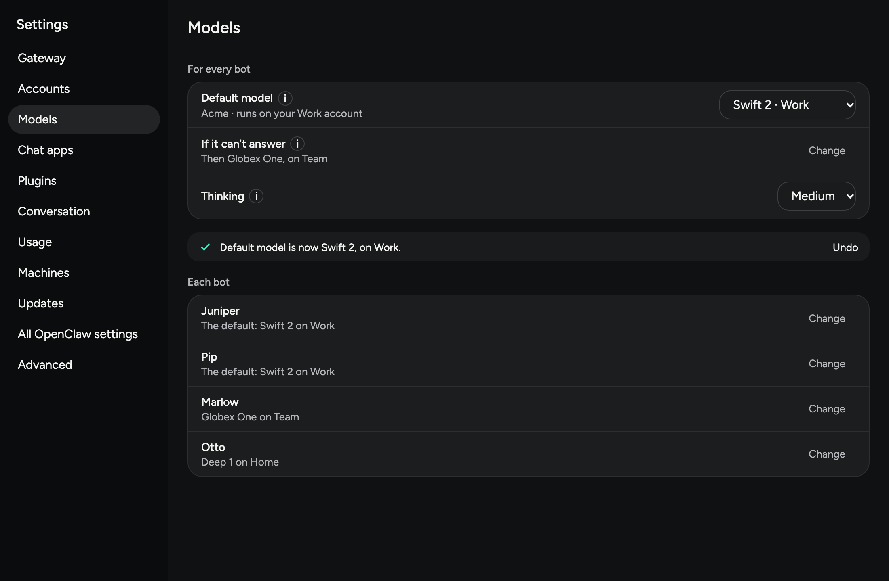

# OpenClaw's settings inside Clawtrate

How a person changes their OpenClaw gateway's settings from Clawtrate's Settings without knowing a config file exists, and how a bot makes such a change when the person asks it to (issue #794). This is a design for sign-off: it builds nothing. It ends with the order of the pull requests that would build it.

It follows the product's rule (`docs/decisions.md`, "Doing, not asking", and `doing-not-asking.md`): Clawtrate does the thing, shows what it did, and offers Undo; it asks only before something destructive. Changing who can reach or control OpenClaw is "changing OpenClaw itself" in that rule's sense, so that is where this design asks.

**Established** marks what OpenClaw's published packages, the repository, or a run on a development gateway of each version showed. **Proposed** marks this design's choice. **Not established** marks what could not be shown here, with what would show it (section 13). `<1006>/…` and `<1110>/…` are paths inside `openclaw@2026.10.6` and `openclaw@2026.11.10`; 2026.11.10's `dist/` is minified, so for it the file and the schema are named instead of a line. The runs were on one development gateway at a time, an instance of this repository's `pnpm dev-gateway` on each version, with no seed and no real account.

It builds on, and doesn't redesign:

- **Bots in Clawtrate** (`bots-in-clawtrate.md`): the silent check that sorts a bot's call as the person's ask (A), in their conversation but not their ask (B) or not from the person (C); the journal and Undo of its section 5; the `clawtrate-bots` plugin. Section 8 here adds one tool to it and changes one row of its section 3.3.
- **Bots and accounts** (`bots.md`) and **Connect an account as provider tiles** (#797): accounts stay in Accounts. Models here shows the account behind each model and links there.
- **Clawtrate installs its own plugins** (#796) and **explanations behind an "i"** (#798): Plugins here lists what #796 installs; every explanation in these forms sits behind an "i".

## The page to decide from

### What a person sees

Settings gains four sections, between Accounts and Conversation, and one at the end:

| Section                   | What it is for                                                                                                  | Picture                                                                                                                                           |
| ------------------------- | --------------------------------------------------------------------------------------------------------------- | ------------------------------------------------------------------------------------------------------------------------------------------------- |
| **Models**                | The default model every bot uses, the account it runs on, what to try if it can't answer, how long bots think   | [Models after a change](gateway-settings/models-done-desktop.png), [light](gateway-settings/models-done-light-desktop.png)                        |
| **Chat apps**             | Connecting Telegram, WhatsApp and the other chat apps, who answers there and who may write                      | [Chat apps](gateway-settings/chat-desktop.png), [Telegram](gateway-settings/telegram-desktop.png), [Say hello](gateway-settings/pair-desktop.png) |
| **Plugins**               | What is installed on OpenClaw, Clawtrate's own first, each with a switch and its settings                       | [Plugins](gateway-settings/plugins-desktop.png)                                                                                                   |
| **All OpenClaw settings** | Every other setting, found by search, each with its own control; a secret is "Set" or "Not set" and never shown | [Two changes that restart once](gateway-settings/all-pending-desktop.png), [a refused value](gateway-settings/all-error-phone.png)                |

No config key is shown unless the person opens a setting's "i", where it sits under the explanation.

A change in a form applies at once and leaves one quiet line, "Default model is now Swift 2, on Work. · Undo". A change that restarts OpenClaw says so beside the setting before it is made ("Restarts OpenClaw"), several such changes wait together under one **Save and restart**, and while OpenClaw restarts a line above Settings says so ([picture](gateway-settings/restart-desktop.png)).



### What a bot does when asked

**Almost nothing a bot is asked applies at once** (section 8): only the default model, the backup models and thinking, when the person's own words name the value. "Make Swift 2 the default for everyone" is done at once in the conversation, with the same line and Undo. "Let my laptop reach you over Tailscale" asks once, in the conversation, with the change written out, what it means and what the restart does ([picture](gateway-settings/bot-desktop.png), [phone](gateway-settings/bot-phone.png)). Connecting a chat app or turning on a plugin is refused with a pointer to its section. Section 8 opens with the common asks in one table.


### The decisions, one line each

1. **Forms:** Models, Chat apps and Plugins get forms of their own; Accounts stays as #797 makes it. Each form writes through the one engine that already owns its settings (section 2).
2. **Chat apps:** Clawtrate drives OpenClaw's own channel set-up over the connection (`wizard.start {flow: "channels"}`) and draws each step in its own form; the only thing opened outside Clawtrate is the chat app itself. Built last, once a stand-in channel of the project's own has established the set-up's frames (section 10).
3. **All OpenClaw settings:** a searchable, structured view drawn from the gateway's own schema and labels, not a file. Secrets are write-only. A value is checked against the schema before it is sent, and the gateway's own refusal is shown under the field.
4. **Undo:** a journal entry on the gateway with each leaf's authored state and a chain of hashes; Undo only when the chain shows nothing was written since, otherwise withheld; a secret's old value is never kept, and its field says so first.
5. **Restart:** the gateway restarts by itself; any change that restarts, or might, waits for one "Save and restart"; the words for running work and the wait follow the version, and a lost contact is said as unconfirmed.
6. **A bot's change:** one new tool, `clawtrate_settings`. At once only on a structured match to the exact change on three reviewed Models settings; otherwise the person's ask gets one card bound to the shown diff, and everything else is refused. Secrets are refused before anything is recorded. The plugin denies OpenClaw's native mutating routes by default, and that is tested before release.
7. **Without full control, on another device, on an unknown version:** read-only forms with one line; a bot's at-once change only from the device that sent it, with its own current grant; forms drawn from the gateway's schema, so an unknown version gets the editor and the forms whose settings it has.
8. **Ships first:** Models (default model with its account, backups, thinking), with the core that every later form uses.

### Decided since the first version

- **The line after a bot's change** says what happened, and Recent changes says "Juniper, in your conversation", not "at your request" (section 8.7).
- **Restart-bound changes wait for one "Save and restart"** (section 7).
- **Chat apps are built last**, after the gateway's set-up frames are established with a stand-in channel (section 10).
- **The bot rules were tightened after an independent security read** (sections 6 to 9): provenance by structured match, classification by effective leaf, secrets refused before recording, Undo by hash chain, restart-bound changes held, native routes denied and tested, and scopes kept to the originating device.

---

## Contents

1. What the gateway offers, on each version
2. What Clawtrate already writes, and one writer for each setting
3. Where it lives in Settings
4. The forms
5. All OpenClaw settings
6. Undo
7. Restart
8. A bot changing a setting when asked
9. Two devices, another computer, no full control, an unknown version, the iPhone
10. The order of pull requests
11. Proposed checklist rows
12. Not doing, and why
13. Not established, and what would establish it
14. The prototype's states

## 1. What the gateway offers, on each version

### 1.1 Reading and writing settings (Established, both versions, read and run)

| Method                       | Scope            | What it does                                                                                                                                                                                                                          | Source                                                                                                                      |
| ---------------------------- | ---------------- | ------------------------------------------------------------------------------------------------------------------------------------------------------------------------------------------------------------------------------------- | --------------------------------------------------------------------------------------------------------------------------- |
| `config.get`                 | `operator.read`  | The saved config with every secret replaced by `__OPENCLAW_REDACTED__`, its authored `hash`, `configRevisionHash` (saved) and `appliedConfigHash` (what the running gateway accepted), `valid`, `issues`, `warnings`; `raw` is `null` | `<1006>/dist/config-Bo7RGaun.mjs:613`; `<1006>/dist/core-method-policy-DkntKRY_.mjs:186-190`; run on both                   |
| `config.schema`              | `operator.read`  | The whole schema with `uiHints`: for each path a label, a group, a help text, `advanced` and `sensitive`. Plugin and channel schemas are in it when loadable                                                                          | `:635`; `<1006>/docs/gateway/protocol/rpc-talk-config-and-agents.md:65`; run on both (about 4 MB, 8,226 hints on 2026.10.6) |
| `config.schema.lookup`       | `operator.read`  | One path: its schema node, hint, immediate children and `reloadKind` (`restart`, `hot` or `none`)                                                                                                                                     | `:639`; `rpc-talk-config-and-agents.md:66`; run on both                                                                     |
| `config.patch`               | `operator.admin` | A JSON merge patch of the config, with `baseHash`, `replacePaths` (to shrink an array), and optional `sessionKey`, `note`, `restartDelayMs`. Answers `changedPaths`, the new `hash` and a restart sentinel with `requiresRestart`     | `:689-786`; `<1006>/dist/sessions-B6HQw2nf.mjs:1249-1263`; run on both                                                      |
| `config.set`, `config.apply` | `operator.admin` | Replace the whole config. Clawtrate never uses them: a whole replacement can drop what another device wrote                                                                                                                           | `:656`, `:787`                                                                                                              |
| `config.openFile`            | `operator.admin` | Opens the file in an editor on the gateway's computer. Not advertised; not used                                                                                                                                                       | `:810`; `core-method-policy-DkntKRY_.mjs:1920`                                                                              |

The same scopes on 2026.11.10 (`<1110>/dist/core-method-policy-DeU1xgVA.mjs`), which also says it in words: "`config.get` requires `operator.read`; config mutations … require `operator.admin`" (`<1110>/docs/gateway/protocol/rpc-talk-config-and-agents.md:83`).

**How a concurrent write is guarded.** Once a config file exists, every write but one needs `baseHash` from a fresh `config.get`. Run on both versions:

- no `baseHash`: "config base hash required for session.idleMinutes; re-run config.get and retry with baseHash" (`config-Bo7RGaun.mjs:746`). The one exception is `ui.prefs`, last writer wins (`:593`).
- a stale one: "config changed since last load; re-run config.get and retry" (`:245`).

**How a bad value is refused.** The gateway validates the whole merged config before it writes anything, and answers `INVALID_REQUEST` with `details.issues[]`, each with `path`, `message` and, for a choice, `allowedValues`. Run on both: `gateway.bind: "everywhere"` gave "invalid config: gateway.bind: Invalid input (allowed: "auto", "lan", "loopback", "custom", "tailnet")"; an unknown key gave "invalid config: session: Unrecognized key: "nonsenseKey"". Nothing was written either time. The gateway also refuses a patch that would empty an array without `replacePaths` (`:736`) and checks that every secret reference still resolves (`:466-480`).

**Secrets.** `config.get` redacts every path the schema marks `sensitive` (218 such paths on 2026.10.6, 223 on 2026.11.10: `gateway.auth.token`, `models.providers.*.apiKey`, `hooks.token`, channel tokens, TLS keys, header values and more), and also any path whose key name looks like a secret and any URL that can carry one (section 8.5 has the rules, per version). `raw` came back `null` in these runs but can be redacted text (`<1006>/dist/redact-snapshot-UvoXgo0H.mjs:190-232`); Clawtrate never reads it. A patch that sends the sentinel back keeps the stored secret: `restoreRedactedValues` (`:731`). Run on both: patching `models.providers.scripted.apiKey` with the sentinel answered `noop: true, changedPaths: []`. So a form can send a whole object it read and never lose a secret, and a secret can only be replaced, never read. Restoring the marker keeps a value; it authorizes nothing (section 8.5).

**Restart or reload.** Every changed path is planned as `restart`, `hot` or `none` (`<1006>/docs/gateway/configuration/hot-reload.md`, "What hot-applies vs what needs a restart"; the same table in `<1110>`). Models, agents, auth profiles, tools, plugins' entries and most of `channels.*` apply hot; `gateway.port`, `gateway.bind`, the auth mode, Tailscale, TLS, the Control UI's path and wide-area discovery restart. A path no rule matches restarts. The write's answer carries `sentinel.payload.stats.requiresRestart`. Run on both: `messages.ackReaction` answered `requiresRestart: false` and applied before the answer; `gateway.controlUi.basePath` answered `requiresRestart: true`, then the gateway restarted in-process by itself.

| Run (`gateway.controlUi.basePath`) | 2026.10.6                                                        | 2026.11.10                                                              |
| ---------------------------------- | ---------------------------------------------------------------- | ----------------------------------------------------------------------- |
| Answer                             | `ok`, `requiresRestart: true`, no `restart` field                | The same                                                                |
| Next 2 seconds                     | Gateway closes admission: "SIGUSR2: config reload"               | `config.get` reads `configRevisionHash ≠ appliedConfigHash` (unapplied) |
| Unreachable                        | About 8 seconds (connection refused)                             | About 8 seconds                                                         |
| Back                               | Same process, in-process restart; saved and applied hashes equal | The same                                                                |

In the default `hybrid` reload mode the gateway's reload owner restarts it; with `gateway.reload.mode: "off"` the write itself schedules the restart (`scheduleDirectRestart`, `config-Bo7RGaun.mjs:143-153, 214`). Either way **nobody has to restart it by hand**. Restart requests coalesce and then wait out a 30-second cooldown, and writes are limited to 30 a minute per method and device (`<1006>/docs/gateway/configuration/config-rpc.md:36-39`; the same in `<1110>`).

**A lost answer.** A write whose answer never came may still have been saved. OpenClaw's own guidance on 2026.11.10 is never to replay it: read again, compare the saved settings, classify `applied`, `unapplied`, `indeterminate` or `unsupported` from the two revision hashes (`<1110>/docs/gateway/protocol/rpc-talk-config-and-agents.md:76-150`). 2026.10.6 has the same fields and no such section.

**Changing the gateway's own sign-in.** A write that changes the shared token or password disconnects every client that signed in with it (`disconnectSharedAuthClients`, `config-Bo7RGaun.mjs:494`; `hot-reload.md`, "Gateway credentials … old shared-auth clients reconnect"). Clawtrate connects with a paired device token, which this does not end; a device that connected with the shared token is cut off.

### 1.2 The shape of the settings, and what differs

**Established (run).** `config.schema` has 45 top-level sections on 2026.10.6 and 47 on 2026.11.10, which adds `database` and `repositoryBranchPrefix` and retires none at the top. Below the top, 59 paths in the first four levels are gone on 2026.11.10 and 166 are new. The ones that matter here:

- **Retired:** `agents.defaults.heartbeat` and every channel's `heartbeatVisibility` (check-ins became ordinary routines: `<1110>/docs/gateway/heartbeat.md`, "Heartbeat migration"; `packages/core/src/check-ins.ts:16-24` already reads which kind of gateway it is from the schema); `skills.workshop`; `tools.github.kind`, `profileId`, `gitAuthor`.
- **New:** `tools.openclaw.autoApproveChanges` (a standing grant for bots' delegated changes, section 1.5), `tools.gatewayPolicy`, `gateway.openclawId` (a sign-in service), `database.postgres.connection` (a secret), `session.communication`, `cron.agents`, `cron.creators`, `cron.defaultTools`, `channels.msteams.accounts`.
- **Secrets added:** `database.postgres.connection`, `env.vars.*`, `tools.github.app.privateKey` (and per bot), `channels.msteams.accounts.*.appPassword`.
- **A write can change paths nobody sent.** On 2026.11.10 a patch of `messages.ackReaction` answered `changedPaths: ["plugins.entries.skill-workshop", "messages.ackReaction"]`: the gateway applied a migration of its own in the same write. Undo must put back only what Clawtrate wrote (section 6).

The schema's own hints give every path a human label and a help text ("Gateway Bind Mode", "Network bind profile: …"), and a group for each section. Those labels are OpenClaw's words; the forms use Clawtrate's, the editor falls back to OpenClaw's (section 5).

### 1.3 Chat apps (Established, both versions, read)

- `channels.status` (`operator.read`) lists each chat app and account with its state. `channels.start`, `channels.stop`, `channels.logout` (`operator.admin`) (`<1006>/docs/gateway/protocol/rpc-system-and-channels.md:52-55`; `<1110>/…:55-58`).
- **The gateway's own channel set-up runs over the connection:** `wizard.start {flow: "channels", channel}` (`operator.admin`), then `wizard.next`, with steps of kind `note`, `select`, `text`, `confirm`, `multiselect`, `progress` and `action`, a step's `sensitive` flag for a secret, an optional `externalUrl` and `deviceCode`, and at the end the `channels` and `accounts` it configured (`<1006>/dist/users-BUx10Lx0.mjs:62-68`; `<1110>/dist/users-DQ-MuWzs.mjs`, `WizardStartParamsSchema` and `WizardStepSchema`; `core-method-policy-DkntKRY_.mjs:413`). It is the same step format Clawtrate already draws for a model sign-in (`packages/core/src/accounts-engine.ts:1220`, `models.authLogin` followed with `wizard.next`).
- **QR sign-in** (WhatsApp and other QR chat apps): `web.login.start {channel}` returns a QR picture, `web.login.wait` finishes and starts the channel (`rpc-system-and-channels.md:56-57`; on 2026.11.10 an `accountId` is required when the channel has more than one account, `:59`).
- **Who may write to the bot:** by default a chat app's direct messages are on `dmPolicy: "pairing"`: a new sender gets a code and no answer until approved (`<1006>/docs/channels/telegram.md:14`). `channels.pairing.list` and `channels.pairing.approve {channel, code, expectedOwnerId}` approve one (`rpc-system-and-channels.md:62-86`).
- **Telegram** needs a bot token that only Telegram makes, in a chat with @BotFather (`<1006>/docs/channels/telegram/setup.md:16-47`). There is no way round that step; it happens inside Telegram.

### 1.4 What a connection without full control can do (Established)

Read everything above that is `operator.read`: the redacted config, the schema, every lookup, `channels.status`, `plugins.list`. Write nothing: every config write, the channel wizard, QR sign-in and every plugin change is `operator.admin`.

### 1.5 What a bot can already do to settings without Clawtrate (Established, both versions, read)

- **The `gateway` tool reads only.** "`gateway` reads config with `config.schema.lookup` / `config.get` … It has no config-write … action" (`<1006>/docs/gateway/security/tool-permissions.md:15`). On 2026.11.10 it also has `restart` and `update.cleanup` (`<1110>/…:15`). It is owner-only: "non-owner senders cannot use the `cron` or `gateway` tools" (`<1006>/docs/gateway/security/hardened-baseline.md:38`).
- **The `openclaw` tool writes, through typed operations** ("write config, `config set`, `config unset`, … change the default model, start/stop/restart the Gateway, create agents, and install plugins"). For a bot's delegated request: **Full Access applies the change with no prompt**, "including when Full Access comes from the configured default"; a restricted run asks in the chat it came from, where only the owner can approve (`<1006>/docs/cli/openclaw.md:118-135`). 2026.11.10 is the same, and adds `tools.openclaw.autoApproveChanges` to force approval even in Full Access, or to grant it standing (`<1110>/docs/cli/openclaw.md:118-150`).
- **So today, with nothing set, a bot whose runs are Full Access can change OpenClaw's settings when asked, with no prompt, no journal and no Undo.** `bots-in-clawtrate.md` §3.3 already holds the `openclaw` tool behind OpenClaw's own approval once the bots plugin is installed; section 8.6 changes what that hold does, and says what stays open.
- Neither version has a precondition that binds a bot's change to what the person saw, and a plugin's gateway call acts as its run's connection (`bots-in-clawtrate.md` §5.1).

## 2. What Clawtrate already writes, and one writer for each setting

**Established (on `main`).** Every place Clawtrate writes to the gateway's config or what it owns today:

| What                                                   | Settings it writes                                                      | Through                                                                                      |
| ------------------------------------------------------ | ----------------------------------------------------------------------- | -------------------------------------------------------------------------------------------- |
| A bot's model, effort and empty fallbacks (#573, #697) | `agents.entries.<bot>.model`, `thinkingDefault`                         | `AccountsEngine.patch` (`packages/core/src/accounts-engine.ts:1831-1856`), then `writeModel` |
| An account's label                                     | `auth.profiles.<id>.displayName`                                        | the same, `setLabel` (`:1860-1885`)                                                          |
| Which accounts a bot may use, the lock (#697)          | the gateway's auth order                                                | `models.authOrderSet` (`:951`, `:1111`)                                                      |
| Signing accounts in and out                            | the gateway's credential stores                                         | `models.authLogin`, `authSetApiKey`, `authLogout` (`:1264`, `:1772`, `:1919`)                |
| A bot's name and picture                               | the agent record, `IDENTITY.md`                                         | `agents.update`, `agents.files.set` (`bot-names.ts:263, 334`; `accounts-engine.ts:2200`)     |
| Check-ins (2026.10.6)                                  | `agents.entries.<bot>.heartbeat`                                        | `check-ins.ts:737`                                                                           |
| Where a bot runs its commands                          | `agents.entries.<bot>.tools.exec`                                       | `machines.ts:950`                                                                            |
| Guides                                                 | the guide section of each bot's `AGENTS.md`; history in `users.prefs`   | `guides.ts:516, 195`                                                                         |
| Bot voice                                              | the voice plugin's own setting                                          | `clawtrate-voice.set` (`voice.ts:120`)                                                       |
| Who may manage bots, in the bots plugin                | `plugins.entries.clawtrate-bots.config.managers`                        | the plugin itself (`plugins/clawtrate-bots/lib/bots.js:348`)                                 |
| Routines' delivery                                     | reads `hooks` only                                                      | `routines.ts:1473`                                                                           |
| One-click Connect (#689)                               | nothing on the gateway: reads `openclaw.json` on this computer, bounded | `apps/desktop/src/setup/settings-reader.ts`                                                  |
| Device approval                                        | the gateway's device list                                               | `device.pair.approve` (`setup-effortless.md` §5)                                             |

**Proposed: one writer for each setting.** A new core module, `gateway-settings.ts`, owns reading the config and schema, the draft, the write with `baseHash`, the read-back and the restart watch. It owns no setting that another engine already writes. It holds one table, **owners**, from a path prefix to the engine that writes it and the Settings section that shows it:

| Path                                                       | Owner                                 | Shown in                     |
| ---------------------------------------------------------- | ------------------------------------- | ---------------------------- |
| `agents.entries.<bot>.model`, `thinkingDefault`, `auth.*`  | `accounts-engine.ts`                  | the bot's settings, Accounts |
| `agents.defaults.model`, `agents.defaults.thinkingDefault` | `accounts-engine.ts`, extended (§4.1) | Models                       |
| `agents.entries.<bot>.heartbeat`                           | `check-ins.ts`                        | Check-ins                    |
| `agents.entries.<bot>.tools.exec`                          | `machines.ts`                         | Machines                     |
| `plugins.entries.clawtrate-*`                              | that plugin's own method              | Plugins                      |
| `channels.*`, `bindings`, `commands.ownerAllowFrom`        | `gateway-settings.ts`, Chat apps      | Chat apps                    |
| everything else                                            | `gateway-settings.ts`                 | All OpenClaw settings        |

All OpenClaw settings shows an owned path read-only, with its value and a link to the section that owns it ("Change in Models"). A change from a bot (section 8) is routed by the same table. A test fails if two engines' write paths overlap.

## 3. Where it lives in Settings

**Proposed.** Settings' list (`packages/ui/src/Settings.tsx:146-158`) becomes: Gateway, Accounts, **Models**, **Chat apps**, **Plugins**, Conversation, Usage, Machines, Check-ins, Updates, **All OpenClaw settings**, Advanced. Each new row has its search line in `SETTINGS_SECTIONS` ("The default model, and what to try if it can't answer"; "Telegram, WhatsApp and other chat apps"; "What's installed on OpenClaw"; "Every other OpenClaw setting"). **Why four and not one "OpenClaw" section with pages:** each is a thing a person looks for by name, and search already finds sections; a section of sections is one more panel.

Search in All OpenClaw settings is its own field. The app's search palette (`search.md`) finds the sections, not individual settings; finding a setting by its label from the palette is left for later (section 12).

## 4. The forms

Every form follows four rules. **Validated before the write:** the value against its schema node (type, choices, bounds, pattern), and against what the gateway lists (a model the gateway offers, a bot that exists). **One write:** `config.patch` with a fresh `baseHash`, only the paths changed. **Read back:** the form shows the new value only after `config.get` reads it with `appliedConfigHash` equal to `configRevisionHash`, as `AccountsEngine.patch` already does (`accounts-engine.ts:1844-1855`), at most 20 seconds. **A quiet line:** one line under the form with Undo, announced once for a screen reader; no toast, no card.

### 4.1 Models

What a person sees ([picture](gateway-settings/models-done-desktop.png), [phone](gateway-settings/models-phone.png)):

- **For every bot:** **Default model**, a picker of the models the gateway offers on signed-in accounts, each with its account ("Swift 2 · Work"), and under it "Acme · runs on your Work account"; **If it can't answer**, the ordered backup models ("Then Globex One, on Team"), up to three, with Change; **Thinking**, Low, Medium or High.
- **Each bot:** its model and account, "The default: Swift 2 on Work" or its own; **Change** opens that bot's settings, where its model already lives (`bots.md`).
- The "i" beside each: one plain sentence, and the key under it (`agents.defaults.model.primary`).

What it writes: `agents.defaults.model.primary`, `agents.defaults.model.fallbacks` (with `replacePaths`), `agents.defaults.thinkingDefault`. All hot on both versions (`hot-reload.md`, "Agent & models"). **Why through `accounts-engine.ts`:** the model list, the account behind each model and the per-bot write are there; a second module listing models would disagree with it. A model on an account that is signed out is listed under "Needs you to sign in again" and isn't offered.

How it joins #797: an account that isn't connected yet appears at the end of the picker as "Connect another account…", which opens Accounts' provider tiles and comes back here when the sign-in ends.

### 4.2 Accounts

Unchanged here: #797 designs its tiles. This design adds nothing to Accounts but the link from Models.

### 4.3 Chat apps

What a person sees ([picture](gateway-settings/chat-desktop.png)): the chat apps connected, each with who answers there and who may write ("Juniper answers · only you can message it"), and below them a tile for each chat app this gateway can connect, read from `channels.status` and the schema's channel sections. Each tile carries the chat app's own logo, by #797's decision for providers; the prototype draws a stand-in letter.

Connecting one, step by step, with no outside page for instructions:

1. **Connect** ([picture](gateway-settings/telegram-desktop.png), [phone](gateway-settings/telegram-phone.png)). Clawtrate starts the gateway's own set-up for that chat app (`wizard.start {flow: "channels", channel}`) and draws each step in its own form: a `text` step as a field, a `sensitive` one as a password field, a `select` as a picker, a `progress` step as a waiting line, a `note` as one line. Where a step needs the chat app itself (Telegram's @BotFather), Clawtrate says the three things to do there in its own words and offers one button that opens the chat app at that place ("Open BotFather in Telegram"); a step's `externalUrl` to a documentation page is never shown. For a QR chat app, the QR picture from `web.login.start` is shown in the form, with "Open WhatsApp › Linked devices › Link a device", and the step ends on `web.login.wait`. **Who answers there** is a picker of the person's bots, the Main Bot first; it writes the chat app's binding.
2. **Say hello** ([picture](gateway-settings/pair-desktop.png)). "Now send your bot any message from Telegram, so it knows it's you." Clawtrate waits on `channels.pairing.list` and shows the sender's handle and first words, with **That's me** and **Not me**. **That's me** approves that sender (`channels.pairing.approve`, its pairing scope) and adds them to the owner list (`commands.ownerAllowFrom`, which needs full control as well: section 9), so OpenClaw treats them as its owner there (`bots-in-clawtrate.md` §3.3). **Not me** dismisses the request. The line under it, true before anyone is let in: "Until you confirm, nobody gets an answer here."
3. Done, after a read-back: Clawtrate reads the chat app's `dmPolicy`, `allowFrom` and the owner list again, and claims only what it read. With pairing on and only that sender let in: "Telegram is connected. Only you can message Juniper there · Undo". Anything else is said as it is ("Telegram is connected. Anyone you've let in can message Juniper there."). Undo disconnects it (`channels.logout`, then the patch that removes what step 1 wrote).

**Why the gateway's own set-up and not Clawtrate's own form per chat app:** OpenClaw knows each chat app's fields, checks and accounts on each version, and every plugin chat app brings its own; a Clawtrate form per app would be wrong the day OpenClaw changes one. Clawtrate's part is drawing it in its own look and doing the owner step. A chat app whose set-up can't be done without a desktop page of the chat app's own (a developer portal) shows that one button with its steps in Clawtrate, and is marked "Needs a few steps in <app>" on its tile.

**Opening a connected one:** who answers there, who may write (only you; people you let in, listed with Remove; anyone, which asks first, section 8.3, and for a person's own press, below), Stop and Start (`channels.stop`, `channels.start`), and **Disconnect**, which asks ("Disconnect Telegram? Its token is removed from OpenClaw; connecting again needs a new one from BotFather.") because the token isn't kept.

### 4.4 Plugins

What a person sees ([picture](gateway-settings/plugins-desktop.png)): **Clawtrate's** first, each "Installed by Clawtrate · <version>" with its switch (#796 installs them; `bots-in-clawtrate.md` §6.6 says what Turn off and Remove do); then **On your OpenClaw**, from `plugins.list`, each with where it came from ("Comes with OpenClaw", "Added on the gateway"), its switch (`plugins.entries.<id>.enabled`, hot) and **Settings**, a form drawn from that plugin's own schema section exactly as section 5 draws any other. A plugin the gateway's `plugins.deny` names shows "Turned off in OpenClaw's settings".

**Not here:** installing a plugin that isn't Clawtrate's own. It is "installing into OpenClaw a program that isn't Clawtrate's own pinned code", which asks (`doing-not-asking.md`), and it needs its own design: what is shown before the code runs, and the catalog (`plugins.catalog.*`). Section 12.

## 5. All OpenClaw settings

**What it is** ([picture](gateway-settings/all-pending-desktop.png), [read-only](gateway-settings/all-readonly-desktop.png), [phone, refused](gateway-settings/all-error-phone.png)): a search field over every setting's label, help text and key, and the matching settings grouped under the schema's groups ("Gateway · 4 of 212 settings"). Each setting is one row: its label, an "i" with OpenClaw's help text and the key, "Restarts OpenClaw" when its `reloadKind` is `restart`, and a control chosen by its schema node:

| Schema node                                                  | Control                                                                                                                |
| ------------------------------------------------------------ | ---------------------------------------------------------------------------------------------------------------------- |
| boolean                                                      | a switch                                                                                                               |
| a closed choice (`enum`, `const` alternatives)               | a picker with the choices in OpenClaw's words, Clawtrate's own where it has them ("This computer only" for `loopback`) |
| number, integer                                              | a number field with its bounds                                                                                         |
| string                                                       | a text field, with its pattern                                                                                         |
| a list of strings                                            | a list with Add and Remove                                                                                             |
| a map or a list of objects                                   | rows, each opening the same view one level down                                                                        |
| `sensitive`                                                  | **"Set"** or **"Not set"**, and Replace or Set; never the value                                                        |
| anything the view can't draw (`anyOf` of objects, free-form) | a small JSON field for that one value, checked against its node                                                        |

**Why not the raw file:** the file holds comments, includes and environment references that a merge patch never touches, and a person shown it has to know JSON5; the honest minimum is the schema, which both versions serve with labels. The JSON field for one value is the only text box, and only where no control fits.

**Settings with no label in the schema** are shown by their key, last in their group, under "More". **An owned path** (section 2) is read-only here with "Change in Models".

**Secrets are write-only.** The row never shows a value; `config.get` doesn't send one. **Replace** opens a password field; its save sends only that path. Under the field, before the save: "The old one isn't kept, so this can't be undone." For `gateway.auth.token` and `gateway.auth.password`, also: "Apps signed in with the old one are signed out. Clawtrate stays connected." (section 1.1). Removing a secret is a delete and asks.

**A bad value is refused before it reaches the gateway**: checked against its node as the person types, the error under the field in plain words ("Use a number from 1 to 65535. Nothing was changed."), the save not offered. What the gateway still refuses (a rule its schema node doesn't carry, a secret reference that no longer resolves) is shown the same way, from `details.issues[].message`, under the field its `path` names, and nothing changes.

**Applying.** A change to a `hot` or `none` setting applies when its control commits (a switch at once, a field on Enter or leaving it), with the quiet line and Undo. A change to a `restart` setting waits in the section's foot: "2 changes · Saving restarts OpenClaw once." with the version's sentence for running work (section 7), **Discard** · **Save and restart**. A change whose `reloadKind` can't be read waits there too. The press is the request: no confirmation follows, unless the change is one that asks (the asks of section 8.3 are a bot's; the person's own change asks only where it could lock this device out, below).

**Getting back from a mistake:** Undo on the line, and **Recent changes** at the top of the section, each with Undo for 7 days (section 6).

**Locking yourself out.** Before saving a change to the address, port, bind, auth mode, TLS or Tailscale settings, Clawtrate works out whether this device could still connect afterwards from how it connects now (loopback, the address it dialled, its auth). If not, it asks: "After this, this device can't reach OpenClaw: it connects over your local network, and OpenClaw would listen on this computer only. **Change anyway** · **Keep**". This is the one ask the person's own change meets, because what follows can't be undone from Clawtrate.

## 6. Undo

**Proposed.** What `doing-not-asking.md` §1 says Undo is holds here, with one rule stricter than a value check: **Undo is offered only when Clawtrate can show that nothing was written to OpenClaw's config since the change; otherwise it is withheld.** A value check is not enough: Clawtrate changes X to Y, another device writes Z and then Y again, and a check that the value is still Y would put X back over two changes it never saw. The gateway keeps no history of writes (its receipt is process-local, `<1110>/docs/gateway/protocol/rpc-talk-config-and-agents.md:145-150`), so the evidence is a chain of authored hashes that Clawtrate keeps itself.

- **What is kept**, one journal entry per change, in the `clawtrate-bots` plugin's journal on the gateway (`bots-in-clawtrate.md` §5.4), written through its admin method:
  - the **intended leaves**: each leaf Clawtrate meant to change, from the effective leaf diff of section 8.3 (not the patch's shape), with its **authored state before and after**, read from `sourceConfig`: present with its exact value, or absent. Never the runtime default that `config` fills in for an absent key;
  - `hashBefore` (the `baseHash` the write used) and `hashAfter` (the `hash` its answer returned);
  - who made it (this device, or a bot with its run and origin) and when.
  - **Not kept:** a secret leaf's value (none is readable), and the extra paths a gateway migration added to `changedPaths` (section 1.2), which are not Clawtrate's to invert.
- **The evidence that nothing came between.** The current `config.get` `hash` equals the entry's `hashAfter`, or is reached from it through journal entries each of whose `hashBefore` is the previous one's `hashAfter`, none of which touched this entry's leaves or a container of them. Any gap withholds Undo: a write from the command line, OpenClaw's own web page, a bot's own tool, a hand edit of the file, or a client without the journal. The line then says "Changed outside Clawtrate since · Open". This is conservative on purpose: an unrelated write elsewhere also withholds it.
- **What Undo writes:** only the confirmed intended leaves, back to their authored state. A value is written back. A leaf that was absent is deleted with `null`. An array Clawtrate changed is written whole as it was, with its path in `replacePaths`. An id-keyed list (such as `agents.entries`, which the gateway merges by id) is restored entry by entry, so a merge never keeps an entry Undo meant to remove. The write carries the current `hash` as `baseHash`; if anything slips in between, it is refused and Undo withdraws itself the same way.
- **The 2026.11.10 migration.** A migration the gateway applied inside the change's own write is part of `hashAfter`, so it doesn't break the chain, and Undo doesn't revert it. If the migration moved one of the intended leaves (its path is no longer in the schema), Undo leaves that leaf and says what it put back and what it couldn't.
- **Until the plugin is on the gateway:** the entry is kept on the device that made the change, in the host's storage (at most 200 per gateway, registered in `owners.ts` and the documented totals). The chain then has only that device's writes, so a write from any other device withholds Undo.
- **Where, and for how long:** in the change's own line, and in **Recent changes** in All OpenClaw settings and in the section the change belongs to, on every device, for 7 days. The journal keeps the entry for 90 days without Undo.
- **A restart change's Undo** restarts again, and its button says so: "Undo and restart".
- **What can't be undone, said before the change:** a secret replaced or set (its old value was never readable); a chat app disconnected (its token goes); a plugin removed (`bots-in-clawtrate.md` §6.6). Each says so where it is made, in the line under the field or in its one confirmation.

## 7. Restart

**Proposed, on the facts of section 1.1.**

- **When.** The gateway decides, from the paths saved. Before a change, Clawtrate reads `config.schema.lookup`'s `reloadKind` for every leaf in it. **If any leaf restarts, or its `reloadKind` can't be read (the lookup fails, no rule matches the path, an unknown version), the whole change is held for one "Save and restart"**: no `hot` leaf in it is applied ahead. For a bot's change this is the card of section 8.3, with **Change and restart**; it never applies at once (section 8.2). After the write, its `requiresRestart` is what Clawtrate trusts.
- **Who triggers it.** The gateway, by itself, in both reload modes. Clawtrate never sends a restart and never calls `update.run`.
- **Several changes share one restart.** Restart-bound edits wait together in the section's foot and go in one `config.patch`; the gateway also coalesces restarts, with a 30-second cooldown. A hot change made in another form while restart edits wait is applied on its own and doesn't flush them.
- **What running work experiences, by version.** The gateway sends nothing that says which, so this is the one place this design tells by version, with `openClawAtLeast` from `packages/core/src/gateway-version.ts`. The same sentence is used in the foot, in a bot's card and in the line above the shell:
  - **2026.10.6:** the gateway stops taking new work and waits for running turns and background tasks to finish, up to its drain budget (5 minutes by default), then restarts (`<1006>/docs/gateway/restart-recovery.md:162-166`). "Saving restarts OpenClaw once its bots finish what they're doing, which can take up to 5 minutes."
  - **2026.11.10:** running work stops at once. At the next start, each interrupted main conversation gets one input to pick up where it left off; a task a bot started stops, and the bot that started it is told (`<1110>/docs/gateway/restart-recovery.md:11-21, 162-169`). "Saving restarts OpenClaw. Conversations pick up where they left off; tasks a bot started stop and may need starting again."
  - **A version Clawtrate doesn't know:** neutral words. "Saving restarts OpenClaw. Work running now may be interrupted."
- **What the person sees while it restarts.** The line above Settings and above the shell, in place of the connection banner's "Reconnecting": "OpenClaw is restarting to apply Who can reach OpenClaw." followed by the version's sentence ([picture](gateway-settings/restart-desktop.png)). Conversations show their own state, as they do for any reconnect.
- **How Clawtrate comes back.** The client's usual reconnect, then `config.get` until the saved and applied revisions are equal. How long it waits before saying anything is wrong:
  - **2026.10.6:** the drain budget plus a minute for start-up, so 6 minutes by default.
  - **2026.11.10 and an unknown version:** 60 seconds from when the gateway went away.
  - **On success:** "Who can reach OpenClaw is now Your private network · Undo and restart".
  - **Back, but the revisions differ:** "Saved, but OpenClaw hasn't applied it yet", as `machines.ts:987` already handles that answer.
  - **Contact lost past the wait:** "Clawtrate lost contact with OpenClaw during the restart, so it can't confirm the change applied." with what Clawtrate last read. Nothing is retried, and nothing is written again.

## 8. A bot changing a setting when asked

### What a person experiences under these rules

**Finding: under these rules almost nothing a bot is asked applies at once.** Only the three Models settings do (the default model, the backup models, thinking), and only when the person's own words name the value. Everything else asks once in the conversation, or is refused with a pointer to the place in Settings. That is the price of the provenance and classification rules below (8.2, 8.3). It still gives the owner the common ask, "make X the default", with no card, and every other ask costs one press or a trip to the right section.

| The person types                                       | What happens                                        | What the person sees, or what the bot says                                                                                                                                                                                                                                                                        |
| ------------------------------------------------------ | --------------------------------------------------- | ----------------------------------------------------------------------------------------------------------------------------------------------------------------------------------------------------------------------------------------------------------------------------------------------------------------- |
| "Make Swift 2 the default for everyone"                | At once                                             | "Default model is now Swift 2, on Work · Undo"                                                                                                                                                                                                                                                                    |
| "Add Globex One as a backup"                           | At once                                             | "Backup models: Globex One · Undo"                                                                                                                                                                                                                                                                                |
| "Use the cheapest model by default"                    | Asks once: the bot chose the value                  | "Make Swift 1 the default model? Swift 2 → Swift 1, on Work. **Change** · **Keep**"                                                                                                                                                                                                                               |
| "Turn on web search"                                   | Refused: enabling a plugin runs its code            | The bot: "I can't turn plugins on. You can, in Settings › Plugins." Under it, Clawtrate's own line: "Open Plugins"                                                                                                                                                                                                |
| "Connect my Telegram"                                  | Refused: it needs a token that only you should type | The bot: "Connecting a chat app needs a token only you should type. It takes a minute in Settings › Chat apps." Under it: "Open Chat apps"                                                                                                                                                                        |
| "Let my laptop reach you over Tailscale"               | Asks once, then restarts                            | "Change who can reach OpenClaw? This computer only → Your private network (Tailscale). Devices on your Tailscale network could then connect, with a token or an approved device." and the version's restart sentence (section 7). **Change and restart** · **Keep** ([picture](gateway-settings/bot-desktop.png)) |
| "Change your port to 18800"                            | Asks once, then restarts                            | The same card: "Change OpenClaw's port? 18790 → 18800." with the lock-out sentence when this device would lose it (section 5)                                                                                                                                                                                     |
| Any of these after the bot read a web page in that run | Refused                                             | "Juniper tried to change the default model after reading a web page. Nothing was changed."                                                                                                                                                                                                                        |

### 8.1 The tool

**Proposed:** one tool in `clawtrate-bots`, beside those of `bots-in-clawtrate.md` §2:

```
clawtrate_settings {
  find?: string,                                   // words to look for, up to 80 characters
  set?: [{ setting: string, value: JSON | null }]  // 1 to 5 settings
}
```

- **`setting`** is one of Clawtrate's own names for the at-once list (`default-model`, `backup-models`, `thinking`), or an OpenClaw key for anything else, which always asks or is refused (8.3).
- **A model is passed as the person named it** ("Swift 2"). The device resolves it against the gateway's catalog, to exactly one model on a signed-in account, or the call is refused ("I couldn't tell which model you meant: Swift 2 is on Work and on Home."). The model never sees the catalog's names before the change.
- **`find`** answers only from Clawtrate's own built-in table, in Clawtrate's own words: the setting's name, what kind of value it takes, whether it applies at once, asks or is refused, and whether it restarts. It returns no text from the gateway: no schema label or help (a plugin writes those), no catalog name, no current value. So nothing it returns is outside content, and it can't make the run B.
- **`set`** asks for the change. Clawtrate applies it with the person's own access, through section 2's owners (`bots-in-clawtrate.md` §5.2). All the settings in one call are one change: one card or none, one journal entry, one Undo, one restart.
- **Description** (240 characters at most): "Change OpenClaw's default model, backup models or thinking when your person names them; it applies at once with Undo. Other OpenClaw settings ask your person first, and some only they can change in Settings."
- **What it returns** uses `bots-in-clawtrate.md` §7.3's words, plus these refusals: "That setting isn't one Clawtrate knows." and "A bot can't change that: it holds a secret. Your person can, in Settings."

### 8.2 When a change applies at once

**The turn being the person's is not enough.** The silent check of `bots-in-clawtrate.md` §4.3 shows that a turn was typed by the person; it doesn't show that this setting and this value are what they asked for. Something read earlier can still be in the bot's context (that design's §4.6). So **a change applies at once only on a trusted, structured match to the exact change**, and all of these must hold:

1. **Origin A**, with "read from outside" tracked where content actually reaches the run:
   - **Tool results, including nested ones.** On both versions a call made through tool search runs in its own executor and is recorded as nested tool activity (`<1006>/dist/builtin-openclaw-CcrkVuBH.mjs:9115-9200`; `<1110>/dist/attempt-D0eWH9Mj.mjs`, `attempt-tool-search-executor.ts`), not through the session's ordinary tool-result path. Until a run on each version shows the plugin sees every nested result, **a run that used tool search or Code Mode counts as having read outside content** (section 13).
   - **Context injected into the run**: a plugin's or hook's added context, a check-in's notes, an attachment, a message steered in that no Clawtrate device sent.
   - **`find`'s answers**, which carry none (8.1).
2. **The setting is on the at-once list**, an exact, reviewed set of leaves: `agents.defaults.model.primary`; `agents.defaults.model.fallbacks`, adding or removing one entry; `agents.defaults.thinkingDefault`. Each addition to this list is its own reviewed change, with its own test.
3. **The value is constrained**: a model the device resolved to exactly one catalog entry on a signed-in account, or a thinking level from the fixed list.
4. **The person's own words name it.** The device's own copy of the person's messages in that run (`bots-in-clawtrate.md` §4.2) contains both:
   - the value, as the catalog names it or as its reference, with spaces collapsed and case ignored;
   - the setting, by one of its fixed words ("default", "backup" or "fallback", "thinking").

   "Make Swift 2 the default" matches; "use the cheapest one" doesn't. The match is made by the device, never by the model.

5. **The change is exactly that leaf**, by the effective diff of 8.3, and nothing in it restarts (section 7).
6. **The device that sent the run applies it**, with its own current admin grant (section 9).

Otherwise:

| Origin | What happens                                                                                                                                                            |
| ------ | ----------------------------------------------------------------------------------------------------------------------------------------------------------------------- |
| A      | At once when 1 to 6 hold; otherwise **asks once**, with the card of 8.3; refused when 8.4 or 8.5 refuse it                                                              |
| B      | Refused, said plainly: "Juniper tried to change the default model after reading a web page. Nothing was changed."                                                       |
| C      | Refused (another bot, a routine's or a check-in's run, a chat-app message, OpenClaw's own page, a started task)                                                         |
| O      | Refused through Clawtrate's tool: Clawtrate can show the owner's ask only in Clawtrate. The owner keeps OpenClaw's own route there, with its exact human approval (8.6) |

### 8.3 Classifying the change, and the card

**The effective leaf diff.** Clawtrate reads `config.get` and applies the proposed change to the authored config (`sourceConfig`) on the device, exactly as the gateway's merge does: objects merge, `null` deletes, arrays replace, and id-keyed lists merge by id unless replaced. It lists every leaf added, changed or removed, including:

- each leaf under a deleted or replaced container;
- each array element;
- for a write routed to another engine (section 2), the leaves that engine will write.

**Each leaf is classified by exact pattern, never by prefix.** A leaf under a known prefix that the table doesn't name exactly is unknown. The whole change takes the strictest class of any leaf:

1. **Refused** anywhere (8.4, 8.5): the whole change is refused.
2. Else **asks** anywhere: the whole change asks.
3. Else **at once**, only when every leaf is on the at-once list and 8.2 holds.

**What asks** (for A):

- **Who can reach OpenClaw:** `gateway.bind`, `gateway.port`, `gateway.mode`, `gateway.customBindHost`, `gateway.tailscale.*`, `gateway.tls.*`, `gateway.remote.*`, `gateway.publicOrigin`, `gateway.trustedProxies`, `gateway.allowRealIpFallback`, `gateway.controlUi.*`, `discovery.*`, `gateway.openclawId.*`.
- **Who can control it:** `gateway.auth.mode` (other than `"none"`, refused), `gateway.roles`, `gateway.nodes.pairing.*`, `accessGroups`.
- **Who can write to the bots, and where messages go:** each chat app's `dmPolicy`, `allowFrom`, `groupPolicy`, `groups`; `bindings`; approving a pairing request.
- **Approvals:** `approvals.*`, `security.*` (tightening and loosening alike; loosening also has the warning line "Commands would run without asking").
- **Everything else** not on the at-once list and not refused: `session.*`, `messages.*`, `cron.*`, a bot's own entry outside its model. **Unknown leaves ask**, so an unknown version's new paths ask until a build classifies them.

**The card** ([picture](gateway-settings/bot-desktop.png), [phone](gateway-settings/bot-phone.png)) shows the whole diff, each leaf in Clawtrate's words, old → new, and one sentence of what it means. When the change restarts, the card adds the version's restart sentence (section 7) and its button is **Change and restart**; otherwise it is **Change**, and **Keep** in both cases.

- **Bound to what was shown.** The card is bound to that diff and to the `hash` it was computed from. **Change** writes exactly that diff, with that `hash` as `baseHash`.
- **Drift invalidates it.** If the config changed in between, the write is refused and nothing is written. The card says "OpenClaw's settings changed since you saw this. Ask Juniper again." It never recomputes and applies.
- **Lifetime.** It waits 24 hours, then ends. Only a device with full control can press **Change** (section 9).

### 8.4 What a bot can never change

Refused with the reason, whatever the origin; the person can make each change in Settings:

- **Secrets and their containers** (8.5).
- **What reaches a host or runs code:**
  - model providers: `models.providers.*`, which carries base URLs, headers, request authentication and local services;
  - tool servers: `mcp.*` and `nodeHost.mcp.*`, whose server entries take a `command`, `args`, `env` and `url` (`<1006>/dist/zod-schema.root-support-BJp8SNHR.mjs:27-31`);
  - `hooks.*`, `gateway.http.*`, `browser.executablePath`, `browser.cdpUrl`, `tools.web.fetch.*`;
  - `commands.*`, which includes `ownerAllowFrom`: who counts as the owner.
- **Anything that lets bots do more:**
  - `tools.*`, and `agents.*.tools.*` where the change widens: an allow added, a deny removed, a profile, exec `security` or `ask` loosened, elevated mode;
  - `tools.openclaw.autoApproveChanges`, `tools.gatewayPolicy`, `agents.*.sandbox`.

  Tightening one of a bot's own tool rules goes through `clawtrate_change` (`bots-in-clawtrate.md` §3.1).

- **Delegation:** `agents.*.subagents.*` goes to the reach rule of `bots-in-clawtrate.md` §3.1, never this tool.
- **Plugins:** any of them, installing, enabling, disabling, configuring or removing; and `plugins.allow`, `plugins.deny`, `plugins.load`, `plugins.installs`.
- **`gateway.auth.mode: "none"`**, and **`update.*`** and OpenClaw's version: updates keep OpenClaw's own approval.

### 8.5 Secrets, refused before anything is recorded

The plugin refuses the call **before it is written into its ledger**, so no secret reaches the journal, a log or the device, when any leaf or value of the change:

- **contains the redaction marker** `__OPENCLAW_REDACTED__`. Sending it back keeps an existing value at the gateway (section 1.1), but it authorizes nothing: a bot that sends one is refused, not treated as a no-op;
- **has a secret reference's shape** (`{source, provider, id}`) or is an environment placeholder (`${…}`);
- **is sensitive by that version's own rules**, all three of:
  - the schema's `sensitive` hint;
  - the key-name patterns `token$`, `password`, `secret`, `api.?key`, `encrypt.?key`, `private.?key`, `serviceaccount`, apart from the names OpenClaw exempts, such as `maxTokens` (`<1006>/dist/sensitive-paths-CieLU95K.mjs:8-38`; `<1110>/dist/sensitive-paths-BrVSmum7.mjs`);
  - the URL rules: `*.baseUrl`, `*.httpUrl`, `*.cdpUrl`, `*.request.proxy.url`, `mcp.servers.*.url`, and any setting whose hint is tagged as a sensitive URL (`<1006>/dist/redact-sensitive-url-C4n2JwGL.mjs:83-89`; `<1110>/dist/redact-sensitive-url-Byg68d6v.mjs`).

  Clawtrate carries each version's rules as a table, tested against that version's package; an unknown version gets the union of the known ones;

- **is a free-form credential carrier**: `*.headers.*`, `*.env.*`, `*.request.auth.*`, `env.vars.*`;
- **edits or deletes a container that holds any such leaf** (deleting `models.providers.acme` deletes its key).

Clawtrate never reads `config.get`'s `raw`. On both versions it can come back as redacted text, not only `null` (`<1006>/dist/redact-snapshot-UvoXgo0H.mjs:190-232`), and nothing here needs it.

### 8.6 OpenClaw's own routes

- **What stays open today, said plainly.** Without the bots plugin, a bot whose runs are Full Access changes OpenClaw's settings with its own `openclaw` tool, with no prompt, no journal and no Undo (section 1.5). A bot that runs commands freely can also edit the config file itself. Nothing in this design closes the command route; that is `doing-not-asking.md` §3 and #675.
- **With the plugin**, its `before_tool_call` refuses the native mutating routes by default, for every bot it serves and every origin but O:
  - every mutating operation of the `openclaw` tool, by any of its names;
  - on 2026.11.10, the `gateway` tool's `restart`.

  In an A run the refusal says "Use clawtrate_settings: it applies the change with Undo, or asks your person." O, the owner in a chat app, keeps OpenClaw's own exact human approval in the chat it came from (`bots-in-clawtrate.md` §3.3). Bots Clawtrate makes also have `openclaw` and `gateway` denied on their own entry (that design's §3.3).

- **The new tool adds no route a bot lacked.** What `clawtrate_settings` writes at once is only the at-once list; everything else is the person's own press on a card, from a device with full control. A bot whose `openclaw` or `gateway` tool was denied by someone other than Clawtrate (the journal says who wrote each deny) is refused `clawtrate_settings`'s `set` too: "Your settings don't let you change OpenClaw." It keeps `find`.
- **The release gate.** Step 7 of section 10 doesn't ship until tests on both versions show, with the plugin installed:
  - each mutating operation is refused by default, for each of its names, called directly, from Code Mode and through tool search, together with the 2026.11.10 `gateway` restart;
  - O still reaches OpenClaw's own approval.

  Each test fails with its hold removed.

### 8.7 How it is attributed

- **In the conversation:** "Default model is now Swift 2, on Work · Undo", drawn from the journal entry. Not "changed by Juniper at your request": an A line says what happened and never that the person asked (`doing-not-asking.md` §1).
- **In Recent changes:** "Default model · Swift 1 → Swift 2 · Juniper, in your conversation · 9:14 · Undo", where "your conversation" opens it. A change made in Settings reads "You, on this Mac". A change from a card reads "Juniper, in your conversation · you pressed Change".

### 8.8 What the security review has to look at

1. **Provenance (8.2).** The structured match is made on the device, from the device's copy of what the person typed. Outside content is tracked through nested tool-search and Code Mode calls, injected context and steered messages. `find` returns no gateway text.
2. **Classification (8.3, 8.4).** It works on the effective leaf diff, including deletions, arrays, id-keyed lists and routed writes. It matches exact leaves, never prefixes, and the strictest leaf wins. Two tests run over both versions' schemas: one fails for any reach, control, approval, code or credential leaf that neither asks nor is refused; one shows that unknown leaves ask.
3. **The card's binding.** The diff and `hash` shown are what is written, and drift refuses the write.
4. **Secrets (8.5).** Refused before the ledger, by each version's own rules, including the URL rules and containers; `raw` is never read.
5. **Undo (section 6).** The hash chain, authored presence, and inverting only the intended leaves.
6. **Restart (section 7).** A restart-bound or uncertain change never applies at once.
7. **Native routes (8.6).** The release gate's tests.
8. **Scopes (section 9).** Only the originating device's current admin grant, and no hand-off.
9. **Lock-out.** Section 5's reachability check, for this device and the person's others.
10. **Rate.** At most 10 `set` calls an hour per bot and 3 cards waiting at a time, inside the gateway's 30 writes a minute.
11. **Lost answers.** A write is never replayed (section 1.1); its line says "Couldn't confirm" with what Clawtrate now reads.

## 9. Two devices, another computer, no full control, an unknown version, the iPhone

- **Two devices.** Each reads the config when a section opens and after any write. A write refused for a stale `baseHash` keeps the person's edit, reads again, and says "Changed on another device just now. Your change is still here to save." Recent changes is the same on both. Undo is offered only by section 6's evidence: once the other device writes anything, the chain through its entry must be in the journal. A restart started from one device shows its line on the other, from the disconnect and the unequal revisions.
- **Scopes for a bot's change.**
  - **At-once writes stay on the originating device.** An at-once write is made only by the device that sent the run, with that device's own current, confirmed admin grant. The grant is read from this connection's `hello-ok` scopes when the change applies, never remembered. No other device applies it on its behalf: the hand-off of `bots-in-clawtrate.md` §5.3 to "any connected Clawtrate with full control" does not apply to `clawtrate_settings`.
  - **Without the grant, the change becomes the card**, never an automatic write. Pressing **Change** on a device without full control opens the existing consent flow ("Ask for full control", setup's request). Once full control is granted, the person presses **Change** again. A card can also be pressed on another of the person's devices that has full control; that is the person's own press there.
  - **Pairing.** Approving a chat app's sender keeps its own pairing scope (`channels.pairing.approve`). Making that sender the owner (`commands.ownerAllowFrom`, section 4.3) needs full control as well, so a device without it can approve a sender but can't do the owner step.
- **A gateway on another computer.** The same forms and editor. A restart there may take longer to come back over a tunnel; section 7's waits hold. The lock-out check reads the address this device dialled, so changing the bind of a gateway reached over the network asks.
- **A connection without full control** ([picture](gateway-settings/all-readonly-desktop.png)). Every section reads; controls are read-only and secrets show "Set" with no Replace. One line at the top: "This device can see OpenClaw's settings but not change them." with **Ask for full control**.
- **A version the forms don't know.** Each form checks its paths with `config.schema.lookup` when it opens, never the version. A field whose path isn't in the schema isn't drawn. A form with none of its paths says "This OpenClaw keeps these elsewhere" and links to All OpenClaw settings, which draws whatever the schema has. 2026.11.10's retired `agents.defaults.heartbeat` is a case this rule already handles in `check-ins.ts`. A bot's change on an unknown version asks for every leaf the classifier doesn't know (8.3), and restart words are neutral (section 7).
- **The iPhone app** (`apps/mobile`, another thread's; nothing there changes here). It would need the same core module to show these sections, and a phone-width layout, which the prototype draws ([phone](gateway-settings/models-phone.png)). Until then the phone shows none of them. A bot's change asked for on the phone isn't applied at once by a desktop (above): it waits as a card for a device with full control.

## 10. The order of pull requests

Each is releasable alone and checked on development gateways of both versions.

1. **Models, and the core every form uses.** `gateway-settings.ts` (read, schema lookups, owners table, write with `baseHash`, read-back, restart watch), `accounts-engine.ts` extended with the defaults, the Models section with its quiet lines, and Undo kept on the device. **The smallest thing that gives the owner the main thing:** pick the model every bot uses and see the account it runs on. Tested: a scenario on each version that changes the default model and reads it back applied; a stale-hash refusal kept as an edit; Undo when unchanged and when changed since; the owners table's overlap test; unit tests for each sentence; pictures at desktop and phone, dark and light.
2. **Restart.** The foot's gathered save, the line above the shell, the version sentences, the wait and the "hasn't come back" line. Tested: a scenario per version saving `gateway.controlUi.basePath` and coming back applied; two restart changes in one write; the drain wording by version.
3. **All OpenClaw settings, without secrets.** Search, groups, controls by node, the JSON field, client checks and the gateway's issues under the field, owned paths read-only, the lock-out check. Tested: the controls against both versions' schemas (every node kind drawn or given the JSON field), a refused value per kind, the lock-out ask.
4. **Secrets, write-only,** and the words before a change that can't be undone. Tested: a secret never in any answer Clawtrate keeps or logs; Replace sends one path; the sentinel kept on an unrelated write.
5. **Plugins.** The list, switches and each plugin's settings form; Clawtrate's own from #796. Tested on each version with a development plugin.
6. **The journal on the gateway.** Entries with authored state and the hash chain, written through the bots plugin; Undo and Recent changes on every device. Needs `bots-in-clawtrate.md` step 3. Tested: Undo withheld after an unjournaled write, after X → Y → Z → Y, and after another device's write without the journal; a deleted leaf and an id-keyed list restored; the 2026.11.10 migration left alone.
7. **`clawtrate_settings`,** its structured match, the effective-diff classifier, the card bound to its diff and hash, secrets refused before the ledger, and the plugin's holds on the native routes, with the security review of 8.8. Needs 6 and `bots-in-clawtrate.md` step 2. Tested: one scenario per origin (A at once, A asks, B, C and O refused), a run that used tool search counted as outside, a drifted card refused, each secret rule per version, the scope rule, and **the release gate of 8.6**; each fails with its rule undone.
8. **Chat apps, last.** First the gateway's set-up frames, established on both versions with a stand-in channel plugin of the project's own on the development gateway (no real chat app); then the set-up drawn from them, QR sign-in, Say hello with That's me and its read-back, a connected app's page, Disconnect.

## 11. Proposed checklist rows

No ids are held for this design; they are proposed here and numbered by the pull request that makes each true.

| area     | platform | behavior                                                                                                                                               | target                                                 | gateway dependency                                      |
| -------- | -------- | ------------------------------------------------------------------------------------------------------------------------------------------------------ | ------------------------------------------------------ | ------------------------------------------------------- |
| Settings | both     | Settings › Models changes the default model, its backups and thinking for every bot, shows the account behind each, with Undo.                         | same                                                   | `config.patch`, `models.list`                           |
| Settings | both     | A change that restarts OpenClaw says so first, several share one restart, and Clawtrate comes back and confirms it applied.                            | better: running tasks' fate said by version            | `config.patch`, `config.get` revisions                  |
| Settings | both     | Settings › All OpenClaw settings finds and changes any setting with its own control; secrets are write-only; a bad value is refused before it is sent. | better: no file, no key unless asked                   | `config.schema`, `config.schema.lookup`                 |
| Settings | desktop  | Settings › Chat apps connects a chat app inside Clawtrate and makes the person its only sender.                                                        | better: no outside instructions                        | `wizard.start {flow: "channels"}`, `channels.pairing.*` |
| Settings | both     | Settings › Plugins lists what is installed, Clawtrate's first, with a switch and settings for each.                                                    | same                                                   | `plugins.list`, `config.patch`                          |
| Bots     | both     | Asked to, a bot changes the default model, backups or thinking at once with Undo when the person names them; other settings ask once or are refused.   | better: never sets a secret or widens what bots may do | `clawtrate-bots`, `config.patch`                        |

## 12. Not doing, and why

- **A raw config file editor.** Comments, includes and environment references make it unsafe to round-trip, and the schema serves everything a person needs (section 5).
- **Installing plugins that aren't Clawtrate's own.** It asks by the rule and needs its own design of what is shown before code runs.
- **A bot setting a secret, updating OpenClaw or touching Clawtrate's plugins** (8.4).
- **Reading a secret back.** OpenClaw never sends one, and nothing here adds a way.
- **Checking a credential by calling the provider.** The gateway's own checks, and the account's sign-in in Accounts, decide.
- **Per-bot overrides in All OpenClaw settings.** A bot's own settings live in its settings tab (`bots.md`, `controls.md`); the editor shows `agents.entries.<bot>` read-only beside a link there.
- **Finding a single setting from the app's search palette.** Settings' sections are found there today; individual settings can join later.
- **Editing an included file separately.** Writes go through `config.patch`, which decides where a value lands (section 13).

## 13. Not established, and what would establish it

The three decisions the first version was least sure of are decided (the page to decide from, "Decided since the first version"). What remains least sure:

1. **Whether the plugin sees every nested tool-search and Code Mode result.** Until a run on each version shows it, a run that used them counts as having read outside content (8.2), which makes most at-once changes in long conversations into cards.
2. **The structured match's words (8.2, item 4).** The fixed setting words may miss how people ask ("put everyone on Swift 2"); a miss becomes a card, never a wrong write. Real conversations, once built, decide whether to add words.
3. **The drain budget's setting name on 2026.10.6.** Section 7 waits 5 minutes plus one by default; the setting that changes the budget wasn't traced, so a gateway with a longer budget would see "lost contact" too early.

Also:

- **A whole set-up through `wizard.start {flow: "channels"}` and `web.login.*`** on either version: not run.
- **`channels.pairing.approve`'s `expectedOwnerId`**, and whether approving a sender and adding them to `commands.ownerAllowFrom` is one step or two on each version: read, not run.
- **Where `config.patch` writes a value whose section lives in an `$include`d file:** not read.
- **Whether `before_tool_call` sees the `openclaw` tool's operation name** in a form the hold of 8.6 can match on both versions, by each of its names, from Code Mode and through tool search: not run. It is the release gate of 8.6.
- **How long a restart with a running turn takes** on each version: not measured.
- **Whether a config write is rate-limited per device and IP** for Clawtrate's connector exactly as the docs say: read, not run.
- **Which chat apps each version can connect without installing a plugin**: `channels.status` on a development gateway lists none configured; the bundled list was not established.

## 14. The prototype's states

`docs/design/prototype/gateway-settings.html`, on local fixtures; every name, model, account and handle is made up, and no token appears. `?screen=` picks a section: `models` (the default), `chat`, `telegram`, `pair`, `plugins`, `all`, `bot`. With it: `done=1` the quiet line with Undo (models, plugins); `pending=1` two restart changes waiting (all); `error=1` a refused value (all); `restart=1` the line while OpenClaw restarts; `access=read` a connection without full control; `connected=telegram` Telegram connected after the read-back (chat); `version=1006` or `version=unknown` the restart words for that version (2026.11.10's otherwise); `q=` the search. At phone width, Back from a section shows the section list. The prototype bar's theme, width and motion apply.

| Picture                                                                                                 | State                                   |
| ------------------------------------------------------------------------------------------------------- | --------------------------------------- |
| [models-done-desktop](gateway-settings/models-done-desktop.png)                                         | `screen=models&done=1`, dark            |
| [models-done-light-desktop](gateway-settings/models-done-light-desktop.png)                             | the same, light                         |
| [models-phone](gateway-settings/models-phone.png)                                                       | `screen=models`, phone                  |
| [chat-desktop](gateway-settings/chat-desktop.png)                                                       | `screen=chat`                           |
| [telegram-desktop](gateway-settings/telegram-desktop.png), [phone](gateway-settings/telegram-phone.png) | `screen=telegram`                       |
| [pair-desktop](gateway-settings/pair-desktop.png)                                                       | `screen=pair`                           |
| [chat-connected-desktop](gateway-settings/chat-connected-desktop.png)                                   | `screen=chat&connected=telegram&done=1` |
| [plugins-desktop](gateway-settings/plugins-desktop.png)                                                 | `screen=plugins`                        |
| [all-pending-desktop](gateway-settings/all-pending-desktop.png)                                         | `screen=all&pending=1`                  |
| [all-error-phone](gateway-settings/all-error-phone.png)                                                 | `screen=all&error=1`, phone             |
| [all-readonly-desktop](gateway-settings/all-readonly-desktop.png)                                       | `screen=all&access=read`                |
| [restart-desktop](gateway-settings/restart-desktop.png)                                                 | `screen=all&restart=1`                  |
| [bot-desktop](gateway-settings/bot-desktop.png), [phone](gateway-settings/bot-phone.png)                | `screen=bot`                            |

Pictures are taken at 1100 × 720 and 390 × 844 with `chrome=0&motion=reduce`, with the design's fonts loaded.
