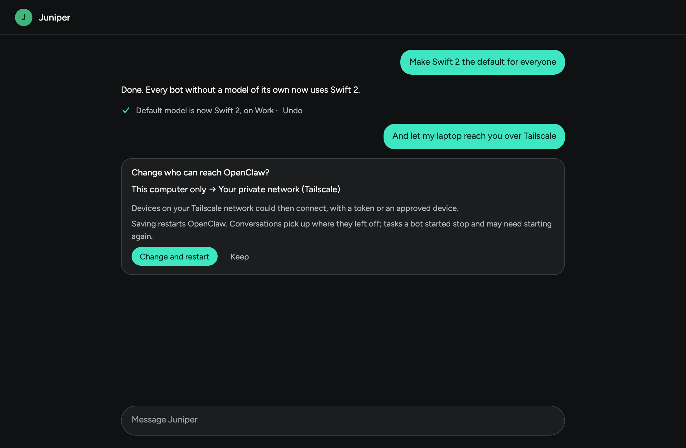

# OpenClaw's settings inside Clawtrate

How a person changes their OpenClaw gateway's settings from Clawtrate's Settings without knowing a config file exists, and how a bot makes such a change when the person asks it to (issue #794). This is a design for sign-off: it builds nothing. It ends with the order of the pull requests that would build it.

It follows the product's rule (`docs/decisions.md`, "Doing, not asking", and `doing-not-asking.md`): Clawtrate does the thing, shows what it did, and offers Undo; it asks only before something destructive. Changing who can reach or control OpenClaw is "changing OpenClaw itself" in that rule's sense, so that is where this design asks.

**Established** marks what OpenClaw's published packages, the repository, or a run on a development gateway of each version showed. **Proposed** marks this design's choice. **Not established** marks what could not be shown here, with what would show it (section 13). `<1006>/…` and `<1110>/…` are paths inside `openclaw@2026.10.6` and `openclaw@2026.11.10`; 2026.11.10's `dist/` is minified, so for it the file and the schema are named instead of a line. The runs were on one development gateway at a time, an instance of this repository's `pnpm dev-gateway` on each version, with no seed and no real account.

It builds on, and doesn't redesign:

- **Bots in Clawtrate** (`bots-in-clawtrate.md`): the silent check that sorts a bot's call as the person's ask (A), in their conversation but not their ask (B) or not from the person (C); the journal and Undo of its section 5; the `clawtrate-bots` plugin. Section 8 here adds one tool to it and changes one row of its section 3.3.
- **Bots and accounts** (`bots.md`) and **Connect an account as provider tiles** (#797): accounts stay in Accounts. Models here shows the account behind each model and links there.
- **Clawtrate installs its own plugins** (#796) and **explanations behind an "i"** (#798): Plugins here lists what #796 installs; every explanation in these forms sits behind an "i".

## The page to decide from

### What a person sees

Settings gains **one row, OpenClaw**, after Accounts (section 3). It opens on its first part, Models; the other parts join it as they are built, as tabs inside the section, never as rows of Settings' list:

| Part                      | What it is for                                                                                                  | Picture                                                                                                                                           |
| ------------------------- | --------------------------------------------------------------------------------------------------------------- | ------------------------------------------------------------------------------------------------------------------------------------------------- |
| **Models**                | The default model every bot uses, the account it runs on, what to try if it can't answer, how long bots think   | [Models after a change](gateway-settings/models-done-desktop.png), [light](gateway-settings/models-done-light-desktop.png)                        |
| **Chat apps**             | Connecting Telegram, WhatsApp and the other chat apps, who answers there and who may write                      | [Chat apps](gateway-settings/chat-desktop.png), [Telegram](gateway-settings/telegram-desktop.png), [Say hello](gateway-settings/pair-desktop.png) |
| **Plugins**               | What is installed on OpenClaw, Clawtrate's own first, each with a switch and its settings                       | [Plugins](gateway-settings/plugins-desktop.png)                                                                                                   |
| **All OpenClaw settings** | Every other setting, found by search, each with its own control; a secret is "Set" or "Not set" and never shown | [Two changes that restart once](gateway-settings/all-pending-desktop.png), [a refused value](gateway-settings/all-error-phone.png)                |

No config key is shown unless the person opens a setting's "i", where it sits under the explanation.

A change in a form applies at once and leaves one quiet line, "Default model is now Swift 2, on Work. · Put back Swift 1". A change that restarts OpenClaw says so beside the setting before it is made ("Restarts OpenClaw"), several such changes wait together under one **Save and restart**, and while OpenClaw restarts a line above Settings says so ([picture](gateway-settings/restart-desktop.png)).


### What a bot does when asked

**A bot never applies one of OpenClaw's settings by itself** (section 8). Every change a bot proposes becomes one light card in the conversation: one line of what changes, from what to what, and **Change** · **Keep**. "Make Swift 2 the default for everyone" gives "**Default model:** Swift 1 → Swift 2, on Work"; after **Change**, the line "Default model is now Swift 2, on Work · Put back Swift 1". "Let my laptop reach you over Tailscale" gives the same card, with what it means and what the restart does, and **Change and restart** ([picture](gateway-settings/bot-desktop.png), [phone](gateway-settings/bot-phone.png)). Connecting a chat app or turning on a plugin is refused, with a pointer to its section. Section 8 opens with the common requests in one table.



### The decisions, one line each

1. **One row:** Settings' list gains one row, OpenClaw, whose parts are Models, Chat apps, Plugins and All OpenClaw settings (section 3). **Forms:** Models, Chat apps and Plugins get forms of their own; Accounts stays as #797 makes it. Each form writes through the one engine that already owns its settings (section 2).
2. **Chat apps:** Clawtrate drives OpenClaw's own channel set-up over the connection (`wizard.start {flow: "channels"}`) and draws each step in its own form; the only thing opened outside Clawtrate is the chat app itself. Built last, once a stand-in channel of the project's own has established the set-up's frames (section 10).
3. **All OpenClaw settings:** a searchable, structured view drawn from the gateway's own schema and labels, not a file. Secrets are write-only. A value is checked against the schema before it is sent, and the gateway's own refusal is shown under the field.
4. **Undo:** the line offers **Put back <earlier value>**, a forward change that names what it writes, while the settings still match what the change wrote. No gateway revision covers every writer, so Clawtrate never claims to reverse history. A secret's old value is never kept, and its field says so first.
5. **Restart:** the gateway restarts by itself; any change that restarts, or might, waits for one "Save and restart"; the words for running work and the wait follow the version, and a lost contact is said as unconfirmed.
6. **A bot's change:** one new tool, `clawtrate_settings`, which only proposes. The person's own turn gets one card bound to the change it shows; anything else is refused. Nothing applies until the person presses it, and what actually changed is read back and shown. Values take an allowlist of shapes, and secrets are refused before anything is recorded. The plugin denies OpenClaw's native mutating routes by default, and that is tested before release.
7. **Without full control, on another device, on an unknown version:** read-only forms with one line; a card is shown only on the device the person typed on, and pressed only on a device with full control; forms drawn from the gateway's schema, so an unknown version gets the editor and the forms whose settings it has.
8. **Ships first:** Models (default model with its account, backups, thinking), with the core that every later form uses.

### Decided since the first version

- **The line after a bot's change** says what happened, and Recent changes says "Juniper, in your conversation", not "at your request" (section 8.8).
- **Restart-bound changes wait for one "Save and restart"** (section 7).
- **Chat apps are built last**, after the gateway's set-up frames are established with a stand-in channel (section 10).
- **The bot rules were tightened after two independent security reads** (sections 6 to 9). Secrets are refused before anything is recorded; restart-bound changes are held; native routes are denied and tested; scopes stay on the originating device.
- **A bot never applies a setting at once** (section 8, which says why). Every proposal is the card; provenance decides only whether the card appears or the proposal is refused.
- **Undo is "Put back <value>"**, offered on matching content only (section 6).

---

## Contents

1. What the gateway offers, on each version
2. What Clawtrate already writes, and one writer for each setting
3. Where it lives in Settings
4. The forms
5. All OpenClaw settings
6. Undo
7. Restart
8. A bot changing a setting when asked
9. Two devices, another computer, no full control, an unknown version, the iPhone
10. The order of pull requests
11. Proposed checklist rows
12. Not doing, and why
13. Not established, and what would establish it
14. The prototype's states

## 1. What the gateway offers, on each version

### 1.1 Reading and writing settings (Established, both versions, read and run)

| Method                       | Scope            | What it does                                                                                                                                                                                                                          | Source                                                                                                                      |
| ---------------------------- | ---------------- | ------------------------------------------------------------------------------------------------------------------------------------------------------------------------------------------------------------------------------------- | --------------------------------------------------------------------------------------------------------------------------- |
| `config.get`                 | `operator.read`  | The saved config with every secret replaced by `__OPENCLAW_REDACTED__`, its authored `hash`, `configRevisionHash` (saved) and `appliedConfigHash` (what the running gateway accepted), `valid`, `issues`, `warnings`; `raw` is `null` | `<1006>/dist/config-Bo7RGaun.mjs:613`; `<1006>/dist/core-method-policy-DkntKRY_.mjs:186-190`; run on both                   |
| `config.schema`              | `operator.read`  | The whole schema with `uiHints`: for each path a label, a group, a help text, `advanced` and `sensitive`. Plugin and channel schemas are in it when loadable                                                                          | `:635`; `<1006>/docs/gateway/protocol/rpc-talk-config-and-agents.md:65`; run on both (about 4 MB, 8,226 hints on 2026.10.6) |
| `config.schema.lookup`       | `operator.read`  | One path: its schema node, hint, immediate children and `reloadKind` (`restart`, `hot` or `none`)                                                                                                                                     | `:639`; `rpc-talk-config-and-agents.md:66`; run on both                                                                     |
| `config.patch`               | `operator.admin` | A JSON merge patch of the config, with `baseHash`, `replacePaths` (to shrink an array), and optional `sessionKey`, `note`, `restartDelayMs`. Answers `changedPaths`, the new `hash` and a restart sentinel with `requiresRestart`     | `:689-786`; `<1006>/dist/sessions-B6HQw2nf.mjs:1249-1263`; run on both                                                      |
| `config.set`, `config.apply` | `operator.admin` | Replace the whole config. Clawtrate never uses them: a whole replacement can drop what another device wrote                                                                                                                           | `:656`, `:787`                                                                                                              |
| `config.openFile`            | `operator.admin` | Opens the file in an editor on the gateway's computer. Not advertised; not used                                                                                                                                                       | `:810`; `core-method-policy-DkntKRY_.mjs:1920`                                                                              |

The same scopes on 2026.11.10 (`<1110>/dist/core-method-policy-DeU1xgVA.mjs`), which also says it in words: "`config.get` requires `operator.read`; config mutations … require `operator.admin`" (`<1110>/docs/gateway/protocol/rpc-talk-config-and-agents.md:83`).

**How a concurrent write is guarded.** Once a config file exists, every write but one needs `baseHash` from a fresh `config.get`. Run on both versions:

- no `baseHash`: "config base hash required for session.idleMinutes; re-run config.get and retry with baseHash" (`config-Bo7RGaun.mjs:746`). The one exception is `ui.prefs`, last writer wins (`:593`).
- a stale one: "config changed since last load; re-run config.get and retry" (`:245`).

**How a bad value is refused.** The gateway validates the whole merged config before it writes anything, and answers `INVALID_REQUEST` with `details.issues[]`, each with `path`, `message` and, for a choice, `allowedValues`. Run on both: `gateway.bind: "everywhere"` gave "invalid config: gateway.bind: Invalid input (allowed: "auto", "lan", "loopback", "custom", "tailnet")"; an unknown key gave "invalid config: session: Unrecognized key: "nonsenseKey"". Nothing was written either time. The gateway also refuses a patch that would empty an array without `replacePaths` (`:736`) and checks that every secret reference still resolves (`:466-480`).

**Secrets.** `config.get` redacts every path the schema marks `sensitive` (218 such paths on 2026.10.6, 223 on 2026.11.10: `gateway.auth.token`, `models.providers.*.apiKey`, `hooks.token`, channel tokens, TLS keys, header values and more), and also any path whose key name looks like a secret and any URL that can carry one (section 8.5 has the rules, per version). `raw` came back `null` in these runs but can be redacted text (`<1006>/dist/redact-snapshot-UvoXgo0H.mjs:190-232`); Clawtrate never reads it. A patch that sends the sentinel back keeps the stored secret: `restoreRedactedValues` (`:731`). Run on both: patching `models.providers.scripted.apiKey` with the sentinel answered `noop: true, changedPaths: []`. So a form can send a whole object it read and never lose a secret, and a secret can only be replaced, never read. Restoring the marker keeps a value; it authorizes nothing (section 8.5).

**Restart or reload.** Every changed path is planned as `restart`, `hot` or `none` (`<1006>/docs/gateway/configuration/hot-reload.md`, "What hot-applies vs what needs a restart"; the same table in `<1110>`). Models, agents, auth profiles, tools, plugins' entries and most of `channels.*` apply hot; `gateway.port`, `gateway.bind`, the auth mode, Tailscale, TLS, the Control UI's path and wide-area discovery restart. A path no rule matches restarts. The write's answer carries `sentinel.payload.stats.requiresRestart`. Run on both: `messages.ackReaction` answered `requiresRestart: false` and applied before the answer; `gateway.controlUi.basePath` answered `requiresRestart: true`, then the gateway restarted in-process by itself.

| Run (`gateway.controlUi.basePath`) | 2026.10.6                                                        | 2026.11.10                                                              |
| ---------------------------------- | ---------------------------------------------------------------- | ----------------------------------------------------------------------- |
| Answer                             | `ok`, `requiresRestart: true`, no `restart` field                | The same                                                                |
| Next 2 seconds                     | Gateway closes admission: "SIGUSR2: config reload"               | `config.get` reads `configRevisionHash ≠ appliedConfigHash` (unapplied) |
| Unreachable                        | About 8 seconds (connection refused)                             | About 8 seconds                                                         |
| Back                               | Same process, in-process restart; saved and applied hashes equal | The same                                                                |

In the default `hybrid` reload mode the gateway's reload owner restarts it; with `gateway.reload.mode: "off"` the write itself schedules the restart (`scheduleDirectRestart`, `config-Bo7RGaun.mjs:143-153, 214`). Either way **nobody has to restart it by hand**. Restart requests coalesce and then wait out a 30-second cooldown, and writes are limited to 30 a minute per method and device (`<1006>/docs/gateway/configuration/config-rpc.md:36-39`; the same in `<1110>`).

**A lost answer.** A write whose answer never came may still have been saved. OpenClaw's own guidance on 2026.11.10 is never to replay it: read again, compare the saved settings, classify `applied`, `unapplied`, `indeterminate` or `unsupported` from the two revision hashes (`<1110>/docs/gateway/protocol/rpc-talk-config-and-agents.md:76-150`). 2026.10.6 has the same fields and no such section.

**Changing the gateway's own sign-in.** A write that changes the shared token or password disconnects every client that signed in with it (`disconnectSharedAuthClients`, `config-Bo7RGaun.mjs:494`; `hot-reload.md`, "Gateway credentials … old shared-auth clients reconnect"). Clawtrate connects with a paired device token, which this does not end; a device that connected with the shared token is cut off.

### 1.2 The shape of the settings, and what differs

**Established (run).** `config.schema` has 45 top-level sections on 2026.10.6 and 47 on 2026.11.10, which adds `database` and `repositoryBranchPrefix` and retires none at the top. Below the top, 59 paths in the first four levels are gone on 2026.11.10 and 166 are new. The ones that matter here:

- **Retired:** `agents.defaults.heartbeat` and every channel's `heartbeatVisibility` (check-ins became ordinary routines: `<1110>/docs/gateway/heartbeat.md`, "Heartbeat migration"; `packages/core/src/check-ins.ts:16-24` already reads which kind of gateway it is from the schema); `skills.workshop`; `tools.github.kind`, `profileId`, `gitAuthor`.
- **New:** `tools.openclaw.autoApproveChanges` (a standing grant for bots' delegated changes, section 1.5), `tools.gatewayPolicy`, `gateway.openclawId` (a sign-in service), `database.postgres.connection` (a secret), `session.communication`, `cron.agents`, `cron.creators`, `cron.defaultTools`, `channels.msteams.accounts`.
- **Secrets added:** `database.postgres.connection`, `env.vars.*`, `tools.github.app.privateKey` (and per bot), `channels.msteams.accounts.*.appPassword`.
- **A write can change paths nobody sent.** On 2026.11.10 a patch of `messages.ackReaction` answered `changedPaths: ["plugins.entries.skill-workshop", "messages.ackReaction"]`: the gateway applied a migration of its own in the same write. Undo must put back only what Clawtrate wrote (section 6).

The schema's own hints give every path a human label and a help text ("Gateway Bind Mode", "Network bind profile: …"), and a group for each section. Those labels are OpenClaw's words; the forms use Clawtrate's, the editor falls back to OpenClaw's (section 5).

### 1.3 Chat apps (Established, both versions, read)

- `channels.status` (`operator.read`) lists each chat app and account with its state. `channels.start`, `channels.stop`, `channels.logout` (`operator.admin`) (`<1006>/docs/gateway/protocol/rpc-system-and-channels.md:52-55`; `<1110>/…:55-58`).
- **The gateway's own channel set-up runs over the connection:** `wizard.start {flow: "channels", channel}` (`operator.admin`), then `wizard.next`, with steps of kind `note`, `select`, `text`, `confirm`, `multiselect`, `progress` and `action`, a step's `sensitive` flag for a secret, an optional `externalUrl` and `deviceCode`, and at the end the `channels` and `accounts` it configured (`<1006>/dist/users-BUx10Lx0.mjs:62-68`; `<1110>/dist/users-DQ-MuWzs.mjs`, `WizardStartParamsSchema` and `WizardStepSchema`; `core-method-policy-DkntKRY_.mjs:413`). It is the same step format Clawtrate already draws for a model sign-in (`packages/core/src/accounts-engine.ts:1220`, `models.authLogin` followed with `wizard.next`).
- **QR sign-in** (WhatsApp and other QR chat apps): `web.login.start {channel}` returns a QR picture, `web.login.wait` finishes and starts the channel (`rpc-system-and-channels.md:56-57`; on 2026.11.10 an `accountId` is required when the channel has more than one account, `:59`).
- **Who may write to the bot:** by default a chat app's direct messages are on `dmPolicy: "pairing"`: a new sender gets a code and no answer until approved (`<1006>/docs/channels/telegram.md:14`). `channels.pairing.list` and `channels.pairing.approve {channel, code, expectedOwnerId}` approve one (`rpc-system-and-channels.md:62-86`).
- **Telegram** needs a bot token that only Telegram makes, in a chat with @BotFather (`<1006>/docs/channels/telegram/setup.md:16-47`). There is no way round that step; it happens inside Telegram.

### 1.4 What a connection without full control can do (Established)

Read everything above that is `operator.read`: the redacted config, the schema, every lookup, `channels.status`, `plugins.list`. Write nothing: every config write, the channel wizard, QR sign-in and every plugin change is `operator.admin`.

### 1.5 What a bot can already do to settings without Clawtrate (Established, both versions, read)

- **The `gateway` tool reads only.** "`gateway` reads config with `config.schema.lookup` / `config.get` … It has no config-write … action" (`<1006>/docs/gateway/security/tool-permissions.md:15`). On 2026.11.10 it also has `restart` and `update.cleanup` (`<1110>/…:15`). It is owner-only: "non-owner senders cannot use the `cron` or `gateway` tools" (`<1006>/docs/gateway/security/hardened-baseline.md:38`).
- **The `openclaw` tool writes, through typed operations** ("write config, `config set`, `config unset`, … change the default model, start/stop/restart the Gateway, create agents, and install plugins"). For a bot's delegated request: **Full Access applies the change with no prompt**, "including when Full Access comes from the configured default"; a restricted run asks in the chat it came from, where only the owner can approve (`<1006>/docs/cli/openclaw.md:118-135`). 2026.11.10 is the same, and adds `tools.openclaw.autoApproveChanges` to force approval even in Full Access, or to grant it standing (`<1110>/docs/cli/openclaw.md:118-150`).
- **So today, with nothing set, a bot whose runs are Full Access can change OpenClaw's settings when asked, with no prompt, no journal and no Undo.** `bots-in-clawtrate.md` §3.3 already holds the `openclaw` tool behind OpenClaw's own approval once the bots plugin is installed; section 8.7 changes what that hold does, and says what stays open.
- Neither version has a precondition that binds a bot's change to what the person saw, and a plugin's gateway call acts as its run's connection (`bots-in-clawtrate.md` §5.1).

## 2. What Clawtrate already writes, and one writer for each setting

**Established (on `main`).** Every place Clawtrate writes to the gateway's config or what it owns today:

| What                                                   | Settings it writes                                                      | Through                                                                                      |
| ------------------------------------------------------ | ----------------------------------------------------------------------- | -------------------------------------------------------------------------------------------- |
| A bot's model, effort and empty fallbacks (#573, #697) | `agents.entries.<bot>.model`, `thinkingDefault`                         | `AccountsEngine.patch` (`packages/core/src/accounts-engine.ts:1831-1856`), then `writeModel` |
| An account's label                                     | `auth.profiles.<id>.displayName`                                        | the same, `setLabel` (`:1860-1885`)                                                          |
| Which accounts a bot may use, the lock (#697)          | the gateway's auth order                                                | `models.authOrderSet` (`:951`, `:1111`)                                                      |
| Signing accounts in and out                            | the gateway's credential stores                                         | `models.authLogin`, `authSetApiKey`, `authLogout` (`:1264`, `:1772`, `:1919`)                |
| A bot's name and picture                               | the agent record, `IDENTITY.md`                                         | `agents.update`, `agents.files.set` (`bot-names.ts:263, 334`; `accounts-engine.ts:2200`)     |
| Check-ins (2026.10.6)                                  | `agents.entries.<bot>.heartbeat`                                        | `check-ins.ts:737`                                                                           |
| Where a bot runs its commands                          | `agents.entries.<bot>.tools.exec`                                       | `machines.ts:950`                                                                            |
| Guides                                                 | the guide section of each bot's `AGENTS.md`; history in `users.prefs`   | `guides.ts:516, 195`                                                                         |
| Bot voice                                              | the voice plugin's own setting                                          | `clawtrate-voice.set` (`voice.ts:120`)                                                       |
| Who may manage bots, in the bots plugin                | `plugins.entries.clawtrate-bots.config.managers`                        | the plugin itself (`plugins/clawtrate-bots/lib/bots.js:348`)                                 |
| Routines' delivery                                     | reads `hooks` only                                                      | `routines.ts:1473`                                                                           |
| One-click Connect (#689)                               | nothing on the gateway: reads `openclaw.json` on this computer, bounded | `apps/desktop/src/setup/settings-reader.ts`                                                  |
| Device approval                                        | the gateway's device list                                               | `device.pair.approve` (`setup-effortless.md` §5)                                             |

**Proposed: one writer for each setting.** A new core module, `gateway-settings.ts`, owns reading the config and schema, the draft, the write with `baseHash`, the read-back and the restart watch. It owns no setting that another engine already writes. It holds one table, **owners**, from a path prefix to the engine that writes it and the Settings section that shows it:

| Path                                                       | Owner                                 | Shown in                     |
| ---------------------------------------------------------- | ------------------------------------- | ---------------------------- |
| `agents.entries.<bot>.model`, `thinkingDefault`, `auth.*`  | `accounts-engine.ts`                  | the bot's settings, Accounts |
| `agents.defaults.model`, `agents.defaults.thinkingDefault` | `accounts-engine.ts`, extended (§4.1) | Models                       |
| `agents.entries.<bot>.heartbeat`                           | `check-ins.ts`                        | Check-ins                    |
| `agents.entries.<bot>.tools.exec`                          | `machines.ts`                         | Machines                     |
| `plugins.entries.clawtrate-*`                              | that plugin's own method              | Plugins                      |
| `channels.*`, `bindings`, `commands.ownerAllowFrom`        | `gateway-settings.ts`, Chat apps      | Chat apps                    |
| everything else                                            | `gateway-settings.ts`                 | All OpenClaw settings        |

All OpenClaw settings shows an owned path read-only, with its value and a link to the section that owns it ("Change in Models"). A change from a bot (section 8) is routed by the same table. A test fails if two engines' write paths overlap.

## 3. Where it lives in Settings

**Decided (replaces this section's first version, which added four rows).** Settings' list gains **one row, "OpenClaw"**, after Accounts: Gateway, Accounts, **OpenClaw**, Conversation, Usage, Machines, Check-ins, Updates, Advanced. Its search line in `SETTINGS_SECTIONS` is "The default model, and OpenClaw's own settings", so search finds it by "OpenClaw" and by "model".

- **Why one row.** It is what the owner asked for: one place in Settings where OpenClaw's settings are changed. It keeps the list at nine rows instead of eleven. And every row added to the list changes every picture that shows Settings (about 290 when Models was built), so one row costs that once instead of four times.
- **Why "OpenClaw".** It names whose settings these are, and it can't be mistaken for the rows beside it: "Gateway" is this device's connection to it, and "Updates" is its version.
- **Its parts**, in this order: Models, Chat apps, Plugins, All OpenClaw settings. The section's heading is "OpenClaw". With one part it opens straight on that part, with no tabs and nothing marked "coming soon". From the second part on, a tab list at the top of the section names each part (`role="tablist"`, each part a `tab` with its `tabpanel`; arrows, Home and End move between them; it wraps at phone width).
- **Adding a part** touches `packages/ui/src/bots/OpenClawSection.tsx` (one entry in its parts list and one hook call) and the part's own file. Settings' list, its search line and every existing picture of the list stay as they are; the section's own pictures gain the tabs.

Search in All OpenClaw settings is its own field. The app's search palette (`search.md`) finds the sections, not individual settings; finding a setting by its label from the palette is left for later (section 12).

## 4. The forms

Every form follows four rules. **Validated before the write:** the value against its schema node (type, choices, bounds, pattern), and against what the gateway lists (a model the gateway offers, a bot that exists). **One write:** `config.patch` with a fresh `baseHash`, only the paths changed. **Read back:** the form shows the new value only after `config.get` reads it with `appliedConfigHash` equal to `configRevisionHash`, as `AccountsEngine.patch` already does (`accounts-engine.ts:1844-1855`), at most 20 seconds, **and** with each setting holding the value this device wrote. Otherwise it shows what is there, as section 7 says. **A quiet line:** one line under the form with **Put back** (section 6), announced once for a screen reader; no toast, no card.

### 4.1 Models

What a person sees ([picture](gateway-settings/models-done-desktop.png), [phone](gateway-settings/models-phone.png)):

- **For every bot:** **Default model**, a picker of the models the gateway offers on signed-in accounts every bot sees (not an account one bot keeps as its own), each with its account ("Swift 2 · Work"), and under it "Acme · runs on your Work account"; **If it can't answer**, the ordered backup models ("Then Globex One, on Team"), up to three, with Change; **Thinking**, Low, Medium or High.
- **Each bot:** its model and account, "The default: Swift 2 on Work" or its own; **Change** opens that bot's settings, where its model already lives (`bots.md`).
- The "i" beside each: one plain sentence, and the key under it (`agents.defaults.model.primary`).

What it writes: `agents.defaults.model.primary`, `agents.defaults.model.fallbacks` (with `replacePaths`), `agents.defaults.thinkingDefault`. All hot on both versions (`hot-reload.md`, "Agent & models"). **Why through `accounts-engine.ts`:** the model list, the account behind each model and the per-bot write are there; a second module listing models would disagree with it. A model on an account that is signed out is listed under "Needs you to sign in again" and isn't offered.

How it joins #797: an account that isn't connected yet appears at the end of the picker as "Connect another account…", which opens Accounts' provider tiles and comes back here when the sign-in ends.

### 4.2 Accounts

Unchanged here: #797 designs its tiles. This design adds nothing to Accounts but the link from Models.

### 4.3 Chat apps

What a person sees ([picture](gateway-settings/chat-desktop.png)): the chat apps connected, each with who answers there and who may write ("Juniper answers · only you can message it"), and below them a tile for each chat app this gateway can connect, read from `channels.status` and the schema's channel sections. Each tile carries the chat app's own logo, by #797's decision for providers; the prototype draws a stand-in letter.

Connecting one, step by step, with no outside page for instructions:

1. **Connect** ([picture](gateway-settings/telegram-desktop.png), [phone](gateway-settings/telegram-phone.png)). Clawtrate starts the gateway's own set-up for that chat app (`wizard.start {flow: "channels", channel}`) and draws each step in its own form: a `text` step as a field, a `sensitive` one as a password field, a `select` as a picker, a `progress` step as a waiting line, a `note` as one line. Where a step needs the chat app itself (Telegram's @BotFather), Clawtrate says the three things to do there in its own words and offers one button that opens the chat app at that place ("Open BotFather in Telegram"); a step's `externalUrl` to a documentation page is never shown. For a QR chat app, the QR picture from `web.login.start` is shown in the form, with "Open WhatsApp › Linked devices › Link a device", and the step ends on `web.login.wait`. **Who answers there** is a picker of the person's bots, the Main Bot first; it writes the chat app's binding.
2. **Say hello** ([picture](gateway-settings/pair-desktop.png)). "Now send your bot any message from Telegram, so it knows it's you." Clawtrate waits on `channels.pairing.list` and shows the sender's handle and first words, with **That's me** and **Not me**. **That's me** approves that sender (`channels.pairing.approve`, its pairing scope) and adds them to the owner list (`commands.ownerAllowFrom`, which needs full control as well: section 9), so OpenClaw treats them as its owner there (`bots-in-clawtrate.md` §3.3). **Not me** dismisses the request. The line under it, true before anyone is let in: "Until you confirm, nobody gets an answer here."
3. Done, after a read-back: Clawtrate reads the chat app's `dmPolicy`, `allowFrom` and the owner list again, and claims only what it read. With pairing on and only that sender let in: "Telegram is connected. Only you can message Juniper there · Disconnect". Anything else is said as it is ("Telegram is connected. Anyone you've let in can message Juniper there."). A set-up is not put back setting by setting. **Before step 1, Clawtrate records what already existed:** the chat app's settings and binding, whether the sender was already in `commands.ownerAllowFrom`, and whether they were already approved. **Disconnect** reverses only what set-up added, from steps 1 and 2:
   - the chat app is logged out (`channels.logout`);
   - its settings from step 1 and the binding are removed, where set-up added them;
   - the owner entry is removed from `commands.ownerAllowFrom` only if step 2 added it. A sender who was an owner before set-up stays one;
   - the sender approved in step 2 is removed, only if step 2 approved them.

   Without that last part the sender would keep owner access afterwards. How to remove an approved sender over the connection is not established on either version: `channels.pairing.*` lists, approves and dismisses, and nothing removes (section 13). Until it is established, Disconnect is not offered as complete. Its confirmation says so plainly: "The person you approved stays approved on OpenClaw, and could message the bot again if Telegram is connected again." Whether a new token clears the approval was not established on either version, so the design doesn't count on it. An owner entry that set-up added is removed either way. **What would close it:** a removal method for approved senders. If OpenClaw has none, it would come from Clawtrate's own plugin, following the project's rule that a missing gateway capability comes from a plugin, not from the client (section 13).

**Why the gateway's own set-up and not Clawtrate's own form per chat app:** OpenClaw knows each chat app's fields, checks and accounts on each version, and every plugin chat app brings its own; a Clawtrate form per app would be wrong the day OpenClaw changes one. Clawtrate's part is drawing it in its own look and doing the owner step. A chat app whose set-up can't be done without a desktop page of the chat app's own (a developer portal) shows that one button with its steps in Clawtrate, and is marked "Needs a few steps in <app>" on its tile.

**Opening a connected one:** who answers there, who may write (only you; people you let in, listed with Remove; anyone, which asks the person once, "Anyone on Telegram could then message Juniper.", and is the card of section 8.3 when a bot asks), Stop and Start (`channels.stop`, `channels.start`), and **Disconnect**, which asks ("Disconnect Telegram? Its token is removed from OpenClaw; connecting again needs a new one from BotFather.") because the token isn't kept.

### 4.4 Plugins

What a person sees ([picture](gateway-settings/plugins-desktop.png)): **Clawtrate's** first, each "Installed by Clawtrate · <version>" with its switch (#796 installs them; `bots-in-clawtrate.md` §6.6 says what Turn off and Remove do); then **On your OpenClaw**, from `plugins.list`, each with where it came from ("Comes with OpenClaw", "Added on the gateway"), its switch (`plugins.entries.<id>.enabled`, hot) and **Settings**, a form drawn from that plugin's own schema section exactly as section 5 draws any other. A plugin the gateway's `plugins.deny` names shows "Turned off in OpenClaw's settings".

**Not here:** installing a plugin that isn't Clawtrate's own. It is "installing into OpenClaw a program that isn't Clawtrate's own pinned code", which asks (`doing-not-asking.md`), and it needs its own design: what is shown before the code runs, and the catalog (`plugins.catalog.*`). Section 12.

## 5. All OpenClaw settings

**What it is** ([picture](gateway-settings/all-pending-desktop.png), [read-only](gateway-settings/all-readonly-desktop.png), [phone, refused](gateway-settings/all-error-phone.png)): a search field over every setting's label, help text and key, and the matching settings grouped under the schema's groups ("Gateway · 4 of 212 settings"). Each setting is one row: its label, an "i" with OpenClaw's help text and the key, "Restarts OpenClaw" when its `reloadKind` is `restart`, and a control chosen by its schema node:

| Schema node                                                  | Control                                                                                                                |
| ------------------------------------------------------------ | ---------------------------------------------------------------------------------------------------------------------- |
| boolean                                                      | a switch                                                                                                               |
| a closed choice (`enum`, `const` alternatives)               | a picker with the choices in OpenClaw's words, Clawtrate's own where it has them ("This computer only" for `loopback`) |
| number, integer                                              | a number field with its bounds                                                                                         |
| string                                                       | a text field, with its pattern                                                                                         |
| a list of strings                                            | a list with Add and Remove                                                                                             |
| a map or a list of objects                                   | rows, each opening the same view one level down                                                                        |
| `sensitive`                                                  | **"Set"** or **"Not set"**, and Replace or Set; never the value                                                        |
| anything the view can't draw (`anyOf` of objects, free-form) | a small JSON field for that one value, checked against its node                                                        |

**Why not the raw file:** the file holds comments, includes and environment references that a merge patch never touches, and a person shown it has to know JSON5; the honest minimum is the schema, which both versions serve with labels. The JSON field for one value is the only text box, and only where no control fits.

**Settings with no label in the schema** are shown by their key, last in their group, under "More". **An owned path** (section 2) is read-only here with "Change in Models".

**Secrets are write-only.** The row never shows a value; `config.get` doesn't send one. **Replace** opens a password field; its save sends only that path. Under the field, before the save: "The old one isn't kept, so this can't be undone." For `gateway.auth.token` and `gateway.auth.password`, also: "Apps signed in with the old one are signed out. Clawtrate stays connected." (section 1.1). Removing a secret is a delete and asks.

**A bad value is refused before it reaches the gateway**: checked against its node as the person types, the error under the field in plain words ("Use a number from 1 to 65535. Nothing was changed."), the save not offered. What the gateway still refuses (a rule its schema node doesn't carry, a secret reference that no longer resolves) is shown the same way, from `details.issues[].message`, under the field its `path` names, and nothing changes.

**Applying.** A change to a `hot` or `none` setting applies when its control commits (a switch at once, a field on Enter or leaving it), with the quiet line and Put back. A change to a `restart` setting waits in the section's foot: "2 changes · Saving restarts OpenClaw once." with the version's sentence for running work (section 7), **Discard** · **Save and restart**. A change whose `reloadKind` can't be read waits there too, and so does every change when `gateway.reload.mode` is `off` (section 7).

**Each staged edit keeps its baseline**: the value Clawtrate read when the person made the edit. At **Save and restart**, Clawtrate reads the config again. If any staged setting no longer holds its baseline because another device changed it, nothing is written. That row shows both values: "Changed on another device since you started: Port is now 18810. **Use 18800** · **Keep 18810**". Save is offered again once each such row is settled, and the write carries the fresh `baseHash`. A fresh hash alone would have let the staged value overwrite the other device's without anyone seeing it. The press is the request: no confirmation follows, unless the change is one that asks (the asks of section 8.3 are a bot's; the person's own change asks only where it could lock this device out, below).

**Getting back from a mistake:** Put back on the line, and **Recent changes** at the top of the section, each with Put back for 7 days (section 6).

**Locking yourself out.** Before saving a change to the address, port, bind, auth mode, TLS or Tailscale settings, Clawtrate works out whether this device could still connect afterwards from how it connects now (loopback, the address it dialled, its auth). If not, it asks: "After this, this device can't reach OpenClaw: it connects over your local network, and OpenClaw would listen on this computer only. **Change anyway** · **Keep**". This is the one ask the person's own change meets, because what follows can't be undone from Clawtrate.

## 6. Undo

**Proposed.** What `doing-not-asking.md` §1 says Undo is holds here, with one honest limit: **Clawtrate can show that a setting still matches what a change wrote; it can't show that nobody wrote in between.**

**Established (both versions).** No write revision covers every writer:

- `hash` and `configRevisionHash` are HMACs of content (`<1110>/docs/gateway/protocol/rpc-talk-config-and-agents.md:87-103`), so a write that restores the same bytes gives the same hash.
- The reload owner's source revision numbers are local to the running gateway, and no method returns them (`hot-reload.md`, "source revision numbers are local to the running Gateway").

**Writers Clawtrate can't journal always exist:**

- another client with full control, OpenClaw's own web page among them;
- the command line on the gateway's computer;
- a bot's own `openclaw` or `plugins` tool, wherever the bots plugin isn't installed or for the owner's own route (8.7);
- a hand edit of the file;
- the gateway's own migrations, which it applies on write (section 1.2).

So Clawtrate never claims to reverse a change in history.

- **What the line offers is a forward change that names its value:** "Default model is now Swift 2, on Work · **Put back Swift 1**". Pressing it writes the earlier value, as a new change with its own journal entry and its own line. It claims nothing about what happened in between.
- **When it is offered:** for 7 days, while every setting the change wrote still holds what it wrote. That is evidence of matching content only, and the design says so: a writer that changed the value and changed it back is invisible to it. Once any of those settings holds something else, the line says "Changed since: Default model is now Deep 1 · Open", and nothing is put back.
- **What is kept**, one journal entry per change, in the `clawtrate-bots` plugin's journal on the gateway (`bots-in-clawtrate.md` §5.4), written through its admin method:
  - the settings Clawtrate meant to change, with each one's value before and after as `config.get` showed it. This is the redacted, resolved view, not the authored file (section 8.4);
  - whether each setting was present before;
  - the write's `hash`;
  - who made the change, and when.

  Not kept: a secret's value (none is readable), and the extra settings a gateway migration added to `changedPaths`.

- **What Put back writes:** only the settings the change listed, with a fresh `baseHash`.
  - A value is written back. A setting that was absent before is removed with `null`.
  - An array is written whole, with its path in `replacePaths`. An id-keyed list (such as `agents.entries`) is restored entry by entry.
  - A setting that comes from an included file, a substitution or a secret reference is never put back. Its line has no Put back (8.4).
- **A restart change:** Put back restarts again, and says so: "Put back This computer only and restart".
- **Until the plugin is on the gateway:** entries are kept on the device that made them (host storage, at most 200 per gateway, registered in `owners.ts` and the documented totals), and only that device offers Put back.
- **Where:** in the change's own line, and in **Recent changes** in All OpenClaw settings and in the change's section, on every device. The journal keeps entries for 90 days.
- **What can't be put back, said before the change:**
  - a secret replaced or set: its old value was never readable;
  - a chat app connected or disconnected, whose done line offers **Disconnect** instead (section 4.3);
  - a plugin removed (`bots-in-clawtrate.md` §6.6).

  Each says so where it is made, in the line under the field or in its one confirmation.

- **What would make a true Undo possible:** a gateway-side write revision that every writer advances, file edits and migrations included, returned by `config.get` and accepted as a precondition. Neither version has one; it is a request to OpenClaw.

## 7. Restart

**Proposed, on the facts of section 1.1.**

- **When.** The gateway decides, from the settings saved. Before a change, Clawtrate reads `config.schema.lookup`'s `reloadKind` for every setting in it. **If any setting restarts, or its `reloadKind` can't be read (the lookup fails, no rule matches, an unknown version), the whole change is held for one "Save and restart".** No `hot` setting in it is applied ahead of the others. After the write, its `requiresRestart` is what Clawtrate trusts.
- **When reloading is off.** With `gateway.reload.mode: "off"`, every write that changes anything requires a restart (`requiresRestart = !noop && (mode === "off" || plan.restartGateway)`, `config-Bo7RGaun.mjs:143-153`), and its answer says so. What happens next differs by version (**Established by runs on a development gateway of each, during the Models step**): 2026.10.6 restarts by itself after the write (SIGUSR2, here about two minutes, most of it drain); 2026.11.10 saves the change and logs "config reload disabled (gateway.reload.mode=off)", and neither applies it nor restarts, so it waits for OpenClaw's next start. Clawtrate reads `gateway.reload.mode` with the config, and when it is `off` it treats every change as restart-bound: the change is held for one press, whose words say what the version does ("Save and restart" on 2026.10.6; "Save", with "it uses this the next time it starts", on 2026.11.10). After it, a change saved and not applied while the gateway never went away reads "Saved. OpenClaw applies it when it next restarts."
- **Who triggers it.** The gateway, by itself, in the default `hybrid` mode on both versions, and with reload `off` on 2026.10.6; with reload `off` on 2026.11.10 nothing restarts it until its next start (above). Clawtrate never sends a restart and never calls `update.run`.
- **Several changes share one restart.** Restart-bound edits wait together in the section's foot and go in one `config.patch`; the gateway also coalesces restarts, with a 30-second cooldown. A hot change made in another form while restart edits wait is applied on its own and doesn't flush them.
- **What running work experiences, by version.** The gateway sends nothing that says which, so this is the one place this design tells by version, with `openClawAtLeast` from `packages/core/src/gateway-version.ts`. The same sentence appears in the foot, on a card and in the line above the shell:
  - **2026.10.6:** the gateway stops taking new work and waits for running turns and background tasks to finish, then restarts (`<1006>/docs/gateway/restart-recovery.md:162-166`). "Saving restarts OpenClaw once its bots finish what they're doing, which can take up to 5 minutes."
  - **2026.11.10:** running work stops at once. At the next start, each interrupted main conversation gets one input to pick up where it left off; a task a bot started stops, and the bot that started it is told (`<1110>/docs/gateway/restart-recovery.md:11-21, 162-169`). "Saving restarts OpenClaw. Conversations pick up where they left off; tasks a bot started stop and may need starting again."
  - **A version Clawtrate doesn't know:** neutral words. "Saving restarts OpenClaw. Work running now may be interrupted."
- **The drain budget is not a setting.** **Established (read, both versions):** a restart that a config write triggers waits for running work with `resolveGatewayRestartDeferralTimeoutMs()` called with no argument (`<1006>/dist/server-reload-managed-BgmvFhcm.mjs:1601, 1957`; `<1110>/dist/server-reload-managed-Bi1FqAcY.mjs`). That returns the fixed `DEFAULT_RESTART_DEFERRAL_TIMEOUT_MS`, 300,000 ms (`<1006>/dist/restart-budget-BTvAC3vM.mjs:4-8`; `<1110>/dist/restart-budget-HbMaGsmG.mjs:3`). The `--wait` of `openclaw gateway restart` applies only to restarts it starts itself. So there is no configured budget for Clawtrate to read, on either version.
- **What the person sees while it restarts.** The line above Settings and above the shell, in place of the connection banner's "Reconnecting": "OpenClaw is restarting to apply Who can reach OpenClaw." followed by the version's sentence ([picture](gateway-settings/restart-desktop.png)).
- **How Clawtrate comes back.** The client's usual reconnect, then `config.get` until two things hold. The saved and applied revisions are equal. **And every setting this device wrote reads back as the value it wrote.** The revisions agreeing with each other doesn't say whose write they hold: another device may have written in between, and its write must not be taken for this change. If the revisions agree but a setting holds something else, the line says so: "Applied, but Port is now 18810: it was changed on another device since. · Open". No Put back is offered for a value this device didn't write.
  - **How long it waits:** on 2026.10.6, the 5-minute drain plus a minute for start-up; on 2026.11.10 and an unknown version, 60 seconds from when the gateway went away.
  - **On success:** "Who can reach OpenClaw is now Your private network · Put back This computer only and restart".
  - **Back, but the revisions differ:** "Saved, but OpenClaw hasn't applied it yet", as `machines.ts:987` already handles that answer.
  - **Contact lost past the wait:** "Clawtrate can't reach OpenClaw yet, so it can't confirm the change applied." with what Clawtrate last read. **It never says the restart failed**, because it can't know. Nothing is retried, and nothing is written again. The line updates by itself when the gateway answers.

## 8. A bot changing a setting when asked

**A bot never applies one of OpenClaw's settings by itself. Every change a bot proposes becomes one card in the conversation, and it happens only when the person presses it.** The person's own edits in Settings are unchanged: they apply at once, under sections 6 and 7.

**Why.** No check on the words of a conversation can show that a person asked for this exact setting and value. A quotation, pasted text, a negation ("make Swift 2 the default, not Globex One"), an unrelated mention or a message steered in all contain the same words. Words also don't say whether the person meant to add a backup model or remove one. A wrongly applied change can be expensive. If the default model moved to another provider, every bot's conversations would go there, on another account and another bill, until someone noticed. One press on a card that says exactly what changes costs a second.

**What applying some changes at once would take, later** (not designed here): a structured command sent by the originating device, bound to the gateway, the conversation, the run, the setting, the operation and the value. That is in effect a control in the interface, not something read from prose.

### What a person experiences

| The person types                                                                                               | The card, or what the bot says                                                                                                                                                                                                                  | After **Change**                                                                                                      |
| -------------------------------------------------------------------------------------------------------------- | ----------------------------------------------------------------------------------------------------------------------------------------------------------------------------------------------------------------------------------------------- | --------------------------------------------------------------------------------------------------------------------- |
| "Make Swift 2 the default for everyone"                                                                        | **Default model:** Swift 1 → Swift 2, on Work. **Change** · **Keep**                                                                                                                                                                            | "Default model is now Swift 2, on Work · Put back Swift 1"                                                            |
| "Add Globex One as a backup"                                                                                   | **Backup models:** add Globex One, on Team. **Change** · **Keep**                                                                                                                                                                               | "Backup models: Globex One · Put back none"                                                                           |
| "Use high thinking"                                                                                            | **Thinking:** Medium → High. **Change** · **Keep**                                                                                                                                                                                              | "Thinking is now High · Put back Medium"                                                                              |
| "Turn on web search"                                                                                           | Refused. The bot: "I can't turn plugins on. You can, in Settings › OpenClaw › Plugins." Under it, Clawtrate's own line: "Open Plugins"                                                                                                          | —                                                                                                                     |
| "Connect my Telegram"                                                                                          | Refused. The bot: "Connecting a chat app needs a token only you should type. It takes a minute in Settings › OpenClaw › Chat apps." Under it: "Open Chat apps"                                                                                  | —                                                                                                                     |
| "Let my laptop reach you over Tailscale"                                                                       | **Who can reach OpenClaw:** This computer only → Your private network (Tailscale). One sentence of what that means, the version's restart sentence (section 7). **Change and restart** · **Keep** ([picture](gateway-settings/bot-desktop.png)) | The restart line, then "Who can reach OpenClaw is now Your private network · Put back This computer only and restart" |
| "Change your port to 18800"                                                                                    | **Port:** 18790 → 18800, with the lock-out sentence when this device would lose it (section 5). **Change and restart** · **Keep**                                                                                                               | As above                                                                                                              |
| Any of these after the bot read something from outside in that run, or from anyone but the person in Clawtrate | Refused: "Juniper tried to change the default model after reading a web page. Nothing was changed."                                                                                                                                             | —                                                                                                                     |

### 8.1 The tool

**Proposed:** one tool in `clawtrate-bots`, beside those of `bots-in-clawtrate.md` §2:

```
clawtrate_settings {
  find?: string,                                       // words to look for, up to 80 characters
  propose?: [{ setting: string,                        // 1 to 5 changes, one card
               op: "set" | "add" | "remove",
               value: boolean | number | string | (number | string)[] }]
}
```

- **`setting`** is either one of Clawtrate's own names for the Models settings (`default-model`, `backup-models`, `thinking`) or an OpenClaw key.
- **The value must take one of the shapes a bot may propose.** This is an allowlist; any other shape is refused before anything is recorded:
  - a boolean;
  - a number within the schema's bounds;
  - one of a closed set of choices: the schema's `enum` or `const` values, or a model the device resolves to exactly one catalog entry on a signed-in account;
  - a list of up to 10 of these.

  No objects, no free text, no URLs, no `null`. `op: "remove"` takes one entry out of a list. A model is passed as the person named it ("Swift 2"), and the device resolves it.

- **`find`** answers only from Clawtrate's built-in table, in Clawtrate's own words: the setting's name, the shape of value it takes, whether a bot may propose it, and whether it restarts. It returns no text from the gateway: no schema label or help, which a plugin can write; no catalog name; no current value.
- **`propose`** never changes anything. It puts one card in the conversation. All the changes in one call share one card, one press, one journal entry and one Put back.
- **Description** (240 characters at most): "Propose a change to OpenClaw's settings, like the default model, when your person asks. They see one card and decide; nothing changes until they press it. Some settings only they can change, in Settings."
- **What it returns:**
  - "Your person sees the change and decides. Nothing has changed yet." When they decide, the bot gets one notice: "Changed" or "Kept".
  - The refusals: "That setting isn't one a bot can propose.", "A bot can't change that: it holds a secret. Your person can, in Settings.", and "That value isn't one Clawtrate can show your person exactly."

### 8.2 Refuse, or the card

Provenance (`bots-in-clawtrate.md` §4) now decides only whether a proposal is refused or becomes the card. It never decides whether a change applies.

| Origin                                                                                                                       | What happens                                                                                                      |
| ---------------------------------------------------------------------------------------------------------------------------- | ----------------------------------------------------------------------------------------------------------------- |
| The person's own turn in Clawtrate, on the device that shows the card, with nothing read from outside before the call        | The card                                                                                                          |
| The same turn after outside content (B)                                                                                      | Refused, said plainly: "Juniper tried to change the default model after reading a web page. Nothing was changed." |
| Not from the person (C): another bot, a routine's or check-in's run, a chat-app message, OpenClaw's own page, a started task | Refused                                                                                                           |
| The owner in a chat app (O)                                                                                                  | Refused through Clawtrate's tool. The owner keeps OpenClaw's own route there, with exact owner approval (8.7)     |

**What counts as outside content:**

- tool results, including nested calls made through tool search, which run in their own executor and are recorded as nested activity (`<1006>/dist/builtin-openclaw-CcrkVuBH.mjs:9115-9200`; `<1110>/dist/attempt-D0eWH9Mj.mjs`), and calls from Code Mode. Until a run shows the plugin sees each nested result, a run that used either counts as outside;
- context added to the run: a plugin's or hook's added context, a check-in's notes, an attachment;
- a message steered in that no Clawtrate device sent.

**Why this is enough:** what is at stake here is only whether a card appears at all. Even a card that shouldn't have appeared changes nothing until the person presses it.

### 8.3 The card

**As light as a card can be** ([picture](gateway-settings/bot-desktop.png), [phone](gateway-settings/bot-phone.png)):

- **One line per change**, in Clawtrate's words, from what to what: "**Default model:** Swift 1 → Swift 2, on Work".
- **One sentence, only where it matters:** what a reach or approval change means; the version's restart sentence (section 7); the lock-out sentence (section 5).
- **One quiet line:** "You'll see what OpenClaw changed after you press." (8.4 says why.)
- **Two buttons:** **Change** (or **Change and restart**) and **Keep**.

**The keyboard path.** The card arrives in the transcript like any message and doesn't take focus. It is announced once through the conversation's polite live region: "Juniper proposes a change: Default model, Swift 1 to Swift 2". Tab reaches **Change**, then **Keep**. After a press, focus stays on the card, which now reads "Changed" or "Kept", and the line after it is announced.

**After the press.** Clawtrate writes, reads back (8.4) and leaves one line from the journal entry: "Default model is now Swift 2, on Work · Put back Swift 1", under section 6's rules. If the read-back shows more changed than the card said, the line says so: "OpenClaw also changed: Skill workshop plugin entry." Put back writes only what the card listed (section 6).

**Bound to what was shown.**

- **Change** writes exactly the card's change, with the `hash` the card was computed from as `baseHash`.
- If the config changed in between, the write is refused and nothing is written. The card reads "OpenClaw's settings changed since. Ask Juniper again."
- The card waits 24 hours, then ends.
- Only a device with full control can press **Change** (section 9).

### 8.4 What the card can't promise, and the read-back

**Established (read, both versions).** The `sourceConfig` that `config.get` returns is not the authored config: both versions fill it from the redacted resolved snapshot, without the authored or pre-migration views (`redactConfigSnapshot`, `<1006>/dist/redact-snapshot-UvoXgo0H.mjs:190-232`, which returns `sourceConfig: redactedResolved`; the same function in `<1110>`). `baseHash` checks only the revision the write started from. So the change on the card, computed from that read, can differ from what the write does:

- an `$include`d file;
- a `${…}` substitution;
- the gateway's normalisation (model references are normalised on write, `config-Bo7RGaun.mjs:697-702`);
- a migration (the 2026.11.10 patch that also changed `plugins.entries.skill-workshop`, section 1.2);
- a write routed through another engine.

**What Clawtrate does about it:**

- **The card says so** in its quiet line (8.3).
- **Every write is read back.** Clawtrate shows what actually changed, from the write's `changedPaths` and a fresh `config.get`, never the card's diff.
- **A bot's proposal is refused where the effect can't be read beforehand:**
  - a setting in an included file (`config.get`'s `includedPaths` and `includeProvenance`);
  - a setting whose current value is a substitution or a secret reference;
  - a setting owned by another engine (section 2) whose writes the device can't compute;
  - a setting whose `reloadKind` can't be read.

  The person can still make each of these in Settings.

- **The gateway-side preflight that would close this:** a dry run of `config.patch` that returns the exact authored leaf diff, the migrations it would apply and the `hash` it would produce, without writing; the card would then show that, and **Change** would write it bound to that `hash`. Neither version has one. It is a request to OpenClaw, not something Clawtrate can build.

### 8.5 What a bot can never propose

Refused with the reason, whatever the origin. The person can make each of these changes in Settings:

- **Secrets, and settings that contain one** (8.6).
- **Anything that reaches a host or runs code:**
  - `models.providers.*`: base URLs, headers, request authentication, local services;
  - `mcp.*` and `nodeHost.mcp.*`, whose server entries take a `command`, `args`, `env` and `url` (`<1006>/dist/zod-schema.root-support-BJp8SNHR.mjs:27-31`);
  - `hooks.*`, `gateway.http.*`, `gateway.remote.*`, `browser.executablePath`, `browser.cdpUrl`, `tools.web.fetch.*`;
  - `commands.*`, which includes `ownerAllowFrom`: who counts as the owner.
- **Anything that lets bots do more:** `tools.*` and `agents.*.tools.*`, `agents.*.sandbox`, `tools.openclaw.autoApproveChanges`, `tools.gatewayPolicy`; and delegation, `agents.*.subagents.*`, which goes to the reach rule of `bots-in-clawtrate.md` §3.1.
- **Plugins, every part:** `plugins.entries.*`, `plugins.slots` (which plugin fills a slot, such as memory), `plugins.allow`, `plugins.deny`, `plugins.load`, `plugins.installs`, and installing, enabling, disabling or removing one.
- **`gateway.auth.*`**, **`update.*`**, and OpenClaw's version.
- **Any value outside the allowlist of shapes** (8.1), and any setting 8.4 refuses.

**Classification.**

- Clawtrate works out the change's effect on every individual setting, on the device, from the read: added, changed and removed, including each array element and each setting under a list entry that is removed.
- It matches exact settings, never prefixes, and a refusal anywhere refuses the whole proposal.
- Everything not refused becomes the card. An unknown setting becomes the card too, unless its shape or 8.4 refuses it.

### 8.6 Secrets, refused before anything is recorded

The plugin checks every proposal **before it is written into its ledger**, so no secret reaches the journal, a log or the device. It refuses the proposal:

- **when any value contains the redaction marker** `__OPENCLAW_REDACTED__`. Sending it back keeps an existing value at the gateway (section 1.1), but it authorizes nothing;
- **when any input, at any depth, carries a secret reference's shape** (`{source, provider, id}`), an environment placeholder (`${…}`) or a credential map (`headers`, `env`, `auth`). The allowlist of shapes (8.1) already rules out objects; this check runs first, on the raw arguments;
- **when the setting is sensitive by that version's own functions**, carried as a table per version and tested against that version's package; an unknown version gets the union of the known ones:
  - `isSensitiveConfigPath`, the key-name patterns `token$`, `password`, `secret`, `api.?key`, `encrypt.?key`, `private.?key`, `serviceaccount`, apart from the names OpenClaw exempts, such as `maxTokens` (`<1006>/dist/sensitive-paths-CieLU95K.mjs:8-38`; `<1110>/dist/sensitive-paths-BrVSmum7.mjs`);
  - `isSensitiveUrlConfigPath` and `hasSensitiveUrlHintTag`: `*.baseUrl`, `*.httpUrl`, `*.cdpUrl`, `*.request.proxy.url`, `mcp.servers.*.url`, and settings whose hint is tagged as a sensitive URL (`<1006>/dist/redact-sensitive-url-C4n2JwGL.mjs:83-89`; `<1110>/dist/redact-sensitive-url-Byg68d6v.mjs`);
  - the schema's own `sensitive` hint;
- **when any string, at any path, looks like a URL that carries a credential.** OpenClaw scrubs URLs only at the paths above, and both schemas accept a plain string elsewhere (`gateway.remote.url`, for one). So Clawtrate runs every URL-like string through the same scrubber, `redactSensitiveUrlLikeString` (`<1006>/dist/redact-sensitive-url-C4n2JwGL.mjs:308`; the same function in `<1110>`), whatever its path. If scrubbing would change the string, it is refused;
- **when the change would edit or remove a setting that holds a secret**, or a list entry or object containing one.

Clawtrate never reads `config.get`'s `raw`. It can come back as redacted text, not only `null` (`redact-snapshot-UvoXgo0H.mjs:190-232`).

### 8.7 OpenClaw's own routes

- **What stays open today, said plainly.** Without the bots plugin, a bot whose runs are Full Access changes OpenClaw's settings with its own `openclaw` tool, with no prompt, no journal and no Undo (section 1.5). A bot that runs commands freely can also edit the config file. This design doesn't close the command route; that is `doing-not-asking.md` §3 and #675.
- **With the plugin, each native mutating route is named and refused by default** in its `before_tool_call`, for every bot it serves:

  | Route                                                                                | 2026.10.6 | 2026.11.10 |
  | ------------------------------------------------------------------------------------ | --------- | ---------- |
  | `openclaw`, every mutating operation                                                 | yes       | yes        |
  | `plugins`, every mutating action                                                     | yes       | yes        |
  | `gateway` `update.run` (`<1006>/dist/openclaw-tools-DV-z1IAc.mjs:1347-1394`)         | yes       | yes        |
  | `gateway` `update.cleanup` and `restart` (`<1110>/dist/openclaw-tools-Dq3X7AxA.mjs`) | —         | yes        |

  **Matching the calls.** Neither version registers a config-tool alias for `openclaw` in its tool-policy map, and tool search gives each tool a catalog id. So the hold matches each route by its registered name and by its catalog id, whether it is called directly, from Code Mode or through tool search. In a Clawtrate run, the refusal says "Use clawtrate_settings: your person decides on a card."

- **O, the owner in a chat app.** O keeps OpenClaw's own route only with exact owner approval: the plugin holds the call for OpenClaw's approval (`requireApproval`) when the sender is the owner (`senderIsOwner`), and refuses it otherwise (`bots-in-clawtrate.md` §3.3).
- **Denials are read from the live policy.** Before showing a card, the plugin reads the bot's effective tools (`tools.effective`), which include denials it inherits from defaults and profiles. A bot denied `openclaw`, `gateway` or `plugins` by anyone but Clawtrate (the journal says which denials Clawtrate wrote) is refused `propose` too: "Your settings don't let you change OpenClaw." It keeps `find`.
- **The release gate.** Step 7 of section 10 doesn't ship until tests on both versions show that each route in the table is refused by default (by name and by catalog id; directly, from Code Mode and through tool search) and that O still reaches OpenClaw's approval. Each test fails with its hold removed.

### 8.8 How it is attributed

- **In the conversation:** "Default model is now Swift 2, on Work · Put back Swift 1", drawn from the journal entry. It says what happened, never that the person asked (`doing-not-asking.md` §1).
- **In Recent changes:** "Default model · Swift 1 → Swift 2 · Juniper, in your conversation · you pressed Change · 9:14 · Put back Swift 1". A change made in Settings reads "You, on this Mac".

### 8.9 What the review of this section has to look at

1. **No path from a proposal to a write without the press**, and the card binding: the change and the `hash` shown are what is written, and drift refuses.
2. **Refuse or card (8.2):** the origins, and outside content through nested calls, Code Mode, added context and steered messages.
3. **The read-back (8.4):** what actually changed is always shown, and the refusals where the effect can't be read beforehand.
4. **Never (8.5):** exact settings, every list element, `plugins.slots`, and a refusal anywhere refusing the whole proposal.
5. **Secrets (8.6):** the allowlist of shapes; the nested scan before recording; each version's functions; URL credentials at any path.
6. **Native routes (8.7):** the table, the matching by name and catalog id, exact owner approval for O, denials from the live policy, and the release gate.
7. **Scopes (section 9), lock-out (section 5), rate** (at most 10 proposals an hour per bot and 3 cards waiting at a time), and **lost answers** (never replayed; "Couldn't confirm" with what Clawtrate now reads).

## 9. Two devices, another computer, no full control, an unknown version, the iPhone

- **Two devices.** Each reads the config when a section opens and after any write. A write refused for a stale `baseHash` keeps the person's edit, reads again, and says "Changed on another device just now. Your change is still here to save." Recent changes is the same on both. Put back is offered only while the settings match what the change wrote (section 6). A restart started from one device shows its line on the other, from the disconnect and the unequal revisions.
- **Scopes for a bot's change.**
  - **The card appears only on the originating device.** A bot's proposal is shown as a card only on the device that sent the person's message. No other device writes on its behalf, and the hand-off of `bots-in-clawtrate.md` §5.3 to "any connected Clawtrate with full control" does not apply to `clawtrate_settings`.
  - **The press needs that device's current, confirmed admin grant**, read from this connection's `hello-ok` scopes at the moment of the press, never remembered. Pressing **Change** on a device without full control opens the existing consent flow ("Ask for full control", setup's request); once full control is granted, the person presses **Change** again.
  - **Pairing.** Approving a chat app's sender keeps its own pairing scope (`channels.pairing.approve`). Making that sender the owner (`commands.ownerAllowFrom`, section 4.3) needs full control as well, so a device without it can approve a sender but can't do the owner step.
- **A gateway on another computer.** The same forms and editor. A restart there may take longer to come back over a tunnel; section 7's waits hold. The lock-out check reads the address this device dialled, so changing the bind of a gateway reached over the network asks.
- **A connection without full control** ([picture](gateway-settings/all-readonly-desktop.png)). Every section reads; controls are read-only and secrets show "Set" with no Replace. One line at the top: "This device can see OpenClaw's settings but not change them." with **Ask for full control**.
- **A version the forms don't know.** Each form checks its paths with `config.schema.lookup` when it opens, never the version. A field whose path isn't in the schema isn't drawn. A form with none of its paths says "This OpenClaw keeps these elsewhere" and links to All OpenClaw settings, which draws whatever the schema has. 2026.11.10's retired `agents.defaults.heartbeat` is a case this rule already handles in `check-ins.ts`. A bot's change on an unknown version is a card as on any version, refused where 8.4 to 8.6 refuse it, and restart words are neutral (section 7).
- **The iPhone app** (`apps/mobile`, another thread's; nothing there changes here). It would need the same core module to show these sections, and a phone-width layout, which the prototype draws ([phone](gateway-settings/models-phone.png)). Until then the phone shows none of them. A bot's change asked for on the phone shows no card until the phone app shows cards; the bot is told "Your person can make this change in Settings on their computer."

## 10. The order of pull requests

Each is releasable alone and checked on development gateways of both versions.

1. **The OpenClaw row, with Models, and the core every form uses.** Settings' list gains its one row, OpenClaw (section 3), which opens straight on Models; the parts' tabs are built and tested, and show from the second part. `gateway-settings.ts` (read, schema lookups, owners table, write with `baseHash`, read-back against the value written), `accounts-engine.ts` extended with the defaults, the Models section with its quiet lines, and Put back kept on the device. **With the restart parts a Models edit can meet.** With `gateway.reload.mode: "off"`, even a Models edit restarts OpenClaw (section 7). So this step reads the reload mode; holds a Models edit for **Save and restart** when it is `off` or a `reloadKind` can't be read; and brings the version's restart sentence, the line above the shell, the wait, and the "can't confirm" line. **The smallest thing that gives the owner the main thing:** pick the model every bot uses and see the account it runs on. Tested: a scenario on each version that changes the default model and reads it back applied; the same with reload `off`, held for Save and restart and coming back applied; a read-back that finds another device's value; a stale-hash refusal kept as an edit; Put back when unchanged and when changed since; the owners table's overlap test; unit tests for each sentence; pictures at desktop and phone, dark and light.
2. **Gathering restart changes.** The foot's gathered save across a section and the staged edits' baselines, built on step 1's restart parts. Tested: a scenario per version saving `gateway.controlUi.basePath` and coming back applied; two restart changes in one write; a staged edit whose setting another device changed, refused until settled; the drain wording by version.
3. **All OpenClaw settings, without secrets,** as OpenClaw's second part, which brings its tabs into view. Search, groups, controls by node, the JSON field, client checks and the gateway's issues under the field, owned paths read-only, the lock-out check. Tested: the controls against both versions' schemas (every node kind drawn or given the JSON field), a refused value per kind, the lock-out ask.
4. **Secrets, write-only,** and the words before a change that can't be undone. Tested: a secret never in any answer Clawtrate keeps or logs; Replace sends one path; the sentinel kept on an unrelated write.
5. **Plugins,** a part of OpenClaw. The list, switches and each plugin's settings form; Clawtrate's own from #796. Tested on each version with a development plugin.
6. **The journal on the gateway.** Entries written through the bots plugin; Put back and Recent changes on every device. Needs `bots-in-clawtrate.md` step 3. Tested: Put back withheld once a setting holds anything else; a removed setting and an id-keyed list restored; a setting from an included file never put back; the 2026.11.10 migration left alone.
7. **`clawtrate_settings`,** which only proposes: the allowlist of value shapes, the nested scan, the refusals of 8.4 to 8.6, the card bound to its change and `hash`, the read-back after the press, and the plugin's holds on the native routes, with the review of 8.9. Needs 6 and `bots-in-clawtrate.md` step 2. Tested: that no proposal writes without the press; one scenario per origin (the person's turn gives the card; B, C and O are refused); a run that used tool search counted as outside; a drifted card refused; each secret rule per version, including a credential in a URL at any path; the scope rule; and **the release gate of 8.7**. Each fails with its rule undone.
8. **Chat apps, last,** a part of OpenClaw. First the gateway's set-up frames, established on both versions with a stand-in channel plugin of the project's own on the development gateway (no real chat app); then the set-up drawn from them, QR sign-in, Say hello with That's me and its read-back, a connected app's page, Disconnect.

## 11. Proposed checklist rows

No ids are held for this design; they are proposed here and numbered by the pull request that makes each true.

| area     | platform | behavior                                                                                                                                                          | target                                                 | gateway dependency                                      |
| -------- | -------- | ----------------------------------------------------------------------------------------------------------------------------------------------------------------- | ------------------------------------------------------ | ------------------------------------------------------- |
| Settings | both     | Settings › OpenClaw › Models changes the default model, its backups and thinking for every bot, shows the account behind each, with Put back.                     | same                                                   | `config.patch`, `models.list`                           |
| Settings | both     | A change that restarts OpenClaw says so first, several share one restart, and Clawtrate comes back and confirms it applied.                                       | better: running tasks' fate said by version            | `config.patch`, `config.get` revisions                  |
| Settings | both     | Settings › OpenClaw › All OpenClaw settings finds and changes any setting with its own control; secrets are write-only; a bad value is refused before it is sent. | better: no file, no key unless asked                   | `config.schema`, `config.schema.lookup`                 |
| Settings | desktop  | Settings › OpenClaw › Chat apps connects a chat app inside Clawtrate and makes the person its only sender.                                                        | better: no outside instructions                        | `wizard.start {flow: "channels"}`, `channels.pairing.*` |
| Settings | both     | Settings › OpenClaw › Plugins lists what is installed, Clawtrate's first, with a switch and settings for each.                                                    | same                                                   | `plugins.list`, `config.patch`                          |
| Bots     | both     | Asked to, a bot proposes a change to OpenClaw's settings on one card; the person presses Change, and sees what changed with Put back.                             | better: never sets a secret or widens what bots may do | `clawtrate-bots`, `config.patch`                        |

## 12. Not doing, and why

- **A raw config file editor.** Comments, includes and environment references make it unsafe to round-trip, and the schema serves everything a person needs (section 5).
- **Installing plugins that aren't Clawtrate's own.** It asks by the rule and needs its own design of what is shown before code runs.
- **A bot applying anything at once, setting a secret, updating OpenClaw or touching any plugin** (section 8).
- **Reading a secret back.** OpenClaw never sends one, and nothing here adds a way.
- **Checking a credential by calling the provider.** The gateway's own checks, and the account's sign-in in Accounts, decide.
- **Per-bot overrides in All OpenClaw settings.** A bot's own settings live in its settings tab (`bots.md`, `controls.md`); the editor shows `agents.entries.<bot>` read-only beside a link there.
- **Finding a single setting from the app's search palette.** Settings' sections are found there today; individual settings can join later.
- **Editing an included file separately.** Writes go through `config.patch`, which decides where a value lands (section 13).

## 13. Not established, and what would establish it

The three decisions the first version was least sure of are decided (the page to decide from, "Decided since the first version"). What remains least sure:

1. **Whether the plugin sees every nested tool-search and Code Mode result.** Until a run on each version shows it, a run that used them counts as having read outside content (8.2), so a bot that used tool search before proposing a change is refused rather than shown as a card.
2. **How to remove an approved chat-app sender over the connection**, which Disconnect needs to reverse a set-up fully, and whether a new token clears an approval (section 4.3). If OpenClaw has no way, the bots plugin would add a method for it.
3. **What the card can't see beforehand** (8.4). It closes only with a gateway-side dry run of `config.patch`. The true Undo of section 6 needs a gateway write revision that every writer advances. Both are requests to OpenClaw.

Also:

- **A whole set-up through `wizard.start {flow: "channels"}` and `web.login.*`** on either version: not run.
- **`channels.pairing.approve`'s `expectedOwnerId`**, and whether approving a sender and adding them to `commands.ownerAllowFrom` is one step or two on each version: read, not run.
- **Where `config.patch` writes a value whose section lives in an `$include`d file:** not read.
- **Whether `before_tool_call` sees the `openclaw` tool's operation name** by its registered name and its tool search catalog id, on both versions, from Code Mode and through tool search: not run. It is the release gate of 8.7.
- **How long a restart with a running turn takes** on each version: not measured. The drain itself is a fixed 5 minutes on both (section 7).
- **Whether a config write is rate-limited per device and IP** for Clawtrate's connector exactly as the docs say: read, not run.
- **Which chat apps each version can connect without installing a plugin**: `channels.status` on a development gateway lists none configured; the bundled list was not established.

## 14. The prototype's states

`docs/design/prototype/gateway-settings.html`, on local fixtures; every name, model, account and handle is made up, and no token appears. `?screen=` picks a section: `models` (the default), `chat`, `telegram`, `pair`, `plugins`, `all`, `bot`. With it: `done=1` the quiet line with Undo (models, plugins); `pending=1` two restart changes waiting (all); `error=1` a refused value (all); `restart=1` the line while OpenClaw restarts; `access=read` a connection without full control; `connected=telegram` Telegram connected after the read-back (chat); `version=1006` or `version=unknown` the restart words for that version (2026.11.10's otherwise); `q=` the search. At phone width, Back from a section shows the section list. The prototype bar's theme, width and motion apply.

| Picture                                                                                                 | State                                   |
| ------------------------------------------------------------------------------------------------------- | --------------------------------------- |
| [models-done-desktop](gateway-settings/models-done-desktop.png)                                         | `screen=models&done=1`, dark            |
| [models-done-light-desktop](gateway-settings/models-done-light-desktop.png)                             | the same, light                         |
| [models-phone](gateway-settings/models-phone.png)                                                       | `screen=models`, phone                  |
| [chat-desktop](gateway-settings/chat-desktop.png)                                                       | `screen=chat`                           |
| [telegram-desktop](gateway-settings/telegram-desktop.png), [phone](gateway-settings/telegram-phone.png) | `screen=telegram`                       |
| [pair-desktop](gateway-settings/pair-desktop.png)                                                       | `screen=pair`                           |
| [chat-connected-desktop](gateway-settings/chat-connected-desktop.png)                                   | `screen=chat&connected=telegram&done=1` |
| [plugins-desktop](gateway-settings/plugins-desktop.png)                                                 | `screen=plugins`                        |
| [all-pending-desktop](gateway-settings/all-pending-desktop.png)                                         | `screen=all&pending=1`                  |
| [all-error-phone](gateway-settings/all-error-phone.png)                                                 | `screen=all&error=1`, phone             |
| [all-readonly-desktop](gateway-settings/all-readonly-desktop.png)                                       | `screen=all&access=read`                |
| [restart-desktop](gateway-settings/restart-desktop.png)                                                 | `screen=all&restart=1`                  |
| [bot-desktop](gateway-settings/bot-desktop.png), [phone](gateway-settings/bot-phone.png)                | `screen=bot`                            |

Pictures are taken at 1100 × 720 and 390 × 844 with `chrome=0&motion=reduce`, with the design's fonts loaded.
