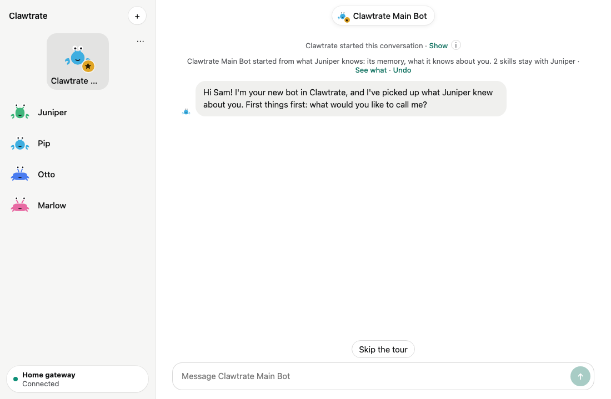
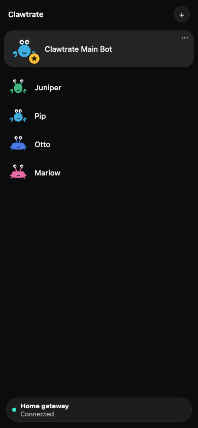
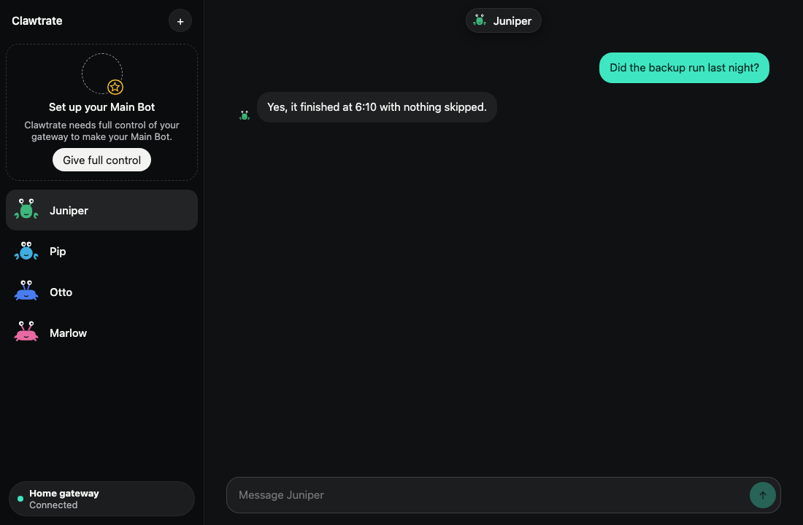
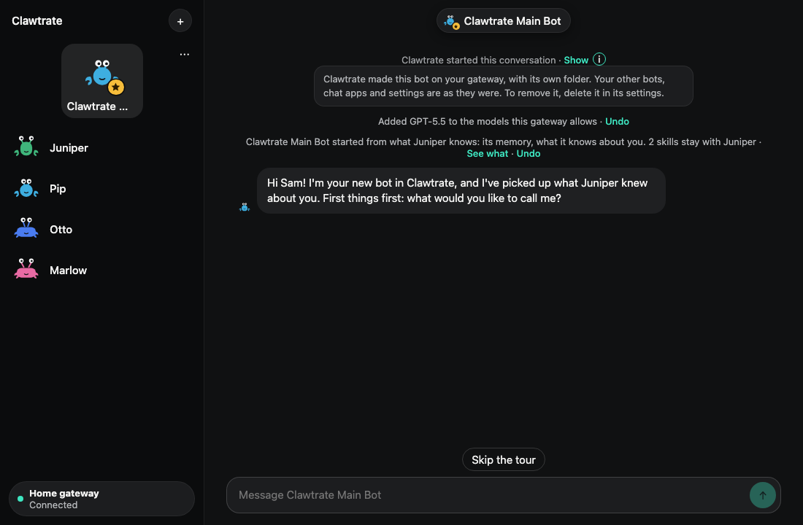
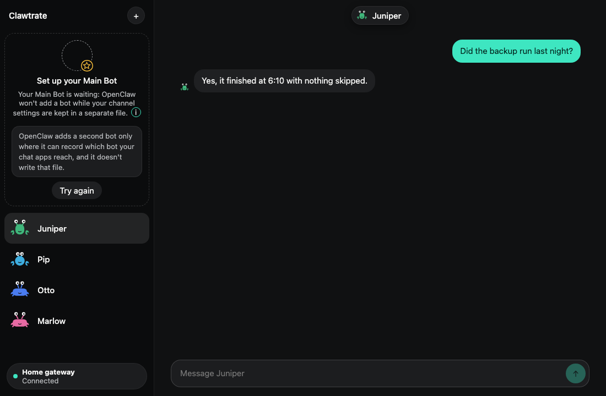
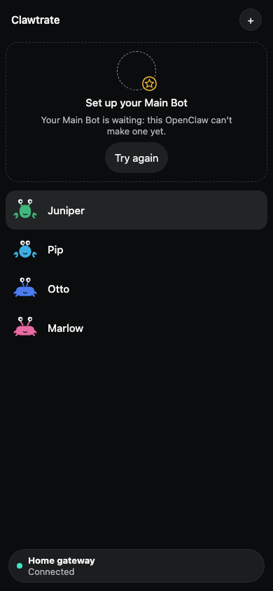
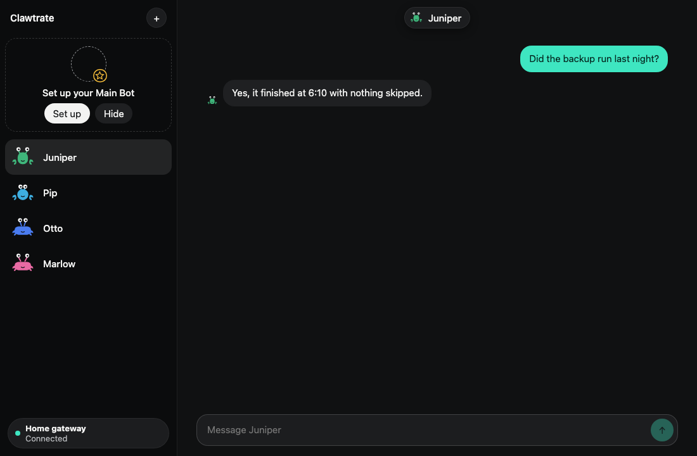
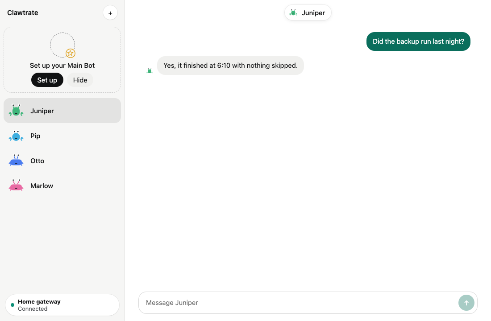
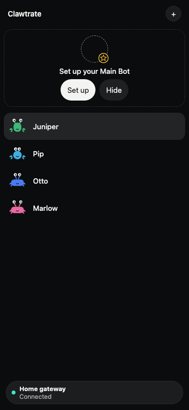
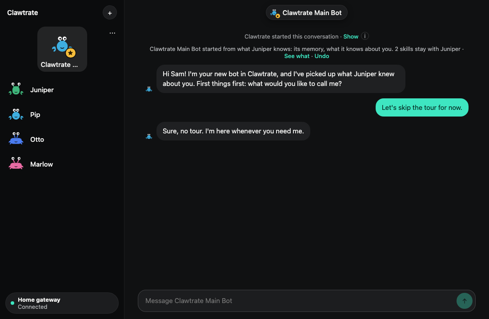

# The Main Bot and its first run

Issue #292, revised for #434. A new person's first minute in Clawtrate is a conversation. Once they connect, Clawtrate makes their Main Bot and the bot says hello. From there the bot leads: it asks what to call it, and the name is taken as they answer; it asks what they'd like help with; and it shows what Clawtrate is by doing a little real work: it starts a task under its own name, so they see a task with its work panel beside the conversation, and hands them what it made as a file. They can skip any of it by saying so, or with one button, and nothing is lost. Nothing in it stops them to read and agree: Clawtrate does each thing, shows what it did and offers Undo, and asks only for the few things that can't simply be undone (section 5). They end with a named Main Bot, starred and pinned first, that knows it lives in Clawtrate.

**How facts are marked.** _(on `main`: file:line)_ is code or a checklist row on `main` today. _(OpenClaw, both)_ is the source or docs of OpenClaw 2026.10.6 and 2026.11.10, each read; section 14 gives the file and line for each version. _(run)_ is a run on a development gateway, in section 14. _(proposed)_ is this design, not built. A statement with no mark is the design's own wording of what a screen says.

It stands on:

- **Connecting** (`docs/design/setup-effortless.md`): local connect for OpenClaw on this computer, whose pieces are on `main` and off in every host _(on `main`: `apps/desktop/src/setup/local-connect.ts:12`)_, the next setup pull request; #653, a first pairing asking once for everything (on `main`); #658 and #665, approving a waiting device from inside Clawtrate (in build).
- **Bots know Clawtrate by default** (#643; always on since #795, with no switch): Clawtrate's guide in every bot's instructions with nothing asked. #666, a bot knowing that _this_ conversation is in Clawtrate.
- **Tasks a bot starts** (#532, on `main`): a task the bot starts under itself (F-565), the card where it was asked (F-587), and the guide that tells it how (F-566). **Files and pictures in the conversation** (F-115, F-535, on `main`, on both versions since #661).
- **What stays out of view** (#490, #491, on `main`; #314, #433): the gateway's own bot, other tools' sessions and channel chats.
- **"Doing, not asking"** (`docs/decisions.md`, and its inventory `docs/design/doing-not-asking.md`, #673, on `main`): the rule this design follows, and the one rule for a bot taking a name.
- **How a bot knows and acts on the app** (`docs/design/bots-in-clawtrate.md`, #669, on `main`): the tools a bot has and what happens with each change. This design is the first run's script and screens; where the first run needs a tool, section 3 names it as that design's.
- **A message the gateway couldn't run** (#663, being fixed in #686): the line, the reason and Try again that the first run's opening builds on.
- **Bringing an existing OpenClaw in** (#495, `docs/design/bring-your-openclaw.md`, draft; issue #487): what the Main Bot can start from on a gateway that already has bots. Section 3 says where the first run hands over to it.
- **#257, #246 and #147** (drafts): New bot's create handling and the bot's identity. Section 9 says what is taken from each.

The evidence is [`docs/research/bot-self-management.md`](../research/bot-self-management.md), findings R1 to R45, and section 14, which re-checks every fact the first run relies on against OpenClaw 2026.11.10. The prototype is [`prototype/main-bot.html`](prototype/main-bot.html); section 11 lists its states.

## The first run, start to finish

### What the person does

Two starting points: OpenClaw already runs on this computer (the usual case), or there is no OpenClaw yet. A click is a press in Clawtrate; "typed" is something typed into a setup field or a terminal; an approval is a request the gateway's owner must approve; a read-and-agree screen is one whose only job is to be read and accepted. Answers typed to the bot in the conversation are counted apart, since they are the conversation.

**OpenClaw runs on this computer**

| Step | What happens                                                                                                                                                                                   | Clicks         | Typed | Approvals | Mark                                                                                                                               |
| ---- | ---------------------------------------------------------------------------------------------------------------------------------------------------------------------------------------------- | -------------- | ----- | --------- | ---------------------------------------------------------------------------------------------------------------------------------- |
| 1    | Clawtrate opens on "OpenClaw is running on this Mac" with **Connect**.                                                                                                                         | 1              | 0     | 0         | proposed in `setup-effortless.md` §3; OpenClaw approves a first loopback pairing that asks for all six silently _(OpenClaw, both)_ |
| 2    | The bots load. Clawtrate makes the Main Bot: a tile with the gold star at the top of the sidebar, above the person's bots. Its conversation opens.                                             | 0              | 0     | 0         | proposed (section 4); the calls are New bot's _(on `main`)_                                                                        |
| 3    | The Main Bot says hello and asks what to call it.                                                                                                                                              | 0              | 0     | 0         | proposed (section 3)                                                                                                               |
| 4    | The person answers. The name is taken at once: the tile, the header and "Message Maple" change, with **Undo** beside it.                                                                       | 0              | 0     | 0         | "Doing, not asking" (`docs/decisions.md`); built by #687                                                                           |
| 5    | The bot asks what they'd like help with, and they answer.                                                                                                                                      | 0              | 0     | 0         | proposed                                                                                                                           |
| 6    | The bot shows how it works: it starts a small task under its name and says so. The task appears in the sidebar under Maple and as a card in the conversation; its result comes back as a file. | 0 (open it: 1) | 0     | 0         | F-565, F-587, F-115 _(on `main`)_; whether the bot does it is its model's (section 3)                                              |
| 7    | The bot says what's next. The person has a named Main Bot, starred and pinned first.                                                                                                           | 0              | 0     | 0         | proposed                                                                                                                           |

So: **1 click to a named Main Bot that has said hello**, nothing typed into setup, no approval, no read-and-agree screen. That click, Connect, is the one thing asked, because it lets this device control the gateway. The name and what to help with are two answers typed to the bot, both optional; the tour adds no click.

On `main` today the same person types the address and token under Advanced, since "This computer" declines every version _(on `main`: `apps/desktop/src/setup/look.ts:130`)_, presses Connect, and approves three access requests, each with `openclaw devices approve` in a terminal: at the first send, the first admin action and the first visit to Machines. No Main Bot is made: the gateway's own bot wears the star _(on `main`: F-015)_.

**No OpenClaw yet**

| Step | What happens                                                                                                                                                                | Clicks                  | Typed | Approvals | Mark                                                                                                    |
| ---- | --------------------------------------------------------------------------------------------------------------------------------------------------------------------------- | ----------------------- | ----- | --------- | ------------------------------------------------------------------------------------------------------- |
| 1    | "Clawtrate didn't find OpenClaw here", with **Set up OpenClaw here**, which says on the same card what it installs and that it keeps running.                               | 1                       | 0     | 0         | proposed for #244 (draft): its separate explanation screen goes (below)                                 |
| 2    | The computer's own dialog asks once: install OpenClaw and its background service.                                                                                           | 1                       | 0     | 0         | #244's dialog, kept: it installs a program that keeps running                                           |
| 3    | It installs (40 to 60 seconds) and connects by itself to the gateway it just set up.                                                                                        | 0                       | 0     | 0         | proposed: #244 offers Connect after the install; the person already said yes                            |
| 4    | The Main Bot is made and its conversation opens with Clawtrate's own line: the bot needs a model account to talk, and the sign-ins the gateway offers, subscriptions first. | 1 + the provider's page | 0     | 0         | proposed (section 2); the sign-ins are `bots.md` §5's _(on `main`: `packages/ui/src/bots/Connect.tsx`)_ |
| 5-9  | As steps 3 to 7 above.                                                                                                                                                      | 0                       | 0     | 0         |                                                                                                         |

So: **3 clicks in Clawtrate and the provider's own sign-in page** to a named Main Bot. Each click is one of the few things that ask: installing OpenClaw changes the computer, the dialog is the computer's own, and signing in hands the gateway an account. A sign-in that finishes in a browser on this computer needs nothing typed in Clawtrate; the provider's page asks for what it asks. An API key, typed once, is the last of the options, never the first.

**OpenClaw they already run**, brought by Connect, one-click Connect or a setup code (section 15): the first table from step 2 on, with no account step when the gateway has one. Their bots are in the sidebar from the first moment, below the Main Bot, as they were, the gateway's own bot among them once they have used it. Someone who used Clawtrate with that gateway before gets no first run by itself: a tile at the top of the sidebar offers it once (section 15.7).

**What the reviewed design asked, for comparison.** On both starting points it added a read-and-agree step, "How should bots run commands?" with two cards, nothing chosen and a sheet to read; a form card under the greeting with three fields (a name, a picture, how it should help) and Save; and an opening message sent in the person's name. On a gateway with other bots, a separate card then offered to start from what one of them knows, and a sheet asked which parts to bring. That is 5 to 7 clicks, 2 typed fields and 3 read-and-agree screens beyond Connect. This revision has none of them. Section 5 lists every prompt the reviewed design had and what each became.

### The conversation

As it usually goes, with what the app does in brackets. The bot is a real bot on the person's gateway, on their model, so its words vary; section 3 says what the app guarantees whatever it says.

> _[Clawtrate makes the Main Bot and opens its conversation. A quiet line at the top: "Clawtrate started this conversation · Show".]_
>
> **Clawtrate Main Bot:** Hi! I'm your new bot in Clawtrate. First things first: what would you like to call me?
>
> **You:** Maple
>
> _[The name is taken. The tile, the header and the composer's "Message Maple" change once the gateway reads it back. Under the reply: "Renamed to Maple · Undo".]_
>
> **Maple:** Maple it is. What would you like a hand with? Anything from your week to your code.
>
> **You:** Keeping my week organised, and some coding.
>
> **Maple:** Got it, I'll remember that. To show you how I work here, I've started a task that puts a starter checklist for your week together while we keep talking. You can watch it under my name in the sidebar, and stop or archive it there if you don't want it.
>
> _[A "Started a task" card, "Week checklist", Working. In the sidebar the task appears under Maple. Opening it shows "Maple started this task from Main" and the work as it happens.]_
>
> **Maple:** It's done. Here's the checklist. You'll find the task under my name whenever you want it.
>
> _[A file card: "week-checklist.md", its size, Save.]_
>
> **Maple:** That's the tour. Ask me anything, or ask me to start something in its own task.

Above the composer, until the tour ends, one button: **Skip the tour**. It sends "Let's skip the tour for now." as the person's message; anything else they write works the same way. Section 3 has the brief the bot is given, what happens when it does something else, and the timings.

### What changed from the reviewed design, and why

Each is a place where the design as written conflicted with the direction set since: Clawtrate does not prompt (it does the thing, shows it and offers Undo, and asks only for what is destructive), connecting takes one click, bots know the app by default, and the bot introduces Clawtrate in conversation.

1. **The bot speaks first.** The reviewed design sent a fixed message in the person's name ("Hi! I just set up Clawtrate. What should I call you…", F-006) and the bot answered it. Now the first thing the person sees is the bot's hello. Clawtrate's brief to the bot is still the conversation's first input, since a run needs one, but it is drawn as a quiet line, "Clawtrate started this conversation", with **Show**, never as the person's message (section 3).
2. **No form.** The guided card (Name, Picture, How should it help?, Save) is gone. The bot asks, the person answers, and the app acts on the answer.
3. **A name is taken as it's given, everywhere.** No card, no Save, no setting: a name a bot writes for itself is taken at once and shown with **Undo**, in the first run and after, by the one rule in `docs/decisions.md` ("Doing, not asking"), which also says what the line under it says. This design adds nothing to that rule (section 3).
4. **The picture is a default.** The Main Bot wears the Claw its name gives it (#302's name Claw), changed with the name, with nothing asked.
5. **What it helps with is the bot's to remember.** The bot writes it in its own `USER.md`, the file OpenClaw keeps for what a bot knows about its person _(OpenClaw, both: `docs/reference/templates/USER.md`)_. Clawtrate writes nothing for it and asks nothing.
6. **No question about how bots run commands, and no command setting yet.** "How should bots run commands?" is gone from setup, and the first run writes no command mode. On a gateway nobody has configured, OpenClaw runs every command a bot chooses without asking, and the Main Bot is no different until the command decision lands (#675). What the Main Bot is denied is OpenClaw's own tools for changing OpenClaw: `gateway`, `plugins` and `openclaw` (section 2).
7. **The bot knows it lives in Clawtrate, by default.** Clawtrate's guide is in the Main Bot's instructions from the moment it is made, with nothing asked (#643). The reviewed design relied on Clawtrate's card for the name because the bot couldn't be relied on; now the bot leads, and the app guarantees only what it drives.
8. **Clawtrate shows itself by doing.** New: a task under the bot's name with its work panel, and a file the task made, handed over in the conversation (section 3). The tour asks the person for nothing.
9. **Connecting is one click on this computer.** The reviewed design assumed full control from the pairing; it now stands on local connect (0 approvals) and #653 (one approval on another computer), and counts the clicks.
10. **A model account is part of the first run.** The reviewed design assumed one. On a gateway with none, signing in is the one step before the hello (section 2); it asks because it hands the gateway an account. The Main Bot's model then follows the account signed in, so the hello runs on a model that account serves.
11. **Starting from what another bot knows is done, not offered.** On a gateway where another bot knows things (#495), the Main Bot starts from its memory and what it knows about the person, brought in right after it is made and before the opening or any message of the person's starts a turn, so it can greet the person already knowing them; Clawtrate's line at the top of the conversation has **See what** and **Undo**. Lines that read like instructions aren't brought, skills don't go to the person's library by themselves, and scheduled jobs aren't moved (section 3).
12. **Changing which bot is the Main Bot happens at once.** Choosing another bot makes it the Main Bot, shown with Undo; no Confirm (section 4).
13. **An opening that fails or isn't confirmed doesn't leave an empty conversation.** One the account can't run on the bot's model goes again on the next model that account lists, and is never resent on the model that failed; one the gateway couldn't run for another reason shows why, with **Try again**; one that isn't confirmed is sent again once by itself (section 3).
14. **The two choices left open are settled.** "While Clawtrate can't make a bot yet" takes its default, the "Set up your Main Bot" tile whose one request is for full control, which asks because it lets the device control the gateway; "the bot already starred" took its default too, a first run on every gateway after the update, which #802 replaces: someone who used Clawtrate with a gateway before is offered the first run once and never has it pushed at them (section 15.7). Section 4 keeps what each alternative would cost.
15. **The proposal cards are withdrawn.** The reviewed design's sections on Clawtrate's bot tools, proposals, Review and save, the "Apply a bot's changes to itself at once" setting and external agents' suggestions rested on a card for every change. A bot's tools and their classes are now `bots-in-clawtrate.md`'s (#669); section 5 says what each prompt became.

### What the rule superseded, and where an earlier decision still pulls against it

- **Superseded, not a choice:** the decision of 2026-11-23 that a bot changing itself asks first on a card by default, with a setting under Settings → Advanced to apply it at once. A bot's own name and picture are now taken at once with Undo, inside and outside the first run, and there is no such setting. Also superseded: the reading of 2026-11-25 that a question is owed wherever a bot gets more freedom. Neither is put back anywhere in this design.
- **Starting from what another bot knows.** On 2026-11-24 every import was to be offered and shown in plain words before anything is saved, each reversible; the rule since makes anything that isn't destructive happen at once. _Chosen:_ memory and what the bot knows about the person are brought in at once, before the opening, and shown with **See what** and **Undo**, which #495 makes real; lines that read like instructions aren't brought, skills don't go to the person's library by themselves, and scheduled jobs are not moved. _Why:_ a copy is fully reversible (Undo removes it, and nothing is taken from the other bot), so it is not destructive; a job keeps acting after the fact, so it is the case the rule says not to do unasked, and moving it stays the person's own switch.

### What is established and what is proposed

Established: every gateway call the first run makes, on both versions (section 14), and the pieces on `main` it reuses: New bot's calls, the name a bot writes being read after its run (F-552), a task a bot starts and its card (F-565, F-587), a file a bot hands over (F-115), the guide's text, the gateway's own bot and other tools' sessions kept out of view (F-562, F-563). Proposed: everything the person sees in this section that `main` doesn't have: the Main Bot made at connect, its tile and star, the hello first, the tour and its skip button, the account step, no command question, the start from another bot, and the clicks above (local connect, #653 and #244's changes are each their own pull request). Whether a real model follows the brief is seen only with a real model: the development gateway's scripted model checks what the app does, not what a model chooses (section 10).

### What is built first

Seven pull requests, in section 13. **The first a person can see and feel is the second, "Your Main Bot says hello"**: after Connect, Clawtrate makes the Main Bot, its tile and gold star appear above the person's bots, and the bot greets them and asks its name. It can start on `main` today and merges after #686, whose line it uses for a failed opening. The first is the test fixture's, which nobody sees. The sign-in step, the tour and the start from another bot follow, each on its own; the name taken at once is being built for every bot by #687.

## Contents

1. What changes
2. Before the bot speaks: connecting, a model account, how bots run commands
3. The first run's conversation
4. The Main Bot
5. Every prompt the design had, and what it became
6. Failure states
7. The iPhone app
8. Parity rows
9. What is taken from #257, #246 and #147
10. For builders
11. The prototype's states
12. Not covered
13. Build order: the pull requests
14. Gateway facts on OpenClaw 2026.10.6 and 2026.11.10
15. A gateway the person brings (#802)

## 1. What changes

| Today                                                                                                 | After                                                                                                                                                          |
| ----------------------------------------------------------------------------------------------------- | -------------------------------------------------------------------------------------------------------------------------------------------------------------- |
| After setup the app opens on the bot list, or on "Make your first bot" for an unused implicit `main`. | Clawtrate makes the Main Bot and opens its conversation. The bot says hello and leads: its name, what to help with, and a short tour by doing.                 |
| Nothing at setup asks how bots run commands (#257's step isn't on `main`).                            | The same: the first run asks nothing about commands and writes no command setting (section 2).                                                                 |
| A bot that takes a name in the chat is renamed once the person confirms it on a card (F-552).         | The name is taken at once and shown with Undo, in the first run and after, by "Doing, not asking" (section 3).                                                 |
| A bot can't change its own settings, except through shell commands.                                   | A bot's tools on Clawtrate, and the class of each, are `bots-in-clawtrate.md`'s (#669). This design uses one of them, for the name, once it is on the gateway. |

## 2. Before the bot speaks: connecting, a model account, how bots run commands

### Connecting

The first run needs full control of the gateway: making a bot is admin (`agents.create`, `agents.files.set`, `config.patch`, `agents.update`, R17) and its conversation needs write (`sessions.create`, `chat.send`) _(OpenClaw, both)_. Giving a device that control is one of the few things that ask, since it lets the device control the gateway: on this computer it is the one Connect click.

- **On this computer**, local connect (`setup-effortless.md` §3) proves the gateway on this computer is this account's own, asks for all six scopes in the first hello and OpenClaw approves it silently: 1 click, 0 approvals. Its pieces are on `main` and off in every host _(on `main`: `apps/desktop/src/setup/local-connect.ts:12`)_. Until it ships, a typed loopback address pairs read-only and steps up three times, each by command (#653's count).
- **On another computer**, a `wss://` address asks once for all six, and the gateway's owner approves once (#653). With another Clawtrate already connected with full control, that approval is one click in it (#658, #665).
- **With no OpenClaw**, #244 sets it up. This design asks of #244 only what the counts above need: the facts on the not-found card itself, the computer's own dialog as the one question, and Connect by itself once the install's gateway is found.
- **Without full control** (a device that paired with less, a host without secure storage, a narrower grant its owner chose), the top of the sidebar is the "Set up your Main Bot" tile with **Give full control**, #418's one request (section 4). The first run waits for it.

### A model account

The bot can't say hello without a model it can reach. Clawtrate decides this from what the gateway reports, never by trying a turn:

- The Main Bot is made with the gateway's default model, as New bot's "Let the gateway choose" does (`bots.md` §4). Right after, Clawtrate reads `models.authStatus {agentId: "clawtrate-main-bot", refresh: true}` _(on `main`: `packages/core/src/accounts-engine.ts:512`)_. When it lists an account for that model's provider whose state needs no sign-in (`bots.md` §7's state words), nothing is asked and the opening is sent.
- **When it doesn't**, the conversation opens with Clawtrate's own message, drawn as the app's, not the bot's: "Before your Main Bot can talk, it needs an account with a model provider. Sign in with one you already have. Your gateway keeps the sign-in; Clawtrate never sees your password." Under it, the gateway's sign-in methods as `bots.md` §5 lists them, subscriptions first, each one click; an API key is last. The sign-in is started for the gateway's own bot when its folder is the gateway's shared one, so every bot can use the account, and for the Main Bot otherwise (`bots.md` §5, "Which store a sign-in lands in"). When the account reads back, the line becomes "Signed in with <provider>.", and **the Main Bot's model follows the account** _(proposed)_: when the Main Bot's model isn't one that account serves, Clawtrate sets it to one that is, by the rule New bot uses for a chosen account (`bots.md` §4, "Once a choice is made"), and writes it as changing a bot's account does (`bots.md` §11), at once, with §11's line in the conversation. That line has no Undo, since the model before is one no account serves; the Main Bot's Model and Account settings change it, as for any bot. The opening is sent only once the Main Bot's model is one a connected account serves, so it never goes on a model the new sign-in can't run (#663).
  - **The default model was already served** by an account the gateway has: there is no sign-in step at all (above), and nothing changes.
  - **The person signs in to two providers**: the first eligible account wins, eligible meaning it has read back and serves a model the gateway lists (an account of the next case isn't eligible, and the person signs in with another). It sets the model and the opening goes. A later sign-in changes nothing about the Main Bot. That account is the gateway's like any other, and the person can move the Main Bot to it in its settings (`bots.md` §11).
  - **No model the gateway lists is served by the new account** (the provider's models aren't on the gateway's list): nothing is sent and the model isn't changed; Clawtrate's line says "Your gateway has no <Provider> model your Main Bot can use. Sign in with another account." and the sign-ins stay under it.
- A gateway #244 set up always has none, since its onboarding skips the account (`setup.md` §10). A gateway the person already used usually has one.

### How bots run commands, and what the Main Bot can't use

**Commands.** Nothing is asked and no command mode is written _(proposed)_. On a gateway nobody has configured, OpenClaw runs every command a bot chooses, as the computer's user, without asking: `exec.security` defaults to `full` for gateway and node hosts, and `exec.ask` to `off` _(OpenClaw, both: `docs/tools/exec-approvals.md` lines 229 and 238 on 2026.10.6, 277 and 286 on 2026.11.10)_. The Main Bot is no different, as every bot New bot makes on `main` is no different, until the decision on commands lands: `docs/design/doing-not-asking.md` section 3 is its proposal and #675 its security review. Where the person has set a command mode for the whole gateway, the Main Bot inherits it; bots the gateway already had keep theirs. Until #675, nothing in the first run changes OpenClaw's approval for a command ("Doing, not asking").

**OpenClaw's own tools for changing OpenClaw.** The Main Bot is made with `tools.deny: ["gateway", "plugins", "openclaw"]` on its own entry, written in the same `config.patch` as its fallbacks (section 3, step 1) _(proposed)_. The `gateway` tool can update OpenClaw and is in OpenClaw's own tool profiles (`docs/gateway/config-tools/tool-policy.md` lines 36-37, both versions); the `plugins` tool installs and turns on plugins (`docs/plugins/manage-plugins.md` line 327 on 2026.10.6, 335 on 2026.11.10); the `openclaw` tool applies any config change, bindings and owner included, without asking when commands run unasked (`docs/cli/openclaw.md` lines 120-123 on both versions; R12). Changing OpenClaw itself is one of the things that ask, and moving a channel is one this design promises never happens (section 4), so a bot Clawtrate makes doesn't get those tools. The deny tightens a bot Clawtrate just made and loosens nothing. It is the deny `bots-in-clawtrate.md` section 3 relies on for bots Clawtrate makes, and the one `doing-not-asking.md` section 3.5 lists. It doesn't reach commands: a command can still run `openclaw` itself, and that is #675's.

## 3. The first run's conversation

### What the app does, in order

1. **Makes the Main Bot** with New bot's calls (section 4): `agents.create {name: "Clawtrate Main Bot", model}`; its `IDENTITY.md` with the Main Bot lines, written held to the hash Clawtrate read or, when the gateway made no `IDENTITY.md`, held to its absence, as New bot writes it _(on `main`: `packages/core/src/accounts-engine.ts:1684-1689`)_, which also ends OpenClaw's own first-run script (R37); its fallbacks and the deny of section 2 in one `config.patch`, which on a gateway whose model allowlist names exact models and not the Main Bot's also adds that model to the list, with #799's line and Undo (section 15.5); and its main conversation, `sessions.create {key: "agent:clawtrate-main-bot:main", agentId, label: "Main"}` with no message, as New bot makes a bot's first task _(on `main`: `packages/core/src/client.ts:1792-1799`)_. Clawtrate's guide goes into its `AGENTS.md` right after, by #643's path for a bot just made, once #643 lands.
2. **Draws it**: the tile with the gold star above the person's bots, the conversation open, and the working line under it (F-081) from that moment until the hello, so the wait is never silent. The composer is usable throughout. On a gateway where another bot knows things, it brings that in now ("Starting from what another bot knows", below), and a message the person sends meanwhile waits for it to end (below).
3. **Checks the model account** (section 2), and signs in first when there is none.
4. **Sends the opening**: Clawtrate's brief (below) to the main conversation with `chat.send {sessionKey, message, idempotencyKey: "<createdAt>:opening:<attempt>"}` (R33), once, as "The opening's delivery" says. **If anyone writes first** (the person, between the conversation opening and the opening being sent, or anything a read of the main conversation shows there just before the send), Clawtrate doesn't send the opening at all: that message is the conversation's first input, the guide in the bot's instructions still tells it where it is, and there is no tour.
5. **Follows the conversation**, acting only on what the gateway reports: a name the bot wrote (taken at once, below), a task it started (its card and its row under the bot), a file it handed over (the file card), a message the gateway couldn't run (below).
6. **Ends the tour** (below), and leaves the Main Bot as an ordinary conversation.

### Clawtrate's brief to the bot

The first message of the main conversation: fixed text, public like the guide, one version per pull request so that no release tells a bot about something the app doesn't do yet. It is the run's own input, so it reaches the bot exactly once and is gone from its later turns except as history. Each version is written out in full here, and each is held in core as one exact string; no release changes or removes a published version (below).

**Version 1, from pull request 2** (the Main Bot says hello; a name the bot writes still gets F-552's card on `main` until #687 lands):

```text
[Clawtrate] Clawtrate made you a moment ago as this person's Main Bot, and this is your first conversation. They haven't written yet, so say hello first.

Ask what they'd like to call you. When they answer, write that name on the "- Name:" line of your IDENTITY.md and change nothing else there.

If they want to skip that, or ask for something else, help with that instead. Don't ask them to set anything up, and don't mention this message.
```

**Version 2, from #687** (a name the bot writes is taken at once, for every bot):

```text
[Clawtrate] Clawtrate made you a moment ago as this person's Main Bot, and this is your first conversation. They haven't written yet, so say hello first.

Ask what they'd like to call you. When they answer, write that name on the "- Name:" line of your IDENTITY.md and change nothing else there. Clawtrate shows it at once.

If they want to skip that, or ask for something else, help with that instead. Don't ask them to set anything up, and don't mention this message.
```

**Version 3, from pull request 4** (the tour):

```text
[Clawtrate] Clawtrate made you a moment ago as this person's Main Bot, and this is your first conversation. They haven't written yet, so say hello first.

Lead, one short message and one question at a time:
1. Ask what they'd like to call you. When they answer, write that name on the "- Name:" line of your IDENTITY.md and change nothing else there. Clawtrate shows it at once.
2. Ask what they'd like help with. Before you look anything up, add one short note of what they said at the end of your USER.md, and leave the rest of the file as it is.
3. Show them how you work in Clawtrate: start one task with sessions_spawn and visible: true, with a short label and a full brief, that makes something small and useful for what they said they want help with and saves it as a file. Tell them in a sentence that you started it, that they can watch it under your name in the sidebar, and that they can stop or archive it there. When its result comes back, hand them the file with a MEDIA: line.
4. Then tell them they can ask you anything, or ask you to start something in its own task.

If they want to skip, or ask for something else at any point, stop the tour and help with that. Don't ask them to set anything up, and don't mention this message.
```

**Version 3a, from pull request 4, for a bot without `sessions_spawn`** in its effective tools (which F-566 already reads):

```text
[Clawtrate] Clawtrate made you a moment ago as this person's Main Bot, and this is your first conversation. They haven't written yet, so say hello first.

Lead, one short message and one question at a time:
1. Ask what they'd like to call you. When they answer, write that name on the "- Name:" line of your IDENTITY.md and change nothing else there. Clawtrate shows it at once.
2. Ask what they'd like help with. Before you look anything up, add one short note of what they said at the end of your USER.md, and leave the rest of the file as it is.
3. Then tell them they can ask you anything.

If they want to skip, or ask for something else at any point, stop and help with that. Don't ask them to set anything up, and don't mention this message.
```

**Versions 4 and 4a, from pull request 5** (starting from another bot), on a gateway where the Main Bot started from what another bot knows: versions 3 and 3a with this paragraph after the first one, each published by pull request 5 as one full string: "Clawtrate started you from what <Juniper>, another of their bots, knows about them. Use it, and don't ask what you already know." The other bot's name is the only part that varies. Should pull request 5 land before pull request 4, it publishes the paragraph with the version then in force, in full, as its own version.

Nothing in the tour waits for a yes. The brief tells the bot to start the task and say that it did and how to remove it, as "Doing, not asking" (`docs/decisions.md`) and the task guide's row B16 (`doing-not-asking.md`, "start one and say so") have it; a bot asks first only before something destructive, which the tour never does.

The brief names no tool of Clawtrate's: step 1 is a file every bot can write. Once `bots-in-clawtrate.md`'s `clawtrate_identity` is on the gateway, step 1 names that tool instead, as a new version.

### How Clawtrate knows its own brief

A row of the main conversation is drawn as the quiet line "Clawtrate started this conversation · Show" only when all three hold, on any device, after any reinstall:

- every user row before it in the Main Bot's main conversation is itself an opening drawn this way (so it is the first, or follows only Clawtrate's own earlier attempts: the one resend, a resend on the account's next model, a Try again, or an opening sent twice);
- its key is the opening's, `<createdAt>:opening:<attempt>:user`, for the `createdAt` `agents.list` gives that bot (the stored row carries the send's key with `:user`, on both versions, section 14);
- its text is, word for word with runs of whitespace collapsed, one of the published versions of the brief above, with the variable paragraph's bot name one `agents.list` lists or the one #495's record of that bring-in names, since the other bot can be renamed or deleted afterwards.

No release changes or removes a published version, so every later build recognises every earlier brief. A first row under the opening's key for that bot's `createdAt` whose text begins `[Clawtrate] ` but isn't a version this build knows (a brief from a newer release, read on an older device) is drawn in full, not collapsed and never as the person's, under "Sent to your Main Bot when it was made"; since it hides nothing, it can't be used to hide anything.

Anything else is drawn as what it is: a row someone else sent under the opening's key, with other words, is a message like any other, never Clawtrate's line. So a second device, or this one after a reinstall, draws Clawtrate's brief as the quiet line with no record of having sent it; and anyone able to write to the conversation can make Clawtrate hide only the brief's own public text. On both versions the first send under a key owns it: a second send with other text is refused ("This message ID was already used for different input"). When Clawtrate's own opening is refused that way, the opening is **taken**, not unknown: Clawtrate sends nothing more, and its line says "Someone else wrote first in this conversation, so Clawtrate didn't send its first message."

### Taking the name

A bot taking a name is one rule, written once: `docs/decisions.md`, "Doing, not asking", with each case in `bots-in-clawtrate.md` sections 3 and 4 and the conversion in `doing-not-asking.md` (B1). That rule says when the name is applied, what the line under it says ("Renamed to Maple · Undo", or the bot's own doing, with where it came from when Clawtrate knows), its limits, which device applies it and how Undo works. It is being built for every bot by #687, `doing-not-asking.md`'s first pull request. This design adds nothing to it. The first run's part is the brief's step 1, which asks the bot to write the name the person gives, and the line, which appears under the bot's reply as anywhere else.

### What the brief's note does to `USER.md`

OpenClaw keeps one trust record for a bot's `USER.md` and `MEMORY.md`. A write by the bot's own file tools records `agent` only when the turn is the owner's and nothing in it came from the network; otherwise `untrusted`, and once `untrusted` the file stays so, and OpenClaw leaves it out of every task's start _(OpenClaw, both: `dist/agent-tools-BcX3RaIU.mjs:468` and `dist/bootstrap-files-Clmbh8CQ.mjs:171-206` on 2026.10.6; `docs/concepts/memory-provenance.md` lines 276-287 on 2026.11.10)_. A turn sent from a connection with `operator.admin` counts as the owner's (`dist/chat-send-handler-D_7lP5Io.mjs` lines 4384 and 5639 on 2026.10.6; the same in 2026.11.10's `chat-send-handler`). On development gateways of both versions, the first run's order (Clawtrate's write before the opening, then the bot's own note in a later turn sent with full control) kept `USER.md` in every task's start. Three things drop it. The app enforces the guards for the second and third; the first is only the brief's instruction to the bot:

| What drops it                                                                                                | What the first run does                                                                                                                                                                                                                                                                                                                                                                                                                      |
| ------------------------------------------------------------------------------------------------------------ | -------------------------------------------------------------------------------------------------------------------------------------------------------------------------------------------------------------------------------------------------------------------------------------------------------------------------------------------------------------------------------------------------------------------------------------------- |
| A web lookup in the same turn, before the bot's write                                                        | The brief tells the bot to add its note before it looks anything up. That is all: a bot that looks something up first still drops the file, and Clawtrate can't tell that it happened.                                                                                                                                                                                                                                                       |
| A turn sent from a device without full control (a phone or a second computer paired for reading and writing) | While the first run's questions are open (the Main Bot made less than ten minutes ago, by the gateway's clock), such a device shows the conversation and, in place of the composer, "You can write to your Main Bot here once it's set up." Its question is answered on a device with full control. After those ten minutes the composer comes back, and an answer written there then drops the file as before.                              |
| A write from outside after the bot has written the file                                                      | Clawtrate writes `USER.md` only during the start from another bot (below), which every turn waits for until its 10-second timeout. A write of it still unanswered then can land after a turn has started, but only while the file is as Clawtrate read it, so never after the bot's own note. After the bot's first note, nothing in the first run writes it from outside, and #495 sends any later removal through the Main Bot's own turn. |

The brief also tells the bot to add its note at the end and leave the rest of the file as it is, so what #495 brought in, and its Undo, stay intact. Clawtrate can't see the record itself: no gateway method on either version reports it.

### When the bot does something else

The bot is the person's, on their model; its words can't be fixed. The app guarantees what it drives, whatever the bot says:

| What happens                                                                          | What the person sees                                                                                                                                                                                                                                                                                                                                                                                                                                                                                                                                                                                                                                                                                                                                                                                                                                                                                                                                                                                                                                                                                                                                                                                                                                                                                                                                                                                                                                                                                                                                                                                                                                                                                                                                                                                                                                                                                                                                   |
| ------------------------------------------------------------------------------------- | ------------------------------------------------------------------------------------------------------------------------------------------------------------------------------------------------------------------------------------------------------------------------------------------------------------------------------------------------------------------------------------------------------------------------------------------------------------------------------------------------------------------------------------------------------------------------------------------------------------------------------------------------------------------------------------------------------------------------------------------------------------------------------------------------------------------------------------------------------------------------------------------------------------------------------------------------------------------------------------------------------------------------------------------------------------------------------------------------------------------------------------------------------------------------------------------------------------------------------------------------------------------------------------------------------------------------------------------------------------------------------------------------------------------------------------------------------------------------------------------------------------------------------------------------------------------------------------------------------------------------------------------------------------------------------------------------------------------------------------------------------------------------------------------------------------------------------------------------------------------------------------------------------------------------------------------------------ |
| The account doesn't serve the bot's model (an account of the wrong kind for it, #663) | Clawtrate never sends the opening again on the model that just failed. It tells this failure from the others by what the gateway sends, as #686 does: a reason #686's rule reads as the account being unable to run this model (#686's `packages/core/src/not-run.ts`); any other reason, or none, is the next row. Clawtrate then sets the Main Bot to the next model that account lists (the next of that provider's models in the gateway's list, the order `bots.md` §4 takes the first from), written as changing a bot's model is (`bots.md` §11), with `config.patch {baseHash}` from the read that found the failed model (R23), so a choice the person makes in between is never overwritten: on a conflict the person's choice stands and the walk stops. It says so under the quiet line, where the failure shows: "Your account couldn't run <model>, so your Main Bot now uses <next model>." It sends the opening again once on that model, with the next attempt number (section 3, "The opening's delivery") in its key and the brief's current version, outside the one automatic resend below. A further failure of the same kind moves to the next listed model the same way: the walk goes through the account's list at most once and never returns to a model that failed. When no listed model is served, nothing more is sent, and the row shows #686's line for a message the gateway couldn't run, with its reason in #686's words, **Change model** and **Change account**, and no **Try again**. The walk is the opening's only, and never overrides a person's own choice: before each step Clawtrate reads the Main Bot's model, and when it is no longer the one that failed (the person chose another meanwhile, or does so later), or the write meets a conflict, the walk ends and changes nothing more; the row then shows #686's line with its actions. A later turn that fails is #686's, as in any conversation. |
| The gateway couldn't run the opening for any other reason                             | Under the quiet line, #686's line for a message the gateway couldn't run: "The gateway couldn't run this message", the reason in plain words when the gateway gave one (on 2026.11.10, after a reload or on another device, "The gateway didn't say why.", since that version keeps no reason for a message it failed before any run, #686), and **Try again**, with #686's other actions. It shows as soon as the gateway says the run failed, not after a timer. **Try again** is the person's own press: it sends the opening once more as a new attempt, outside the one automatic resend below, with the next attempt number in its key (`<createdAt>:opening:<n>`, "The opening's delivery") and the brief's current version; #686's own Try again, which resends a message as it was, isn't used for this row. Until #686 lands, pull request 2 builds on it.                                                                                                                                                                                                                                                                                                                                                                                                                                                                                                                                                                                                                                                                                                                                                                                                                                                                                                                                                                                                                                                                                   |
| The model is slow                                                                     | The working line, as for any reply (F-081). After 45 seconds with a run going and no reply: Clawtrate's line "Your Main Bot hasn't answered yet." with **Stop**.                                                                                                                                                                                                                                                                                                                                                                                                                                                                                                                                                                                                                                                                                                                                                                                                                                                                                                                                                                                                                                                                                                                                                                                                                                                                                                                                                                                                                                                                                                                                                                                                                                                                                                                                                                                       |
| The model fails mid-run (an account error, a rate limit)                              | The run's error as any conversation shows it (#686). Nothing is resent by itself.                                                                                                                                                                                                                                                                                                                                                                                                                                                                                                                                                                                                                                                                                                                                                                                                                                                                                                                                                                                                                                                                                                                                                                                                                                                                                                                                                                                                                                                                                                                                                                                                                                                                                                                                                                                                                                                                      |
| It doesn't ask for a name, or never writes one                                        | Nothing breaks. The Main Bot keeps "Clawtrate Main Bot" until the person names it, by asking it or with Rename in its settings. Its tile, star and place don't depend on a name.                                                                                                                                                                                                                                                                                                                                                                                                                                                                                                                                                                                                                                                                                                                                                                                                                                                                                                                                                                                                                                                                                                                                                                                                                                                                                                                                                                                                                                                                                                                                                                                                                                                                                                                                                                       |
| It writes a name the person didn't give                                               | "Doing, not asking" (above): taken, shown as the bot's own doing, with Undo.                                                                                                                                                                                                                                                                                                                                                                                                                                                                                                                                                                                                                                                                                                                                                                                                                                                                                                                                                                                                                                                                                                                                                                                                                                                                                                                                                                                                                                                                                                                                                                                                                                                                                                                                                                                                                                                                           |
| It skips the tour, or does only part of it                                            | Nothing is missing that the person needs. The skip button goes when the tour ends (below).                                                                                                                                                                                                                                                                                                                                                                                                                                                                                                                                                                                                                                                                                                                                                                                                                                                                                                                                                                                                                                                                                                                                                                                                                                                                                                                                                                                                                                                                                                                                                                                                                                                                                                                                                                                                                                                             |
| It goes off course, or refuses                                                        | The conversation is the person's: whatever they write next is a normal message. The brief is never sent again by itself.                                                                                                                                                                                                                                                                                                                                                                                                                                                                                                                                                                                                                                                                                                                                                                                                                                                                                                                                                                                                                                                                                                                                                                                                                                                                                                                                                                                                                                                                                                                                                                                                                                                                                                                                                                                                                               |
| It starts more than one task                                                          | The tour ends at the first started task's result; any other task is an ordinary one.                                                                                                                                                                                                                                                                                                                                                                                                                                                                                                                                                                                                                                                                                                                                                                                                                                                                                                                                                                                                                                                                                                                                                                                                                                                                                                                                                                                                                                                                                                                                                                                                                                                                                                                                                                                                                                                                   |
| The bot can't start tasks                                                             | Step 3 isn't in its brief (above); if a start fails anyway, the bot says so in its reply.                                                                                                                                                                                                                                                                                                                                                                                                                                                                                                                                                                                                                                                                                                                                                                                                                                                                                                                                                                                                                                                                                                                                                                                                                                                                                                                                                                                                                                                                                                                                                                                                                                                                                                                                                                                                                                                              |
| The person leaves, or closes the app                                                  | Everything stays as it was: the conversation, the name, a task that is running. Coming back opens the Main Bot's conversation where it was.                                                                                                                                                                                                                                                                                                                                                                                                                                                                                                                                                                                                                                                                                                                                                                                                                                                                                                                                                                                                                                                                                                                                                                                                                                                                                                                                                                                                                                                                                                                                                                                                                                                                                                                                                                                                            |

### Skipping and stopping

- **Skip the tour**, one button above the composer while the tour runs, sends "Let's skip the tour for now." as the person's message, shown as theirs, since they pressed it. The button goes. Writing anything else does the same in the person's own words.
- **Stop** stops the reply in progress, as in any conversation. A command that already ran isn't undone.
- **Nothing is lost** either way: a name taken stays, a task started keeps running and stays under the bot, and the bot keeps what it noted.
- The tour ends, and the button goes, when the person presses it, when a task the Main Bot started from this conversation has handed back its result, when the person opens another bot or task, or after ten minutes. Which of these happened is kept on this device for that gateway and that Main Bot (its id and `createdAt`), so the button never comes back.

### Where it ends

The person is left with a Main Bot that has their name for it and its Claw, the gold star and the tile at the top of the sidebar; its main conversation, with the tour in it; Clawtrate's guide in its instructions; what it helps with in its `USER.md`; and, when the tour ran, one task under its name with a file. On a gateway with other bots, they stay below, as they were.

### Starting from what another bot knows

This is where the first run hands over to #495, whose design says which bot, what counts, what is copied and left out, and how each part is removed; this design states only what the first run needs. On a gateway where another bot knows things, Clawtrate brings in that bot's memory and what it knows about the person **right after making the Main Bot and before the opening** _(proposed)_, so the bot can greet the person already knowing them, and because a write from outside is safe only before the bot's own first write (above). Nothing is asked; it is a copy, and the other bot keeps everything.

- **Lines that read like instructions aren't brought.** Memory lines go through the same filter as an answer pasted from another assistant (#495; `doing-not-asking.md` F7), and lines that look like passwords or keys are left out too; the line counts what was left out. OpenClaw may have set the other bot's file aside as untrusted, and Clawtrate can't see that (no gateway method on either version reports it), so the filter is what stands between a page that once steered that bot and the Main Bot.
- **Skills don't go to the person's library by themselves.** Every bot uses that library, so another bot's skills there would reach all of them unasked. With Clawtrate's helper on the gateway a skill goes to the Main Bot alone (#495); without it skills stay with the other bot, and the line says so ("2 skills stay with Juniper"). The person can still bring them from #495's list with their own press.
- **The line.** At the top of the conversation, under the quiet line: "<Main Bot> started from what Juniper knows: its memory, what it knows about you · **See what** · **Undo**", with #495's further lines under it. It names the Main Bot by its current name and follows its rename: "Clawtrate Main Bot started from…" before it is named, "Maple started from…" after. **See what** opens #495's list of what was brought; **Undo** removes all of it, as #495 says, after a restart and from another device.
- **It ends before any turn starts, or at its timeout.** The bring-in writes the Main Bot's `USER.md` and memory from outside, which is safe only before the bot's own first write (above). So no turn starts until it has ended: the opening waits for it, and so does a message the person sends while it runs. The composer isn't disabled: their message shows at once in the conversation with "Sending…" under it and the working line, and goes the moment the bring-in has ended. The longest it waits is 10 seconds. At that timeout the bring-in ends for good and sends nothing afterwards. Clawtrate releases what was waiting: the opening, or a message the person sent, which then counts as the person writing first (no opening). Its line says what it brought, naming anything still unconfirmed as unconfirmed rather than as nothing: "<Main Bot> started from part of what Juniper knows: its memory. What it knows about you isn't confirmed yet · **See what** · **Undo**", or, when nothing was confirmed, "Clawtrate couldn't confirm it brought in what Juniper knows: its memory, what it knows about you." A write sent and still unanswered at the timeout is **late**. Each of the bring-in's writes is held to the hash Clawtrate read (R23), so a late write can still land, but only on a file unchanged since that read as far as Clawtrate can tell (a write in between that left the same bytes passes the hash), never after the bot's own first write to it, which changes the file, except in one window Clawtrate can't close: OpenClaw 2026.10.6 checks the hash and then writes, so a bot's write saved between the two can be replaced without a conflict (`docs/decisions.md`, the guides' "Writes"), and the file is then an outside write after the bot's, left out of every task's start (above). Apart from that window, a turn may start before a late write lands, and the order the bot's trust record needs (above) still holds. When the late write's answer arrives, or at the next read of that file (which the app makes before it next shows or uses the bring-in's state, and at the next connect), a file whose hash equals the hash of what the bring-in wrote is recorded in the bring-in's record as brought in late, and the line says so ("What it knows about you came in late · **Undo**"). A late write whose answer says it was saved is recorded so even when the bot has written the file since; **Undo** is then not offered. With the answer lost and the file changed again, Clawtrate can't tell whether the bring-in's words are in it, so that part stays named as unconfirmed. Any other change is someone else's write, under the existing rule for one: Clawtrate writes the file again only while it is exactly as its own write left it (#495). Nothing lands silently, and **Undo** is offered only while the file still holds exactly what the bring-in wrote.
- **Scheduled jobs are not moved.** They keep running with the bot they belong to. #495's list of them, each with its own switch, is placed under the Main Bot's first reply that ends after its name has read back, as a line in the conversation; it isn't a card and doesn't stop the tour.

### Timing

Estimates on a real model; the instrumented builds report each separately.

| Point                                                             | Target                 |
| ----------------------------------------------------------------- | ---------------------- |
| Opening the app to the Main Bot's conversation, with its composer | 20 s (effortless PR 6) |
| That to the bot's hello                                           | 3-8 s                  |
| The person's answer to the name in the tile                       | 1-3 s after the reply  |
| The whole tour, with the person's answers                         | under 2 minutes        |

### The opening's delivery

Clawtrate sends the opening once per gateway and Main Bot, across a restart and a lost reply on the device that sends it, and across two devices once Clawtrate's bot tools hold the record. The bot can still get it twice in two cases, each said with "The first message was sent twice.": an unconfirmed opening is sent again once (below), and the first can land after the read that found none; and without the tools, two people's devices taking over an unfinished Main Bot in the same moment can each send it (section 4), a known limit until the bot tools hold the record. The record is the reviewed design's, now keyed to the main conversation:

```ts
{
  bot: { id: string; createdAt: number };
  opening: {
    state: "unsent" | "sending" | "delivered" | "failed" | "taken" | "unknown";
    attempt: number;                         // the last number used: 1 for the first send; every later send takes the next above any this device can see
    resend?: { device: string; at: number }; // who claimed the resend
  };
  claim: { device: string; at: number };   // the gateway's clock; the device hashed
}
```

- **Without Clawtrate's bot tools on the gateway** only the record's `claim` is shared, in the person's `users.prefs` (section 4, "A Main Bot found unfinished"), and the rest stays on the device: only the device holding the claim sends the opening. The one whose `agents.create` made the Main Bot runs the bring-in and sends it with `idempotencyKey` `<createdAt>:opening:1`; one that took the claim over never runs the bring-in again, and sends the opening only if none is in the conversation (section 4). Any other device shows the conversation as it is and sends nothing.
- **With them**, the record is one of the plugin's, keyed by gateway and the Main Bot's incarnation, claimed with `registerIfAbsent` and moved with `compareAndApply` (R22): `sending` is written before the call and never goes back to `unsent` by itself.
- **After a lost reply, a restart or a device change**, Clawtrate reads the main conversation's history (`chat.history`). The opening there, as "How Clawtrate knows its own brief" recognises it, makes it `delivered`; the gateway's failure of its run makes it `failed` (the next model, or the person's **Try again**, above); a refusal of its key for other input makes it `taken`. Anything else after a `sending` makes it `unknown`. `chat.send`'s key deduplicates only in the gateway's memory, for a while (R21, R29, R33), so it is a convenience, never a reason to resend or not.
- **An unknown opening is sent again once, by itself**: after a fresh read still shows no opening, Clawtrate sends it again under the next attempt number (below; 2 when nothing else has been sent), once, and never again by itself. Nothing waits for a press: a second opening, if the first landed after all, only means the bot says hello twice, and Clawtrate's line then says "The first message was sent twice." With the plugin, the resend is claimed with `compareAndApply`, so two devices never both send it. The idempotency key names the attempt, and a late answer from an earlier attempt changes nothing. If that resend isn't confirmed either, Clawtrate's line says "Clawtrate couldn't confirm your Main Bot got its first message. You can write to it yourself." and nothing more is sent.
- **Every send of the opening uses the next attempt number**: one more than the highest attempt visible to this device, in its record or in the main conversation's history. The automatic resend, a resend on the account's next model, a Try again and a takeover's send all take it. Without the plugin, an attempt still in flight on another device is invisible, which is the case of the first message sent twice above. The gateway drops a send whose key it has already seen (R33), so a reused number could make a send vanish silently.
- **The main conversation is never created with a message** (R29: an existing key is adopted, and a message sent with it would start another run). It is made empty, as New bot makes it, and the opening goes by `chat.send`.

### A second device or a second person

The Main Bot is already there: its tile and its main conversation open as they are, and nothing is made, sent or renamed, with one exception: a device that takes over an unfinished setup (section 4, "A Main Bot found unfinished") sends the opening only if none is in the conversation, never imports, and otherwise sends nothing. A device that opens it during someone else's tour sees the same conversation, without the skip button, which belongs to the device that started it. The first run is once per gateway, the iPhone app and other people on the gateway included (section 15.3).

## 4. The Main Bot

The Main Bot is the bot a person meets first and comes back to. It starts as a bot Clawtrate made in the first run, never one the gateway already had; later, once Clawtrate's bot tools are on the gateway, the person can make another of their bots the Main Bot.

### What a person sees

- **Its tile.** The Main Bot has a tile of its own at the top of the sidebar, above pinned bots and every other bot: its avatar at 56 px, centred, its name under it on one line (truncated, the full name on hover and focus), on a rounded tile that takes the selected fill when its chat is open. The rest of the sidebar keeps its order below (pinned bots, then the person's sort). The tile can't be unpinned, hidden or dragged; the Main Bot leaves it only when another bot becomes the Main Bot.
- **Its star.** A gold star on the avatar's lower right, wherever the Main Bot is drawn, from the 22 px title pill to the 56 px tile: a disc in `--star` with a star in `--star-ink`, ringed by the surface behind it at 1.5 px, inside #300's Presence ring. `--star` is the one colour the visual language adds for this: the creatures' yellow in the dark theme and a deeper gold in the light one, outside the palette guard's hues. The badge is the only gold in the app. Its accessible name joins the bot's: "Maple, Main Bot".
- **On the phone**, the tile is the first item of the bot list, full width, avatar at 56 px beside the name, with the star.
- **Its words.** Wherever the app names it as such: "Main Bot". "Primary bot" is gone from the words.

### Clean by default

Clawtrate's sidebar holds the bots the person works with and the tasks they started in Clawtrate. Other things that reach the gateway stay out of view unless a switch under Settings → Advanced brings them in. The first run relies on three of these, which are designed and built on their own:

- **The gateway's own bot** (#490), while it is untouched (section 15.2). Once another bot exists, it isn't in the sidebar, under Hidden bots, in search or in a list for choosing a bot. "Show the gateway's own bot" brings it back. A gateway's own bot the person has used stays in view as an ordinary bot.
- **Other tools' sessions** (#491). A bot's task list holds its main conversation and the tasks started in Clawtrate. API clients' sessions and scheduled runs aren't listed and don't set its preview, its unread mark or its place; a paired switch brings them back.
- **Channel chats** (#314, #433). They stay out of the list, and with "Show external channel chats" off, a channel message doesn't lead the sidebar at all: not a bot's preview, its unread mark or its place.

Each shows while it waits on an approval or a question from the person, until that is answered, so nothing that needs the person is out of sight.

### Which bot it is

**The record is the bot's id.** The first run makes the Main Bot with `agents.create {name: "Clawtrate Main Bot", model}`, so its id is `clawtrate-main-bot`; the name changes in the first run, the id never does. `agents.list` (read) shows every device of every person on that gateway which bot it is, and with it its `createdAt`, which with the id is its incarnation (below). Nothing about it is kept only on a device.

**One Main Bot, made once.** The gateway refuses `agents.create` for an id it already has, inside its own config write (R28). So when two devices, two windows, or two people run the first run at the same moment, one `agents.create` makes the bot and the other is refused `already-exists` (R45). The refused one reads the bot list, finds `clawtrate-main-bot` and opens it: nothing is made twice. The opening is sent by the device that made the bot, which runs the bring-in, or by a takeover of an unfinished setup when the conversation has no opening; the one case in which two devices can each send it, without Clawtrate's bot tools, is a Main Bot found unfinished and taken over by two people's devices at once (below). A reinstall or a new device finds it the same way.

**With the `clawtrate-bots` plugin** the gateway also holds the choice as a record of the plugin, `mainBot: {id, createdAt}`, in the same retained store as the first run's record (R22), set with `compareAndApply` on an admin connection. A later change of Main Bot (below) needs it. Without the plugin, the id is the record.

Which id Clawtrate reads as the Main Bot, in order: the plugin's `mainBot` when the plugin is there and names a listed bot with that `createdAt`; otherwise `clawtrate-main-bot` when it is listed; otherwise none.

A bot someone made by hand with the name "Clawtrate Main Bot" before the first run has that id, and Clawtrate can't tell it from its own without the plugin; it is taken as the Main Bot. That is the one case where a bot the gateway already had becomes the Main Bot. Its identity file has no Main Bot lines, so Clawtrate adds them, held to the hash it read, with nothing asked: being the Main Bot is so by default, and the lines grant nothing. A file that changed between the read and the write is left alone, and its settings say "Clawtrate couldn't update what Juniper is told about being the Main Bot." with **Try again**.

### What it is told

Clawtrate writes the Main Bot's `IDENTITY.md` when it makes it, as New bot does for a name (#376, R37): the `- Name:` line, then these lines, which are what makes it aware it is the Main Bot:

> You are the Main Bot in Clawtrate, the bot people here start with. Being the Main Bot gives you no extra access: don't make or change other bots yourself; tell the person what you'd suggest, and they decide in Clawtrate.
>
> Your picture is one of Clawtrate's avatars, chosen in Clawtrate. Don't make or set a picture yourself.

and, in place of New bot's line about a new name, "When the person gives you a new name, write it on the `- Name:` line above; Clawtrate takes it from there." New bot's own line says the name shows once the person confirms it, which stops being so when #687 lands; this line is true before and after. The file is the bot's to read, and the bot can edit it; the record above, not the file, decides which bot is the Main Bot. Being in Clawtrate is the guide's to say (#643), not these lines. When Clawtrate's bot tools arrive (section 13, pull request 6), the first line names them.

### Making another bot the Main Bot

"Make Maple the Main Bot" in a bot's menu, or **Replace with different bot** on the Main Bot's menu, which opens "Choose your Main Bot", a list of the person's bots (F-259). Choosing one does it at once, with no Confirm: "Maple is your Main Bot · **Undo**" shows at the top of the sidebar, and Undo moves everything back, from any device, from the plugin's record. One bot at a time:

- **The new Main Bot** takes the tile and the star. Clawtrate adds the Main Bot lines to its `IDENTITY.md`, after the `- Name:` line, held to the hash it read (R23).
- **The old Main Bot** becomes an ordinary bot. It keeps its name, picture, tasks, routines and settings, and goes to its place in the list below. Clawtrate replaces its Main Bot lines with New bot's ordinary ones, held to the hash it read; for a bot New bot never made, it removes them and adds nothing. If either file changed since it was read, nothing is overwritten: the bot's settings say "Clawtrate couldn't update what Juniper is told about being the Main Bot." with **Try again**.
- **Where it is kept.** In the `clawtrate-bots` plugin's `mainBot` record, for every person and device on the gateway. Without the plugin, "Make … the Main Bot" and **Replace with different bot** aren't offered: the Main Bot is `clawtrate-main-bot`, and its menu says "Changing the Main Bot needs Clawtrate's bot tools on your gateway."
- **The gateway's own bot is never offered**, and choosing changes nothing on the gateway beyond the two identity files: no binding, owner or order.

Deleting the Main Bot (#82, #147) leaves the gateway without one, except when it was chosen later and the bot the first run made is still listed: then the read order above makes `clawtrate-main-bot` the Main Bot again, the delete dialog says so ("Juniper becomes your Main Bot again."), and Clawtrate adds the Main Bot lines back, held to the hash it read, as it does for a hand-made one. Deleting asks, once, in #82's delete dialog, since it can't be undone. Afterwards every device shows "Set up your Main Bot" at the top of the sidebar with **Set up**, which makes one at once when pressed, with no confirmation; nothing is made until a person presses it, since they have just deleted one: the first run starts by itself only for a person who hasn't used Clawtrate with that gateway before (section 15.7), never after a Main Bot has been seen there. If the deleted bot's files were kept, a new Main Bot made under the same id starts from them; the delete dialog says so ("If you make a new Main Bot, it starts from these files.") when the files are kept. A create refused with `deletion-pending` shows "Clawtrate is still removing the old Main Bot. Try again in a moment." with **Try again**.

### The gateway's own bot

Every OpenClaw gateway has a bot that takes what reaches the gateway without naming a bot: a channel message that matches no binding, another tool's call with no agent, and ambient work such as heartbeats (R41). It is not the Main Bot, and this design never writes it.

- **How Clawtrate recognises it**: `agents.list` `defaultId`, the test #431's rename card uses to skip the default bot and #490 uses, with one exception: when `selectionRequired` is true, `defaultId` is only the first configured bot, not an owner (R42), so no bot is the gateway's own and none is left out. Without the exception, a roster with no owner would lose an ordinary bot of the person's from view. It holds for the implicit `main` (ownership `sole`), for a default someone renamed (the id is what counts, not the name), and for a default its owner changed with `agents.defaults.systemAgent` (`defaultId` follows on the next read, after `config.changed`). The Main Bot is never left out, even if the owner makes it the gateway's default.
- **When it leaves the sidebar**: once another bot exists (#490), and only while it is untouched: OpenClaw still lists its `BOOTSTRAP.md` or none of its files, it has no name of its own and no `MEMORY.md` (section 15.2). A gateway's own bot the person has used is never left out by this rule. On a gateway whose only bot is its own one, it stays in the sidebar until the first run has made the Main Bot, so the sidebar is never empty. If it was open when it left, the Main Bot opens.
- **Unread work** from it isn't counted anywhere: not the dock badge, not a total.
- **A pending approval or question** from it brings it into the sidebar, as an ordinary row below the others, until that is answered (#490), and its card says which bot asks.
- **The switch**: Settings → Advanced, **Show the gateway's own bot**, off by default, shown only while the gateway's own bot is untouched (section 15.2). Behind its "i": "OpenClaw's own bot. Channel messages and other apps' requests that name no bot go to it. It keeps running while it's hidden." On, it is an ordinary bot: a row below the others, never under Hidden bots unless the person hides it.
- **Nothing on the gateway changes**: it keeps running, keeps its channels, its routines and its sessions.

**Where this differs from #490 as filed.** Recognition takes the `selectionRequired` exception above, which #490's builder has. And from build step 1 on, the gateway's own bot is never starred when the switch shows it; until then, #490's "starred or not as today" holds.

### Channels stay where they were

The first run never mentions channels, never offers to move them and writes no binding. The requirement, for every gateway write the first run and a Main Bot change make:

- **Clawtrate's own requests never write** `bindings`, `agents.defaults.systemAgent`, `agents.defaults.heartbeat`, `agents.ownership`, the order of `agents.entries`, the gateway's own bot's entry, or anything under `channels`. Its writes are the ones New bot makes, for the new bot only: `agents.create`, `agents.files.set` of its `IDENTITY.md` and `AGENTS.md` (and, before the opening, what #495 brings in), `config.patch` of its own `agents.entries.<id>` paths (its fallbacks and section 2's deny) and, only where #799 says, the model allowlist, `agents.update` of its name and picture, and `sessions.create` of its own tasks.
- **The owner of each channel is the same after as before.** On OpenClaw 2026.10.6 a channel message with no binding goes to the gateway's recorded owner, and with several bots and no owner it is not delivered at all (R41). Making a bot never makes it that owner:
  - on a gateway that already has several bots, the owner's entry, the bindings, `agents.ownership` and `agents.defaults.systemAgent` read back byte for byte the same, and an unbound direct message reaches the same bot before and after (R43);
  - on a gateway with one bot, implicit or not, OpenClaw's own config writer, not Clawtrate, turns the roster explicit as the Main Bot is made, records that bot as owner and adds a channel-wide binding to it for each active channel; an unbound direct message reaches it before and after (R44). On 2026.10.6 it also writes `agents.defaults.heartbeat` naming that bot; 2026.11.10 has no such key and writes none (section 14). Clawtrate never undoes or repeats those writes.
- **The test.** On a development gateway with a channel and an unbound sender, for both shapes of gateway: the first run's requests, recorded at the gateway, contain none of the paths above; the owner each channel account resolves to, read before and after, is the same bot; on the several-bots gateway, the owner's entry and the bindings are byte-identical; and an unbound direct message sent after the first run is routed to the gateway's own bot (the session key's agent is that bot's id), never to the Main Bot. It runs on both versions, and expects the heartbeat write only on 2026.10.6. It is a contract test, so a gateway version that moved channels by itself would fail it, and the first run wouldn't ship for that version until this section says how Clawtrate keeps channels where they were.

### What the Main Bot may do with other bots

Being the Main Bot grants nothing by itself, and moving the star moves nothing else. There is no switch for the Main Bot's say over other bots (`doing-not-asking.md` F3): what any bot may do with other bots, and how each such change is done, shown or asked, are `bots-in-clawtrate.md`'s (#669). Specialist bots with a stated job, made by the Main Bot on request, are #437's design.

### A bot changing itself

"Doing, not asking" and `bots-in-clawtrate.md` (section 3, "Taking the name"). Nothing about it is the Main Bot's own.

### Its incarnation

A bot is the same bot while its id and `createdAt` are the same. Every record here binds to both. A bot the gateway lists with no `createdAt` has no reliable incarnation, so a kept Undo can't be bound to it: its name is still taken, and Undo is offered only on the device that took it, until that device restarts.

**No write on OpenClaw 2026.10.6 checks the incarnation when it commits.** The gateway keeps `createdAt` in its state database, not in the config (R34). So a bot deleted and re-created with the same id passes a file hash or a missing-file condition when its file is the same, passes a routine revision on a routine it inherited, and can pass the config hash when its entry is rebuilt the same way. A check made just before the write narrows the window but doesn't close it, and a lock that only Clawtrate takes can't stop another client. The same holds on 2026.11.10 (section 14). For the first run this matters only to Undo: Clawtrate reads the bot again before an Undo and sends nothing if its id and `createdAt` aren't the ones it kept.

### On the first run

| What the gateway has                                                                                                        | The first run                                                                                                                                                                                                                                                                                                                                                        |
| --------------------------------------------------------------------------------------------------------------------------- | -------------------------------------------------------------------------------------------------------------------------------------------------------------------------------------------------------------------------------------------------------------------------------------------------------------------------------------------------------------------- |
| No Main Bot, a connection that can make one, and a person who hasn't used Clawtrate with this gateway before (section 15.7) | Section 3: the bot is made, its main conversation opens, the account is checked, and the opening is sent; the bot says hello. Bots already there stay as they were, below the tile.                                                                                                                                                                                  |
| A Main Bot whose first run has finished, on another device or by another person                                             | Its main conversation opens as it is, or an empty one with "Message Maple". Nothing is made or sent, and nothing is renamed.                                                                                                                                                                                                                                         |
| A Main Bot whose first run another device is running, or ran and left unfinished                                            | The same conversation opens, with that device's tour in it, and no skip button; it sends nothing, because that device holds the first run's claim (section 4, "A Main Bot found unfinished"). The one exception is a takeover of an unfinished setup once that claim can be taken over: it sends the opening only when the conversation has none, and never imports. |
| No Main Bot, and a connection that can't make one                                                                           | "Set up your Main Bot" at the top of the sidebar, with the one request for full control (below).                                                                                                                                                                                                                                                                     |
| No Main Bot, and a person who used Clawtrate with this gateway before                                                       | Nothing is made or sent. "Set up your Main Bot" at the top of the sidebar with **Set up** and **Hide**, once (section 15.7).                                                                                                                                                                                                                                         |
| No Main Bot, and a gateway whose methods or settings don't let the first run make one                                       | Nothing more is tried until **Try again** or the next connection. "Set up your Main Bot" at the top of the sidebar with the reason in one line (section 15.6).                                                                                                                                                                                                       |
| A failed `agents.list`                                                                                                      | `bots.md`'s roster failure. Nothing is made or sent.                                                                                                                                                                                                                                                                                                                 |
| An `agents.create` refused other than as `already-exists`, or not answered                                                  | The bot list is read; a `clawtrate-main-bot` there is the Main Bot, and the next section finishes it. Otherwise the tile says "Clawtrate couldn't make your Main Bot." with **Try again**, which creates again only after a read shows none (#257).                                                                                                                  |

### A Main Bot found unfinished

A device can find `clawtrate-main-bot` listed without having made it: its own `agents.create` was answered but the answer was lost, or another device stopped part-way. When `clawtrate-main-bot` is the Main Bot by section 4's read order (with Clawtrate's bot tools, only while their `mainBot` record names it), the first run finishes what is missing, at once and with nothing asked, on any device with full control _(proposed)_:

- **The identity lines.** When its `IDENTITY.md` is still OpenClaw's template, or has no Main Bot lines, Clawtrate writes them held to the hash it read (R23). A file someone changed since is left alone, and the bot's settings say so (section 6).
- **The fallbacks and the deny, and the main conversation**, as New bot writes them, only where they are missing: the fallbacks and section 2's deny only when the bot's entry has no fallbacks and no `tools` of its own, as `agents.create` leaves it, so a "Clawtrate Main Bot" someone made by hand keeps its settings (section 4); a `config.patch` held to the config hash, and `sessions.create` of the main key with no message, which adopts a conversation already there (R29).
- **The opening, only from the importing device, or a takeover of an unfinished setup when the conversation has no opening.** The device holding the first run's claim sends the opening: the one that made the bot, which runs the bring-in, or one that took the claim over, which never does. The claim is the `claim` of the first run's record (section 3, "The opening's delivery"), kept on the gateway and taken with the one kind of write the design already uses for a claim only one device can win, the kind the record of changes uses (`bots-in-clawtrate.md` 5.2, step 2): with Clawtrate's bot tools, in the plugin's store, by `registerIfAbsent` and then `compareAndApply`; without them, in the person's `users.prefs` (key `clawtrate.first-run.clawtrate-main-bot`, holding the bot's `createdAt`, the device and the time), by a compare-and-set with `expectedEntries` that answers `conflict` when another device got there first, the store the name's applying device is claimed in until the plugin is there (`doing-not-asking.md` section 5, pull request 1). The device that makes the Main Bot takes the claim as soon as `agents.create` answers, before the bring-in; a device that finds the bot unfinished and reads no claim takes it the same way. Another device that reads a claim held by a device other than itself, or a pending bring-in, shows the Main Bot as being set up (its conversation with the working line, and no skip button) and sends nothing by itself. A claim can be taken over once its device's connection to the gateway has gone and the claim is more than 120 seconds old, the rule the record of changes recovers a claim by (`bots-in-clawtrate.md` 5.2, step 3), with the same one-winner write. A device that can read no claim (without the bot tools, another person's device, since `users.prefs` is per person, or a connection with no durable user) treats the bot as claimed by whichever device made it until 120 seconds after its `createdAt`. By then any bring-in has ended, since it ends for good at 10 seconds (section 3). A takeover doesn't start the bring-in again, and never sends a second opening: it reads the main conversation first, and an opening already there, or any other message, means it sends nothing. Otherwise the opening goes only while the main conversation has no message at all and the bot was made less than ten minutes ago by the gateway's clock (`createdAt`), so an old, empty Main Bot is never greeted again by itself, as section 3 says, with the next attempt number visible to it in its key (section 3, "The opening's delivery"). Devices of two different people taking over in the same moment, without the bot tools, can each send it; the bot then says hello twice, and Clawtrate's line says "The first message was sent twice." With Clawtrate's bot tools on the gateway the shared record makes it once.

Every one of these writes binds to the bot it read only as far as the gateway allows: the file hash and the config hash are checked inside the write, `createdAt` is not (R34, on both versions, section 14), and no check Clawtrate makes before the write can close that gap. So the safeguard is in what is written, not in when: each write is right for any bot with the id `clawtrate-main-bot` that is the Main Bot, whichever incarnation it is. The identity lines are what any Main Bot is told; the fallbacks are New bot's; the deny only takes tools away; the main conversation is adopted if it exists; and the opening goes only into an empty conversation of a bot under ten minutes old. A bot deleted and made again under that id between Clawtrate's read and its write gets what it would have got had Clawtrate read it, except that an opening sent in that instant carries the earlier `createdAt` in its key and isn't drawn as the quiet line. If someone also wrote to the re-made bot in that same instant, the opening lands after their message: it is then an ordinary, visible message in that conversation, hiding nothing, and the bot answers it as it would any message. Nothing in either version lets a send refuse a bot that isn't the one read (R34), and the harm is one extra message, so the design accepts it rather than leaving a bot without its opening. Finishing starts only while `clawtrate-main-bot` is the Main Bot; if another device makes a different bot the Main Bot in the moment between (possible only with Clawtrate's bot tools), `clawtrate-main-bot` can be left with the Main Bot lines, which grant nothing and don't make it the Main Bot (the record does). Clawtrate still reads the bot's id and `createdAt` again just before each write and sends nothing if they changed, which narrows the window but isn't what makes it safe.

### When Clawtrate can't make a bot yet

Making the Main Bot needs admin access (`agents.create`, `agents.files.set`, `config.patch`, `agents.update`, R17) and write (`sessions.create`, `chat.send`). A device paired read-only can't. With local connect on this computer and #653 elsewhere, that is now rare: a host without secure storage, a plain `ws://` address on a network, or a narrower grant the gateway's owner chose. This revision takes the reviewed design's default; the alternative is kept with its cost.

- **Taken: no stand-in.** The top of the sidebar is a tile reading "Set up your Main Bot", an empty avatar with the gold star in outline, and one line: "Clawtrate needs full control of your gateway to make your Main Bot." with **Give full control**, the one request #418 offers a device paired with less. The person's bots are listed below as ordinary rows, none starred (#490); on a gateway whose only bot is its own one, that bot is the row. The gateway's own bot is among them once the person has used it (section 15.2); only an untouched one is out of view, as #490 hides it once any other bot exists. Once full control is granted, the first run runs. _What it costs:_ the tile's empty state and wiring it to #418's offer; nothing that has to be undone later.
- **Not taken: a stand-in star.** Until the Main Bot can be made, an existing bot (the gateway's default, or the person's choice) gets the gold star and the tile. When full control is granted, the first run makes the real Main Bot and the star moves to it; the stand-in goes back to an ordinary row, or leaves the sidebar if it is the gateway's own bot. _What it costs:_ a second source for the Main Bot, a move the person sees once, an exception to #490's rule, and a stand-in that can't be told it is the Main Bot, since its identity file can't be written read-only.

### A bot already starred

On `main` today the star is always on the gateway's default bot (F-015). Nobody has chosen one yet: the choice dialogs (F-007, F-259) are not built, and #147's `clawtrate.primary` is not on `main`. The revision before #802 took the reviewed design's default, the first of the three below; #802 replaces it with the third.

- **Replaced by #802: the first run makes the new Main Bot.** On the update, the first connection to each gateway runs the first run once. The previously starred bot loses the star and stays as an ordinary bot with its chats intact; when it is the gateway's own bot, it leaves the sidebar once the Main Bot exists (#490), its chats intact on the gateway and one switch away. _What the person sees:_ after updating, the Main Bot's chat and its tile; the bot that was starred, which on today's builds is always the gateway's own bot, is no longer in the sidebar. Its chats stay on the gateway, behind "Show the gateway's own bot". _What it costs:_ nothing beyond the first run: it runs on each device's first connection after the update to a gateway with no Main Bot listed.
- **Not taken: keep the starred bot if Clawtrate made it.** A starred bot that Clawtrate made in New bot (New bot's record of its account, `users.prefs` key `clawtrate.bot-account.<id>`, is the sign) stays the Main Bot: it gets the tile and the gold star, and Clawtrate adds the Main Bot lines to its identity file. Any other starred bot, the gateway's own included, is handled as in the default. _What the person sees:_ no first run when their bot qualifies. _What it costs:_ the New bot record is per person, so another person on the gateway would get a first run anyway and, without the plugin, a different Main Bot; plus a migration card and its tests. On `main` the starred bot is the gateway's default, which Clawtrate made only on a gateway that had no bots, so this path rarely applies.
- **Taken, for #802: offered once, never pushed** (section 15.7). A person who used Clawtrate with the gateway before gets no first run by itself: "Set up your Main Bot" at the top of the sidebar, with **Set up** and **Hide**, and after Hide never again. The star leaves the gateway's default bot with the update (F-015's rewording in pull request 2), so until they press Set up no bot is starred, and the bot they used stays in view (section 15.2). _What it costs:_ the offer's tile and its `users.prefs` key, and the mark at the update.

### Several gateways

Clawtrate connects to one gateway at a time; #79 and #101 design switching. The Main Bot, the new-bot default, the onboarding record, managers and an external agent's access each belong to one gateway, and switching gateways switches them all.

### What stays with #82

Copy, export, import and delete stay with #82 and #147 §8 to §10. No tool here deletes or duplicates a bot.

## 5. Every prompt the design had, and what it became

Clawtrate does not prompt: it does the thing, shows what it did and offers Undo. A confirmation stays only for what is destructive: deleting something, anything that can't be undone, accounts and credentials (signing in, letting a device control a gateway, handing over a secret), spending money, and changing OpenClaw itself. Each place the reviewed design asked, confirmed or offered a card is one of three below; there is no fourth kind and no setting that turns asking on or off.

| The reviewed design had                                                                                                                                                                                                       | Now                                                                                                                                                                                                                                                           | Kind                                    |
| ----------------------------------------------------------------------------------------------------------------------------------------------------------------------------------------------------------------------------- | ------------------------------------------------------------------------------------------------------------------------------------------------------------------------------------------------------------------------------------------------------------- | --------------------------------------- |
| "How should bots run commands?" at setup, with its sheet                                                                                                                                                                      | Gone. Nothing is asked and no command mode is written until the command decision (#675); the Main Bot is denied `gateway`, `plugins` and `openclaw` (section 2)                                                                                               | Not done                                |
| "Also use this for Juniper" on that step                                                                                                                                                                                      | Gone with it                                                                                                                                                                                                                                                  | Not done                                |
| The opening sent in the person's name, with its caption                                                                                                                                                                       | The bot speaks first; Clawtrate's brief is a quiet line with Show (section 3)                                                                                                                                                                                 | Done at once                            |
| The guided card: name, picture, how it should help, Save                                                                                                                                                                      | The bot asks in conversation; the name is taken from the answer, the picture follows the name, what it helps with goes in the bot's own `USER.md`                                                                                                             | Done at once, Undo                      |
| "Use Maple's Claw as its picture?" after Save                                                                                                                                                                                 | The name's Claw is the picture, with the name                                                                                                                                                                                                                 | Done at once, Undo                      |
| The manager switch on the guided card                                                                                                                                                                                         | Gone: there is no such switch (`doing-not-asking.md` F3; section 4)                                                                                                                                                                                           | Done at once                            |
| F-552's rename card, for a name a bot wrote                                                                                                                                                                                   | The name is taken, by the one rule in "Doing, not asking", built by #687 (section 3)                                                                                                                                                                          | Done at once, Undo                      |
| "Apply a bot's changes to itself at once", a setting under Advanced                                                                                                                                                           | Gone: there is nothing left for it to turn on                                                                                                                                                                                                                 | Not done                                |
| "Start Maple from what Juniper knows" and its "Choose what to bring" sheet                                                                                                                                                    | Brought in when the Main Bot is made, before the opening, with See what and Undo; instruction-like lines left out; skills not put in the shared library; scheduled jobs not moved (section 3)                                                                 | Done at once, Undo                      |
| "Send it again" and "Leave it" for an unconfirmed opening                                                                                                                                                                     | Sent again once by itself, then said plainly; an opening the gateway couldn't run shows why, with Try again as the person's own press (section 3)                                                                                                             | Done at once                            |
| "Maple is being set up on another device" while waiting                                                                                                                                                                       | The same conversation, shown as being set up while another device holds the first run's claim (section 4)                                                                                                                                                     | Done at once                            |
| A card to add the Main Bot lines to a hand-made "Clawtrate Main Bot", or after the chosen Main Bot is deleted                                                                                                                 | Added, held to the hash read; a changed file is left alone and said (section 4)                                                                                                                                                                               | Done at once                            |
| "Choose your Main Bot" with Confirm                                                                                                                                                                                           | Choosing does it, with Undo (section 4)                                                                                                                                                                                                                       | Done at once, Undo                      |
| "Set up your Main Bot" after the Main Bot was deleted                                                                                                                                                                         | Not made by itself, since the person just deleted one; **Set up** makes it when pressed, with nothing to confirm (section 4)                                                                                                                                  | Not done                                |
| Deleting the Main Bot (#82's dialog)                                                                                                                                                                                          | Kept: one plain confirmation                                                                                                                                                                                                                                  | Asks: can't be undone                   |
| "Give full control" on the "Set up your Main Bot" tile                                                                                                                                                                        | Kept: the one request #418 offers                                                                                                                                                                                                                             | Asks: lets a device control the gateway |
| Connect                                                                                                                                                                                                                       | Kept: one click                                                                                                                                                                                                                                               | Asks: lets a device control the gateway |
| Signing in to a model provider                                                                                                                                                                                                | Kept, as the one step before the hello when there is no account (section 2)                                                                                                                                                                                   | Asks: an account                        |
| #244's not-found card, its explanation screen and the computer's dialog                                                                                                                                                       | The card's button and the computer's dialog; the explanation screen goes, its facts on the card (section 2)                                                                                                                                                   | Asks: changes OpenClaw itself           |
| A bot's proposal cards ("Pip asks to rename itself", "Juniper asks to create Stride"), Review and save, the Proposals list, the journal's Undo, "Bring Juniper under Clawtrate's limits", and an external agent's suggestions | Withdrawn from this design. A bot's tools on Clawtrate and what happens with each change are `bots-in-clawtrate.md`'s (#669); of the managed tool policy, only section 2's three-tool deny is written; external agents over MCP are not part of the first run | `bots-in-clawtrate.md`                  |

**What the checks still do.** Nothing that used to decide "apply or ask" is dropped; for a name it decides what the line says, by "Doing, not asking". A change that can't be shown to be the person's own ask is never presented as theirs.

**What the first run uses of a bot's tools.** Only the name, and only once `clawtrate_identity` is on the gateway (#669); until then the bot writes its `- Name:` line, which every bot can. The task and the file in the tour are the gateway's own `sessions_spawn` and a `MEDIA:` line. Being the Main Bot gives a bot no extra tool, and its tools are #669's.

**What the reviewed design's plugin sections still hold that this design relies on**, now in section 4 and section 14: a bot's incarnation is its id and `createdAt`, kept outside the config (R34); `agents.update` takes no precondition on either version (R24); `agents.create` refuses an id it already has (R28, R45); and the plugin's retained records (R9, R22), which the opening's shared record and Undo across devices use once Clawtrate's bot tools are on the gateway (#669 installs them).

## 6. Failure states

| Condition                                                                                                                                                                                           | Where        | Words                                                                                                                                                                       | Actions                                                                          |
| --------------------------------------------------------------------------------------------------------------------------------------------------------------------------------------------------- | ------------ | --------------------------------------------------------------------------------------------------------------------------------------------------------------------------- | -------------------------------------------------------------------------------- |
| No model account the Main Bot can use                                                                                                                                                               | First run    | Section 2's message: "Before your Main Bot can talk, it needs an account with a model provider."                                                                            | The sign-ins                                                                     |
| The account signed in serves no model the gateway lists                                                                                                                                             | First run    | "Your gateway has no <Provider> model your Main Bot can use. Sign in with another account."                                                                                 | The sign-ins                                                                     |
| The bring-in not ended after 10 seconds                                                                                                                                                             | First run    | In place of the bring-in's line, what it brought, and anything not yet confirmed named as such: "… What it knows about you isn't confirmed yet"                             | See what and Undo, for what was brought                                          |
| A late bring-in write lands on the file as Clawtrate read it                                                                                                                                        | First run    | Under the bring-in's line: "What it knows about you came in late", on its answer or at the next read of the file                                                            | Undo, only while the file holds exactly what the bring-in wrote                  |
| The account doesn't serve the Main Bot's model (#663)                                                                                                                                               | First run    | "Your account couldn't run <model>, so your Main Bot now uses <next model>.", and the opening goes again on it; once no listed model is served, #686's line with its reason | None while it walks the list; then Change model and Change account, no Try again |
| The gateway couldn't run the opening for another reason                                                                                                                                             | First run    | #686's line: "The gateway couldn't run this message", with the reason when the gateway gave one                                                                             | Try again (sends the opening as a new attempt), and #686's actions               |
| A run going and no reply in 45 s                                                                                                                                                                    | First run    | "Your Main Bot hasn't answered yet."                                                                                                                                        | Stop                                                                             |
| The opening still unconfirmed after its one resend                                                                                                                                                  | First run    | "Clawtrate couldn't confirm your Main Bot got its first message. You can write to it yourself."                                                                             | —                                                                                |
| Someone else wrote first under the opening's key                                                                                                                                                    | First run    | "Someone else wrote first in this conversation, so Clawtrate didn't send its first message."                                                                                | —                                                                                |
| A device without full control while the first run's questions are open                                                                                                                              | First run    | "You can write to your Main Bot here once it's set up." in place of the composer                                                                                            | —                                                                                |
| The gateway refuses a second bot because its bindings live in an included file (`CONFIG_WRITE_REJECTED`, "Automatic agent ownership materialization cannot append to $include-owned bindings", R44) | The tile     | "Your Main Bot is waiting: OpenClaw won't add a bot while your channel settings are kept in a separate file.", with section 15.6's "i"                                      | Try again                                                                        |
| A gateway whose `hello-ok.features.methods` lacks a method the first run calls (section 15.6)                                                                                                       | The tile     | "Your Main Bot is waiting: this OpenClaw can't make one yet."                                                                                                               | Try again                                                                        |
| `agents.create` refused by the gateway's settings for another reason (`CONFIG_WRITE_REJECTED`)                                                                                                      | The tile     | "Your Main Bot is waiting: OpenClaw didn't add it.", the gateway's words behind the "i"                                                                                     | Try again                                                                        |
| A person who used Clawtrate with this gateway before, and no Main Bot (section 15.7)                                                                                                                | The tile     | "Set up your Main Bot"                                                                                                                                                      | Set up, Hide                                                                     |
| The Main Bot couldn't be made                                                                                                                                                                       | The tile     | "Clawtrate couldn't make your Main Bot." Section 4's table says when a create is tried again.                                                                               | Try again                                                                        |
| A create refused with `deletion-pending`                                                                                                                                                            | The tile     | "Clawtrate is still removing the old Main Bot. Try again in a moment."                                                                                                      | Try again                                                                        |
| The connection can't make a bot                                                                                                                                                                     | The tile     | "Clawtrate needs full control of your gateway to make your Main Bot." (section 4)                                                                                           | Give full control                                                                |
| The Main Bot lines couldn't be added to or taken from a bot                                                                                                                                         | Bot settings | "Clawtrate couldn't update what Juniper is told about being the Main Bot."                                                                                                  | Try again                                                                        |

## 7. The iPhone app

`apps/mobile` isn't on `main` and belongs to its own coordinator. Impact: core's first-run engine and its words are shared; the Main Bot's tile (the first item of the bot list, full width, with the gold star), the first run's conversation with its account step, its rename line with Undo and the skip button need the app's own screens at 44 pt. From section 15: the gateway's own bot, once used, is a row of the bot list like the others; the "Set up your Main Bot" tile with its waiting line and Try again, or with Set up and Hide, is the list's first item; a phone that connects to a gateway whose Main Bot another device made opens it as it is, with no first run of its own.

## 8. Parity rows

**Reworded in `docs/parity.md` by this revision**, because the old text is no longer true. Each keeps its status:

- **F-005**: the first run makes a new Bot, the Main Bot, and opens its chat, also on a gateway that already has Bots; with no model account the Main Bot can use, its conversation first offers the gateway's sign-ins.
- **F-006**: the Main Bot speaks first: its hello and its first question, with Clawtrate's brief to it drawn as a quiet line, never as the person's message; the bot leads from there (section 3).
- **F-007**: no existing Bot is offered as the Main Bot; with none on the gateway, the sidebar's top tile offers to set one up. Its gateway cell no longer suggests reordering `agents.entries`.
- **F-008**, **F-200**, **F-242**: "primary Bot" reads "Main Bot".
- **F-025**: "Replace with different Bot" is on the Main Bot's menu.
- **F-245**: the share sheet pre-fills the Main Bot, which is no longer the gateway's `defaultId`.
- **F-259**: choosing another Main Bot moves the star and the tile at once, with Undo, and the old one stays as an ordinary Bot; it needs the plugin's gateway-wide record, and without the plugin the item isn't offered.

**To reword in the pull request that builds it**: **F-015** (pull request 2): "The Main Bot's avatar carries a gold star badge at its lower right." (`client only: the Main Bot from F-007`), with its three checks moved in the same pull request; until then it stays as it is, `done`. **F-562** (section 15.9's pull request): "The gateway's own bot stays out of the sidebar until the person has used it, unless they ask for it." with "better" naming section 15.2's test, and a check that a gateway's own bot with no `BOOTSTRAP.md`, with a name of its own or with a `MEMORY.md` stays listed beside another bot. **F-552** is reworded once, by #687, the conversion of "Doing, not asking" that renames at once with Undo; this design doesn't reword it. Left as they are, because they stay true: F-013 and F-031 (pinned Bots; the Main Bot's tile is above them, F-574), F-027 (Hidden Bots; the gateway's own Bot is never there, F-562), F-519 (channel chats; #433 adds to it).

**The design's own rows.** Of F-540 to F-548, held for the reviewed design and not in `docs/parity.md`, only **F-541** stays: "The first run sends its opening once per gateway and Main Bot, across a restart and a lost reply on the device that sends it and across devices once Clawtrate's bot tools hold its record; sends it again once by itself, never more, when its delivery can't be confirmed, each send under an attempt number no earlier send visible to this device used (without the bot tools, an attempt still in flight on another device is invisible, the case of the first message sent twice), and says so when both landed; never sends it again on a model the account couldn't run, but on the next model that account lists; shows why when the gateway couldn't run it for another reason, with Try again; and recognises its own brief by its place, its key and its exact text." F-540 (the command question) is withdrawn with the question; F-542 to F-548 (proposals, managers, external agents, the managed policy) are withdrawn with the proposal cards, and a bot's tools have `bots-in-clawtrate.md`'s rows (#669).

**New rows: F-570 to F-576**, one for each behaviour this revision adds that no row covers. No more are needed. In `docs/parity.md`'s form, all `both` and `todo`:

| Row   | Area     | Behaviour                                                                                                                                                                                                                            |
| ----- | -------- | ------------------------------------------------------------------------------------------------------------------------------------------------------------------------------------------------------------------------------------ |
| F-570 | Main Bot | The first run makes a new Bot and makes it the Main Bot, also on a gateway that already has Bots, and none of those Bots becomes the Main Bot; for a person who used Clawtrate with the gateway before, only when they press Set up. |
| F-571 | Main Bot | Two devices running the first run on one gateway at once end with one Main Bot, and every device and person on that gateway finds it.                                                                                                |
| F-572 | Main Bot | Clawtrate's requests while making the Main Bot write no channel binding and no gateway owner, and a channel message that matches no binding reaches the same Bot before and after.                                                   |
| F-573 | Main Bot | The Main Bot's identity file tells it that it is the Main Bot and that this gives it no extra access.                                                                                                                                |
| F-574 | Main Bot | The Main Bot has a tile of its own at the top of the sidebar, above pinned Bots, that can't be unpinned, hidden or moved.                                                                                                            |
| F-575 | Main Bot | On a gateway with Clawtrate's bot tools, making another Bot the Main Bot moves the tile, the star and the Main Bot's identity lines at once, with Undo, and the old one stays as an ordinary Bot with its tasks.                     |
| F-576 | Main Bot | The Main Bot leads a short tour by doing (a task under its name, a file it hands over), which the person can skip at any point with one button or in their own words, with nothing lost.                                             |

The gateway's own Bot leaving the sidebar, and other tools' sessions leaving a task list, are F-562 and F-563, on `main`. Starting from another bot's knowledge is #495's rows. The name, in the first run and after, is F-552 (reworded by #687) and `bots-in-clawtrate.md`'s F-604, one behaviour; this design has no row for it.

## 9. What is taken from #257, #246 and #147

- **#257** (an open pull request): the implicit-`main` reading and the held-bot handling of a create that didn't read back. Of its deny list, the three tools that change OpenClaw (section 2). Not taken: its command modes, its Approvals step and the rest of its deny list, which belong to the command decision.
- **#246** (an open pull request): nothing; its command wording and its refusal to create without a choice go with the question.
- **#147** (an open pull request): the dialog for choosing another bot (renamed Main Bot, section 4), now without Confirm; the read-back table. Not taken: its storage in `clawtrate.primary` and its fallback to the gateway's default, which section 4 replaces. Copy, export, import and delete stay with #82.

## 10. For builders

### Contract tests that must fail without each behaviour

On a development gateway, against the real app, each named for its row, on both OpenClaw versions:

- **F-570, F-571**: the first run on a gateway with several bots and on one whose only bot is its own makes `clawtrate-main-bot` once; two devices at once end with one Main Bot, the second refused `already-exists` and opening it.
- **F-572**: section 4's channel test, for both shapes of gateway.
- **F-573**: the Main Bot's `IDENTITY.md` holds the lines, written held to the hash read or to the file's absence, and its first turn carries no `BOOTSTRAP.md`; its entry denies `gateway`, `plugins` and `openclaw`, and those tools are absent from its turns.
- **F-574**: the tile above pinned bots, with no Unpin, Hide or drag.
- **F-541**: two devices opening the first run at once; a restart between the claim and the opening; a lost `chat.send` answer, sent again once under the next attempt number and never again by itself, also after a resend on the account's next model has used attempt 2; the main conversation made empty and never given the opening through `sessions.create`; a late answer from the first attempt changing nothing; a second device that finds the Main Bot while the claiming device runs the bring-in shows it as being set up and sends nothing, takes the claim over only after the claiming device has gone and 120 seconds have passed, and then sends the opening only when none is in the conversation, never importing; a takeover's attempt number is above every attempt the conversation's history shows.
- **F-541**, further: an unconfirmed opening sent again when the first had landed after all leaves both in the conversation, both drawn as the quiet line, and "The first message was sent twice." under them; an opening the account can't run on the Main Bot's model moves the Main Bot to the account's next listed model, says so, and sends the opening again on it, never on the model that failed, walking the list at most once and ending on #686's line with Change model and Change account and no Try again when no model is served, and changing nothing when the person chose a model meanwhile; an opening the gateway fails before any run for another reason shows #686's line under the quiet line, and Try again sends it as a new attempt; a row under the opening's key with other text is drawn as an ordinary message, on the sending device and on another; Clawtrate's own opening refused for its key is "taken" and nothing more is sent; a message the person sends before the opening goes means no opening is sent.
- **The bring-in before any turn** (with pull request 5): a message the person sends during the bring-in shows with "Sending…" and is sent only after the bring-in has ended, and `USER.md` is then in a new task's start; a bring-in held past 10 seconds ends there: what was waiting is sent (a message the person sent, then with no opening, or else the opening), and the line names what landed and what isn't confirmed; a write held at the gateway past the timeout that then lands on an unchanged file is shown as brought in late with Undo, on its answer and, after a restart, at the next read; one refused because the file changed since is never shown as brought; one whose answer arrives after the bot has written the file is shown as late with no Undo, and with its answer lost and the file changed, that part stays unconfirmed; and Undo is gone once the file differs from what the bring-in wrote.
- **`USER.md`** (with pull request 4): the bot's note in the brief's order, from a turn sent with full control, leaves `USER.md` in a new task's start; a device paired for reading and writing shows its line in place of the composer while the first run's questions are open.
- **F-576**: the scripted model following the brief: a visible task started from the main conversation listed under the Main Bot, its file handed over and shown; a second task started in the tour leaving the tour ended at the first one's result; Skip the tour sending its message and going; a model that never writes a name leaving the Main Bot named "Clawtrate Main Bot" with nothing broken.
- **F-005's account step**: a gateway whose `models.authStatus` lists no usable account for the Main Bot's model opens on the sign-ins and sends the opening only once one reads back; signing in to another provider than the default model's sets the Main Bot's model to one that account serves (`bots.md` §4 and §11) before the opening, and the opening then runs; a second sign-in after that changes nothing; an account none of whose provider's models the gateway lists sends nothing and says so.

- **A brought gateway** (section 15): a gateway's own bot whose `BOOTSTRAP.md` the gateway no longer lists stays in the sidebar beside the Main Bot, and one that lists it, unnamed and with no `MEMORY.md`, leaves it; neither is starred, and an unanswered or failed file read leaves it shown. A person with a `clawtrate.` key in their `users.prefs`, or a device that kept the gateway from before the update, gets no `agents.create` and no opening, and the tile with Set up and Hide; Hide writes `clawtrate.first-run.offer` and no device of theirs shows the tile again; Set up runs the first run. A gateway without one of the first run's methods gets no call and the waiting line; Try again calls nothing until the methods are there. On both versions.

Whether a real model follows the brief is seen only on a real gateway with a real model. The development gateway's scripted model is told what to do by the check, so the checks prove what the app does with what the bot does, not what a model chooses.

### Not yet established

What a real long-used gateway's own bot holds (section 15's table is a development gateway's, with its files changed by hand); whether a person's chat-app conversations with a gateway's own bot that never finished OpenClaw's own first conversation exist in practice (section 15.2 leaves such a bot out); any measured first-run time; whether a real model leads as the brief asks, on the models people use; section 4's channel test on a gateway with several channel accounts and per-account bindings (only one Telegram account was tried, R43 and R44); whether a client may mark its own `chat.send` input as system input on either version (`systemInputProvenance`, section 14), which would let the brief be kept out of the transcript instead of drawn as a quiet line.

## 11. The prototype's states

`main-bot.html` takes `theme`, `width`, `motion` and `chrome`, as the other pages, and:

| Parameter   | Values                                                                                                                                                                                                                                                                                                                                                                                                            |
| ----------- | ----------------------------------------------------------------------------------------------------------------------------------------------------------------------------------------------------------------------------------------------------------------------------------------------------------------------------------------------------------------------------------------------------------------- |
| `at`        | a point in the first run: `start` (the hello is coming), `greeted` (it asks its name), `named`, `task` (the help answer given and the task started), `done`                                                                                                                                                                                                                                                       |
| `account`   | `none`: no model account yet, so the conversation opens with the sign-ins                                                                                                                                                                                                                                                                                                                                         |
| `name`      | `bot`: the bot names itself without the person typing the name                                                                                                                                                                                                                                                                                                                                                    |
| `slow`      | `1`: a run is going and the hello doesn't come, so Clawtrate's line with Stop shows                                                                                                                                                                                                                                                                                                                               |
| `opening`   | `failed`: the gateway couldn't run the first message and didn't say why (#686's line, Try again); `model`: the account couldn't run the Main Bot's model, so the next one it lists is used; `nomodel`: it runs none of them (#686's line, Change model and Change account, no Try again); `taken`: someone else wrote first under its key; `unconfirmed`: its delivery couldn't be confirmed after its one resend |
| `from`      | `juniper`: another bot knew things, so the Main Bot started from it                                                                                                                                                                                                                                                                                                                                               |
| `device`    | `limited`: a device without full control while the first run's questions are open                                                                                                                                                                                                                                                                                                                                 |
| `existing`  | `1`: a Main Bot already made, on another device                                                                                                                                                                                                                                                                                                                                                                   |
| `plugin`    | `missing`: the Main Bot's menu without Clawtrate's bot tools                                                                                                                                                                                                                                                                                                                                                      |
| `gateway`   | `brought`: a gateway the person already ran, whose own bot, Juniper, they have used, so it is listed beside the Main Bot, which starts from what Juniper knows (section 15)                                                                                                                                                                                                                                       |
| `offer`     | `1`: someone who used Clawtrate with this gateway before: no Main Bot, the "Set up your Main Bot" tile with Set up and Hide, and Juniper's conversation as it was (section 15.7)                                                                                                                                                                                                                                  |
| `waiting`   | `version`, `include` or `refused`: a gateway the first run's steps don't fit, and the tile's line for each, with Try again (section 15.6)                                                                                                                                                                                                                                                                         |
| `device`    | also `readonly`: a connection that can't make the Main Bot, with the tile's one request (section 15.4)                                                                                                                                                                                                                                                                                                            |
| `info`      | `1`: the quiet line's "i" open                                                                                                                                                                                                                                                                                                                                                                                    |
| `allowlist` | `1`: #799's line, the Main Bot's model added to the gateway's model allowlist, with Undo                                                                                                                                                                                                                                                                                                                          |
| `pane`      | `list`: at phone width, the bot list in place of the conversation, the Main Bot's tile (or the "Set up your Main Bot" tile) first                                                                                                                                                                                                                                                                                 |

The first run plays as a conversation on a stand-in gateway and a stand-in bot: the bot's lines are a fixture of one way a real model might follow the brief, not words the product fixes. The person's answers are typed in the composer, or played to a point with `at`. The tile, the header and the composer's placeholder change only on the stand-in's read-back of the name, and Undo puts it back the same way. The "Started a task" card with its row under the Main Bot in the sidebar, and the file card, are drawn as section 3 describes them; Skip the tour, Undo, See what, Try again, Stop and the sign-in buttons work; Open task marks the task's row, and on a phone shows the task in place of the conversation with a way back; Change model and Change account only announce the setting they open. The rename line's words are the rule's ("Doing, not asking"), and Show reveals pull request 4's brief word for word. The rail draws the Main Bot, `clawtrate-main-bot` ("Clawtrate Main Bot" until named, Juniper when it exists already), as its tile with the gold star above the other bots, and keeps the gateway's own bot, `main`, out of it, since other bots exist. The tile's menu offers **Replace with different bot** only with the plugin. The "Set up your Main Bot" tile is drawn for section 15's states, offered, waiting and without full control; its Try again, Give full control and Hide only announce what they do. The bots' rows have no preview line. Not drawn: the tile after a delete, "Choose your Main Bot", #495's list behind See what, and the delete paragraph's states. The Claws are a stand-in drawn from the name, not #300's creatures. The page is a fixture: it shows each state and proves no gateway effect. `node docs/design/prototype/tools/checks/main-bot.mjs --pictures docs/design/main-bot-onboarding` checks the page and writes section 15's pictures. The reviewed revision's other views (a bot's rename card, creating a bot by chat, proposals, external agents in Settings) are withdrawn with the cards they showed.

## 12. Not covered

- Deleting, duplicating, exporting and importing bots (#82).
- What a bot may do on the person's computer, and how a person changes it: the separate command design.
- A bot's tools on Clawtrate and the class of each: `bots-in-clawtrate.md` (#669).
- External agents over MCP, and the managed tool policy beyond section 2's three-tool deny: to be designed under the same rule on their own.
- Raster pictures (#302 §8's gate). Group chats (#83).

## 13. Build order: the pull requests

Each pull request is small enough to review alone and merges before the next one that needs it. The Main Bot needs no plugin on either OpenClaw version: every write in sections 3 and 4 is one New bot already makes, so it is built first. Rows F-570 to F-576 are all used; no more are needed. A name taken at once with Undo is not in this list: it is #687, the first conversion of "Doing, not asking", for every bot.

1. **The fixture's Main Bot is a bot Clawtrate made.** Nothing a person sees. In the fixture, Juniper keeps its place and its tasks but becomes `clawtrate-main-bot` (every `agent:main:` key of it becomes `agent:clawtrate-main-bot:`), and a gateway bot `main`, named "main", the default, with no picture and one channel-fed main conversation, is added; F-562 keeps it out of view. The development gateway's seed does the same. The visual baselines are recorded again once, in a commit that changes only baselines, with the shots that moved for any reason other than the sidebar's top listed. _Rows_: none. _Needs_: nothing.
2. **Your Main Bot says hello. The first one a person can see and feel.** On a first connection with full control to a gateway with no Main Bot, Clawtrate makes `clawtrate-main-bot` with New bot's calls, section 4's identity lines and section 2's three-tool deny; shows its tile with the gold star above the person's bots; opens its main conversation with the working line; sends pull request 2's brief once (the device holding the first run's claim, in `users.prefs` without the plugin), recognised by its place, key and text and drawn as the quiet line; and the bot says hello and asks its name. An opening the account can't run on the Main Bot's model goes again on the account's next listed model, never on the one that failed; one the gateway couldn't run for another reason shows #686's line with Try again; one Clawtrate can't confirm is sent again once; a message the person sends first means no opening. A Main Bot found unfinished is finished (section 4). With no full control, the "Set up your Main Bot" tile and its one request. Includes section 4's channel contract test on both versions, and rewords F-015 to the gold star with its three checks (`e2e/preview.spec.ts`, `apps/mobile/simulator/ios.test.ts`, `visual/bots.visual.spec.ts`). The rename card's test of the gateway's own bot (`isDefault`, `packages/core/src/mapping.ts`) takes section 4's `selectionRequired` exception (#471). _Rows_: F-005 (without the account step), F-006, F-007, F-015, F-541, F-570 to F-574. _Needs_: 1 and #686. **It can start on `main` today** and merges after #686: full control works at a `wss://` address and on this computer after the step-up approvals, and local connect only makes it one click.
3. **Signing in before the hello.** Section 2's account check and the sign-ins in the conversation, `bots.md` §5's connect component in place, and the Main Bot's model following the account signed in. It is what a gateway #244 set up meets first. _Rows_: F-005's account part. _Needs_: 2.
4. **The tour.** Pull request 4's brief (the name's sentence once #687 has landed, the note in `USER.md`, the task and the file), the skip button and its end, the guard for a device without full control, the 45-second line, and what the person sees when the bot does something else (section 3). The task and file cards are `main`'s. _Rows_: F-576. _Needs_: 2, #687 and #643; on 2026.11.10, #634 (a started task's brief) and #636 (its reports).
5. **Starting from another bot.** The bring-in right after the Main Bot is made, with its filter, its line, See what and Undo, every turn waiting for it to end (10 seconds at most), the place for the jobs list, and the brief's added line. It is #495's pull request 4, built once, with this design's brief versions and section 3's conditions. _Rows_: #495's. _Needs_: 2 and #495's pull requests 1 to 3, with the filter for instruction-like lines in #495's core.
6. **The plugin's parts**: the opening's shared record, the Main Bot lines naming the tools, and `clawtrate_identity` in a new version of the brief. _Needs_: `bots-in-clawtrate.md`'s plugin on the gateway (#669).
7. **Making another bot the Main Bot** (F-259, F-575, F-025's item), at once with Undo. _Needs_: 6.

**Added for #802** (section 15.9): a small pull request before 2, the gateway's own bot staying in view once used; and pull request 2 gains the gate for someone who used Clawtrate with the gateway before, the offer, the quiet line's "i" and the waiting lines.

Outside this list and stood on: local connect (the next setup pull request) for one click and no approval on this computer; #653 (on `main`) for one approval on another computer; #658 and #665 for that approval as a click in another Clawtrate; #244 for setting up OpenClaw, which must also connect with all six scopes in its first loopback hello for the no-OpenClaw count to hold, beside section 2's other changes to it.

`docs/decisions.md`'s "Doing, not asking" already says what this design needs of it. Its "Built before this rule, converted in order" list gains nothing from here: the guided card, the command step and the proposal cards were never built.

## 14. Gateway facts on OpenClaw 2026.10.6 and 2026.11.10

Every gateway fact the first run relies on, on both versions. `<1006>` and `<1110>` are the npm packages `openclaw@2026.10.6` and `openclaw@2026.11.10`, read only; 2026.11.10's `dist/` is minified, so its lines are whole modules on one line. "Run" is a named development instance of that version (through `OPENCLAW_BIN`), reset afterwards: seeded as the development gateway seeds it (an explicit owner and four bots) unless the row says unseeded or reduced to one bot; the other 2026.10.6 runs are the research's (R43 to R45).

| Fact                                                                                                                                                                           | 2026.10.6                                                                                                                                                                                                                           | 2026.11.10                                                                                                                                                                                                                                                                                                                                                                                                                                                                                                                                                                                         |
| ------------------------------------------------------------------------------------------------------------------------------------------------------------------------------ | ----------------------------------------------------------------------------------------------------------------------------------------------------------------------------------------------------------------------------------- | -------------------------------------------------------------------------------------------------------------------------------------------------------------------------------------------------------------------------------------------------------------------------------------------------------------------------------------------------------------------------------------------------------------------------------------------------------------------------------------------------------------------------------------------------------------------------------------------------- |
| `agents.create` derives the id from the name and refuses an id it already has; two at once make one bot (R28, R45)                                                             | `<1006>/dist/agent-create-BG8iKnfd.mjs:412`; run (R45)                                                                                                                                                                              | `<1110>/dist/agent-create-D-GDlBP-.mjs:12` (`already-exists`). Run: two `agents.create {name: "Clawtrate Main Bot"}` at once gave `clawtrate-main-bot` and `agent "clawtrate-main-bot" already exists`; `agents.list` then gave its `createdAt`                                                                                                                                                                                                                                                                                                                                                    |
| `agents.create`'s parameters                                                                                                                                                   | Closed: `name`, `workspace`, `model`, `emoji`, `avatar` (`<1006>/dist/agents-models-skills-D_vYckoD.mjs:523-529`)                                                                                                                   | Adds `agentId`, `onboarding` and `expectedOwnerId` (`<1110>/dist/src-4ukgpRDU.mjs:11`). Clawtrate sends none of them, so one request works on both                                                                                                                                                                                                                                                                                                                                                                                                                                                 |
| OpenClaw's own onboarding of a new bot                                                                                                                                         | None                                                                                                                                                                                                                                | New, opt-in with `onboarding: true`: a saved introduction, then a hidden internal turn telling the bot to ask which role it should take (chief of staff, researcher, writer, reviewer), with no tools (`<1110>/dist/agents-CIT9C4Vg.mjs:7`, `<1110>/dist/agents-onboarding-BAumQ8Lf.mjs:18`). Not used: it exists on one version only and asks its own questions                                                                                                                                                                                                                                   |
| A new workspace is seeded with starting files (R32), and `IDENTITY.md` may be among them or not                                                                                | R32                                                                                                                                                                                                                                 | Run, on a seeded development instance: `agents.files.list` showed `AGENTS.md`, `SOUL.md`, `IDENTITY.md`, `USER.md` and `BOOTSTRAP.md` after the create. On an unseeded instance of either version, right after `agents.create`, there was no `IDENTITY.md` and `MEMORY.md` was listed as missing. So the identity write is held to the hash read or to the file's absence, as New bot does (`packages/core/src/accounts-engine.ts:1684-1689`). `BOOTSTRAP.md` and `IDENTITY.md`'s templates are the same in both packages' `docs/reference/templates/`; `USER.md`'s drops its dated metadata lines |
| Writing `IDENTITY.md` ends OpenClaw's own first run before the next turn (R37)                                                                                                 | R37                                                                                                                                                                                                                                 | Run: after `agents.files.set IDENTITY.md` and one turn, `BOOTSTRAP.md` read as missing                                                                                                                                                                                                                                                                                                                                                                                                                                                                                                             |
| A gateway's own bot lists `BOOTSTRAP.md` until its own first conversation has happened, and every starting file as missing before its first turn (section 15.2)                | Run, on an unseeded instance: before any turn every starting file `missing`; after one message `BOOTSTRAP.md` listed; after `USER.md` was changed and one more turn, not listed. `docs/start/bootstrapping.md:39-42`                | Run: the same three results. `docs/start/bootstrapping.md:39-43`                                                                                                                                                                                                                                                                                                                                                                                                                                                                                                                                   |
| `agents.files.set` takes `expectedHash` or `expectedMissing` and refuses a changed file (R23)                                                                                  | `<1006>/dist/src-BSx5Woe0.mjs:2840`                                                                                                                                                                                                 | `<1110>/dist/src-4ukgpRDU.mjs:91` (adds `expectedWorkspace`). Run: a write held to the read hash passed; the next held to the same hash was refused, `agent file "IDENTITY.md" changed since it was read`                                                                                                                                                                                                                                                                                                                                                                                          |
| `agents.update` takes no precondition; a name is stored with its whitespace collapsed and written to `IDENTITY.md` (R24, R26)                                                  | `<1006>/dist/agents-models-skills-D_vYckoD.mjs:539`                                                                                                                                                                                 | `<1110>/dist/users-DQ-MuWzs.mjs:17` (adds `agentRuntime`; still no precondition). Run: `agents.update {name: "  Maple   Leaf "}` listed "Maple Leaf", and `IDENTITY.md` had one line, `- Name: Maple Leaf`                                                                                                                                                                                                                                                                                                                                                                                         |
| `sessions.create` with a key adopts an existing session (R29)                                                                                                                  | `<1006>/dist/src-BSx5Woe0.mjs:1501`                                                                                                                                                                                                 | `<1110>/dist/src-4ukgpRDU.mjs:59` ("ignored when adopting an existing key"). Run: the main key created with no message, then created again: the same `sessionId`                                                                                                                                                                                                                                                                                                                                                                                                                                   |
| `chat.send` needs an `idempotencyKey`, deduplicates a repeat of it, refuses the key for other input, and the stored row carries it (R21, R33)                                  | `<1006>/dist/sessions-B6HQw2nf.mjs:2425`; run: the key sent again with other text was refused, "This message ID was already used for different input"                                                                               | `<1110>/dist/logs-chat-CUeTJ2fB.mjs:9` (adds `appContext`). Run: the opening sent with a key started a run whose id is the key; the same key again answered `in_flight`; with other text it was refused as on 2026.10.6; `chat.history`'s first row carried the key with `:user`                                                                                                                                                                                                                                                                                                                   |
| `agents.list` reports `defaultId`, `ownership` and `selectionRequired` (R42)                                                                                                   | `<1006>/dist/agents-models-skills-D_vYckoD.mjs:514`                                                                                                                                                                                 | `<1110>/dist/users-DQ-MuWzs.mjs:17`. Run: `{defaultId: "main", ownership: "explicit", selectionRequired: false}` before and after the Main Bot was made                                                                                                                                                                                                                                                                                                                                                                                                                                            |
| Making a bot on a gateway with an explicit owner leaves routing as it was (R43)                                                                                                | Run (R43), with a channel message                                                                                                                                                                                                   | Run, config only: `bindings`, `agents.ownership`, `agents.defaults.systemAgent` and the owner's entry read back the same before and after. No channel message was sent on 2026.11.10                                                                                                                                                                                                                                                                                                                                                                                                               |
| One bot becoming several makes the gateway record an owner and bind each active channel to it, and refuses when bindings come from `$include` (R44)                            | `<1006>/dist/io.write-topology-czu3FQjW.mjs:46`; run (R44), which also wrote `agents.defaults.heartbeat`                                                                                                                            | `<1110>/dist/io.write-topology-CwDpeq53.mjs:5`, the same refusal word for word. Run, config only: a gateway reduced to `main` read `ownership: "sole"`; after `agents.create {name: "Clawtrate Main Bot"}` it read `ownership: "explicit"` and `agents.defaults.systemAgent: {agentId: "main"}`, with no heartbeat key (2026.11.10 has none). The per-channel binding needs a channel and is left to pull request 2's contract test                                                                                                                                                                |
| With several bots and no owner, an unbound channel message is refused (R41)                                                                                                    | Run (R41)                                                                                                                                                                                                                           | `AGENT_SELECTION_REQUIRED` in `<1110>/dist/agent-id-BJAE9pTe.mjs`. Source only                                                                                                                                                                                                                                                                                                                                                                                                                                                                                                                     |
| A bot's `createdAt` is kept outside the config, and no write checks it (R34)                                                                                                   | R34                                                                                                                                                                                                                                 | Run: `agents.list` gave `createdAt`; the config entry has none. No write's parameters take it (rows above)                                                                                                                                                                                                                                                                                                                                                                                                                                                                                         |
| `models.authStatus {agentId, refresh: true}` says whether a bot has an account for its provider                                                                                | `bots.md` §20                                                                                                                                                                                                                       | Run: answered per provider with a `status` (`static` for the scripted provider) and its profiles                                                                                                                                                                                                                                                                                                                                                                                                                                                                                                   |
| A first loopback pairing that asks for all six is approved silently, unless `autoApproveLocal` is off                                                                          | `<1006>/dist/node-connect-reconcile-CAkPC2vI.mjs:178-196`                                                                                                                                                                           | `<1110>/dist/node-connect-reconcile-BfP6TC8T.mjs:5`                                                                                                                                                                                                                                                                                                                                                                                                                                                                                                                                                |
| `sessions_spawn` with `visible: true` makes an ordinary session under the bot (F-565)                                                                                          | `<1006>/docs/tools/subagents.md:49`                                                                                                                                                                                                 | `<1110>/docs/tools/subagents.md:52`. On 2026.11.10 the started task's brief shows as a message card until #634                                                                                                                                                                                                                                                                                                                                                                                                                                                                                     |
| A file a bot hands over with a `MEDIA:` line can be saved (F-115)                                                                                                              | On `main`                                                                                                                                                                                                                           | The download ticket's form differs, so files and pictures open only once #661 lands                                                                                                                                                                                                                                                                                                                                                                                                                                                                                                                |
| On a gateway nobody configured, a bot runs every command without asking: `exec.security` defaults to `full` for gateway and node hosts, `exec.ask` to `off`                    | `<1006>/docs/tools/exec-approvals.md:229,238`                                                                                                                                                                                       | `<1110>/docs/tools/exec-approvals.md:277,286`. The first run writes no command mode (section 2; #675)                                                                                                                                                                                                                                                                                                                                                                                                                                                                                              |
| The `gateway`, `plugins` and `openclaw` tools exist and change OpenClaw: updating it, installing plugins, any config change                                                    | `<1006>/docs/gateway/config-tools/tool-policy.md:36-37`, `docs/plugins/manage-plugins.md:327`, `docs/cli/openclaw.md:120-123`                                                                                                       | `<1110>/docs/gateway/config-tools/tool-policy.md:36-37`, `docs/plugins/manage-plugins.md:335`, `docs/cli/openclaw.md:120-123`. Denied to the Main Bot (section 2)                                                                                                                                                                                                                                                                                                                                                                                                                                  |
| A bot's own write of `USER.md` or `MEMORY.md` is trusted only in an owner turn with nothing from the network; an untrusted file stays so and is left out of every task's start | `<1006>/dist/agent-tools-BcX3RaIU.mjs:468`, `dist/bootstrap-files-Clmbh8CQ.mjs:171-206`; run: kept with the first run's order, left out after a web lookup, a turn from a device without admin, or an outside write after the bot's | `<1110>/docs/concepts/memory-provenance.md:276-287`; run: the same four results. No gateway method reports the record                                                                                                                                                                                                                                                                                                                                                                                                                                                                              |

**What differs, for this design:** `agents.create` takes more on 2026.11.10, and Clawtrate sends only what both take; 2026.11.10 can open a new bot's conversation itself, and Clawtrate doesn't ask it to; a single-bot gateway gets no heartbeat key when it becomes several; `USER.md`'s template is shorter; the started task's brief (#634) and its reports (#636) need their fixes on 2026.11.10 before the tour shows them right, and files and pictures need #661, which is on `main`. Nothing the first run writes or reads behaves differently otherwise. Not run on either version: a real channel message after the Main Bot is made, which the channel contract test in pull request 2 runs on both.

## 15. A gateway the person brings

Issue #802. Everyone gets the first run. A person who connects a gateway they already run, by Connect, by one-click Connect on a Mac that runs OpenClaw (#689) or by a setup code, skips the part that sets OpenClaw up, since theirs is set up, and gets the part that makes their bot: the same Main Bot, hello, tour and skip button as sections 2 to 4, in the same words. Their bots are in the sidebar from the first moment, as they were. This section gives what differs, one decision each, with its reason.




### What is established

- **Today's code has no first run and no gate for one.** The shell opens as soon as the bots load (`packages/ui/src/screen.ts:13`), on whatever the gateway has. The gateway's own bot is the `defaultId` of `agents.list` (`packages/core/src/mapping.ts:85`) and leaves every list as soon as another bot exists (`packages/core/src/gateway-bot.ts:20-22`, F-562).
- **The merged design gates the first run on the gateway, not on who set OpenClaw up.** It starts where no Main Bot is listed and the connection can make one (section 4, "On the first run"). Nothing records that Clawtrate set a gateway up; the only place the two paths differ is the account step (section 2: a gateway #244 set up has no account yet).
- **Already true for a gateway with bots, and kept:** "Which bot it is" (the Main Bot is always one Clawtrate makes; an existing bot becomes it only when it is a hand-made "Clawtrate Main Bot"), "Starting from what another bot knows" (#495's bring-in), "A second device or a second person", "Channels stay where they were" and "A Main Bot found unfinished".
- **What the merged text got wrong for a brought gateway, corrected below and in place:** "A bot already starred" ran the first run on every gateway at the update; "The gateway's own bot" and "When Clawtrate can't make a bot yet" hid the gateway's own bot even when it is the bot the person has talked to for months, and so does #495's walk-through, step 1; the `$include` failure sent the person to a config file; and a gateway without a method the first run needs had no line.
- **What a gateway holds**, from runs on a development gateway of each version, started by me and stopped after each probe, and both versions' docs. `openclaw onboard` itself wasn't run on this machine; its docs say a local onboarding that skips the account "prepares the named agent's workspace" (`docs/start/wizard.md:25`, both versions), and that the bot's own first-run questions start "on the agent's first real turn" (`docs/start/bootstrapping.md:13`, both).

| On the gateway's own bot, `main`                                 | 2026.10.6                                                                                                                                                      | 2026.11.10                                           |
| ---------------------------------------------------------------- | -------------------------------------------------------------------------------------------------------------------------------------------------------------- | ---------------------------------------------------- |
| Before its first turn (an unseeded instance)                     | `agents.list`: no name and no identity. `agents.files.list`: `AGENTS.md`, `SOUL.md`, `USER.md`, `BOOTSTRAP.md` and `MEMORY.md`, all `missing`. No conversation | The same                                             |
| After one message                                                | The starting files are written: `BOOTSTRAP.md` is listed, `MEMORY.md` is still missing; `agent:main:main` exists, `createdVia: "operator"`; still no name      | The same                                             |
| After its `USER.md` differs from the template, and one more turn | `BOOTSTRAP.md` is no longer listed                                                                                                                             | The same                                             |
| The development tool's seed (after #757)                         | Named "main", `BOOTSTRAP.md` listed, one main conversation made by a channel message; the person's bots beside it                                              | Not run seeded; the seed is the same tool            |
| OpenClaw's own rule: when `BOOTSTRAP.md` goes                    | Once `SOUL.md`, `IDENTITY.md` or `USER.md` differs from its template, or a `memory/` folder exists (`docs/start/bootstrapping.md:39-42`)                       | The same (lines 39-43), for the stock `BOOTSTRAP.md` |

A long-used gateway isn't in the seed, whose own bot is untouched. What one holds follows from that rule: its own bot has no `BOOTSTRAP.md`, and usually a name and a `MEMORY.md` of its own. That was made by hand above, not seen on a real long-used gateway.

### 15.1 A gateway that already has bots

**Decision: the first run is the same bot-making conversation everyone gets, and asks nothing about the bots already there.** Clawtrate makes the Main Bot as section 3 says; the person's bots stay as they were, in the sidebar from the first moment, below the Main Bot's tile, each opening its main conversation with one press (`bot-opens-main.md`). With Clawtrate's bot tools on the gateway, **Make Juniper the Main Bot** in Juniper's menu moves the star and the tile at once, with Undo (section 4). Nothing renames, re-files or edits an existing bot unless the person presses something; the one write to every bot is Clawtrate's guide, a marked section of `AGENTS.md` that the owner decided is always there (#795), and it leaves text outside its section alone (15.5).

_Why:_ the person asked for the bot-making part, and a question about which bot to use would be asked of everyone to serve the few who want an old bot starred. Talking to an old bot costs nothing: its row opens it. #495's bring-in still starts the Main Bot from what that bot knows, so the hello already knows the person.

### 15.2 The gateway's own bot when the person has used it

**Decision: the gateway's own bot stays in view, as an ordinary bot, unless it is untouched.** Untouched means OpenClaw's own first conversation hasn't happened: `agents.files.list {agentId: <defaultId>}` lists `BOOTSTRAP.md`, or lists every starting file as missing, and `agents.list` gives it no name of its own (a name other than its id, compared without case), and its `MEMORY.md` is missing. Only then does F-562's rule leave it out while another bot exists. Any other gateway's own bot is the person's: a row like the others, never starred, never moved; it goes under Hidden bots only if the person hides it.

- **Read** with `operator.read` (#495's B7), once per connection and again whenever `agents.list` is read again. Until the answer is in, or if the read fails, the bot is shown: nothing is hidden before Clawtrate knows.
- **Its "i"** in its settings, not under its name: "Your gateway's own bot. Chat-app messages and other apps' requests that name no bot go to it."
- **"Show the gateway's own bot"** in Settings → Advanced is shown only while the gateway's own bot is untouched, since otherwise it is already in view.
- **Nothing else in F-562 changes**: a `selectionRequired` gateway has no own bot; a task of its own that waits on the person brings an untouched one back; Unread work from an untouched one isn't counted.

_Why:_ OpenClaw itself deletes `BOOTSTRAP.md` once the bot's files are its own (the table above), on both versions, so the test is OpenClaw's and needs no record of Clawtrate's. A bot someone named or that keeps memory is a bot someone uses. A gateway set up by Clawtrate, or by an onboarding that skipped the account, has an untouched own bot, and the merged rule holds there unchanged. #757's fixture `main` (named "main", one channel-fed conversation) stays out of view once its listing includes `BOOTSTRAP.md`, as the seed's does.



### 15.3 Once per gateway, not once per device

**Decision: the merged rule holds, and it is the gateway's.** The first run starts by itself only on a connection that can make the Main Bot, to a gateway that lists none, for a person who hasn't used Clawtrate with it before (15.7). Whichever device gets there first runs it; `agents.create` makes one Main Bot however many try (R28, R45), and only the device holding the first run's claim sends the opening (section 3, "The opening's delivery"). Every other device, the iPhone app among them, and every other person on the gateway, finds the Main Bot and opens it as it is: during the tour it is shown as being set up, without the skip button; afterwards it is an ordinary conversation. Nobody gets a second first run on that gateway. A person new to Clawtrate who connects first, on a gateway several people use, runs it for the gateway.

_Why:_ the Main Bot is a bot on the gateway, so the record of it is the gateway's list. Running the tour once per device would greet a bot twice that already knows the person.

### 15.4 A connection without full control

**Decision: no new request.** Making the Main Bot needs `operator.admin` and stays out of reach; everything that only reads works, so the person's bots are shown as 15.2 says, and a write connection talks to each of them as today. The top of the sidebar is section 4's "Set up your Main Bot" tile, "Clawtrate needs full control of your gateway to make your Main Bot.", with #418's **Give full control** where #418 offers it (a desktop paired at a `wss://` address); on the iPhone and on a pairing at a loopback address the tile names the request the pairing makes, as `bots.md` §2's admin bar does. The bring-in, the guide and the plugin wait with it. Once full control is granted, the first run runs.

_Why:_ the request for wider access is decided (#418) and nothing is added to it; the floor is the app as it is today, with one line saying what waits.



### 15.5 What is written on the person's gateway

Making the Main Bot is the person's own act in the first run. Everything that changes their OpenClaw beyond it is said in one line, and each can be taken back. Nothing is deleted.

| Written                                                                                                                                            | When                                   | Said                                                                                                                                                                       | Taken back                                                                          |
| -------------------------------------------------------------------------------------------------------------------------------------------------- | -------------------------------------- | -------------------------------------------------------------------------------------------------------------------------------------------------------------------------- | ----------------------------------------------------------------------------------- |
| The Main Bot: `agents.create`, its folder with OpenClaw's starting files, its `IDENTITY.md`, its entry's fallbacks and deny, its main conversation | The first run (section 3)              | Its tile and conversation; the quiet line's "i": "Clawtrate made this bot on your gateway, with its own folder. Your other bots, chat apps and settings are as they were." | Deleting it in its settings (#82's dialog, which asks, since it can't be undone)    |
| The Main Bot's model added to the gateway's model allowlist, when the list names exact models and not that one                                     | The same write that makes it (#799)    | #799's line: "Added <model> to the models this gateway allows · Undo"                                                                                                      | Undo. Without it, the task in the tour would be refused ("model not allowed", #799) |
| What #495 brings in: marked sections in the Main Bot's own `USER.md` and `MEMORY.md`                                                               | Before the opening (section 3)         | "<Main Bot> started from what Juniper knows … · See what · Undo"                                                                                                           | Undo, or Remove in #495's review. Nothing is written to Juniper                     |
| Clawtrate's voice plugin, where `plugins-install.md`'s checks pass                                                                                 | First setup (`plugins-install.md` §10) | That design's line                                                                                                                                                         | **Take it off** in Settings (turns it off; installed stays, nothing is removed)     |
| Clawtrate's guide, one marked section in each bot's `AGENTS.md`, the person's existing bots included                                               | On connecting, always (#795)           | Nothing: it is always there, by the owner's decision                                                                                                                       | Not offered (#795). Text outside the section is never touched                       |
| The first run's claim and this person's answer to the offer (15.7), in their `users.prefs`                                                         | The first run, the offer               | Nothing: Clawtrate's own records, not OpenClaw's settings                                                                                                                  | —                                                                                   |

**What OpenClaw writes by itself.** On a gateway with one bot, OpenClaw's own config writer, as the Main Bot is made, records the existing bot as the owner, binds each active channel to it and, on 2026.10.6, writes a heartbeat key (section 4, R44). Every message reaches the same bot as before, so there is nothing for the person to see and nothing to undo; putting those keys back would change where messages go. Clawtrate never writes them, repeats them or reverses them.

**Never written:** a binding, the owner, a channel, `agents.defaults` other than #799's list, an existing bot's name, picture or files outside the guide's section, a command mode.



### 15.6 A gateway the first run's steps don't fit

**Decision: the app works as it does today, and the top of the sidebar says in one line that the Main Bot is waiting, with Try again.** The tile is section 4's "Set up your Main Bot" tile; the line names the reason in plain words, with the gateway's own words behind its "i"; **Try again** runs the step again, and so does each new connection, once.

| What the gateway does                                                                                                                                                            | Line                                                                                                                                                                                                                                                                                          |
| -------------------------------------------------------------------------------------------------------------------------------------------------------------------------------- | --------------------------------------------------------------------------------------------------------------------------------------------------------------------------------------------------------------------------------------------------------------------------------------------- |
| An older or newer OpenClaw whose `hello-ok.features.methods` lacks one the first run calls (`agents.create`, `agents.files.set`, `config.patch`, `sessions.create`, `chat.send`) | "Your Main Bot is waiting: this OpenClaw can't make one yet." Nothing is called                                                                                                                                                                                                               |
| `agents.create` refused because the channel bindings are in an included file (R44)                                                                                               | "Your Main Bot is waiting: OpenClaw won't add a bot while your channel settings are kept in a separate file." Its "i": "OpenClaw adds a second bot only where it can record which bot your chat apps reach, and it doesn't write that file."                                                  |
| Any other refusal of the gateway's settings (`CONFIG_WRITE_REJECTED`, a config it can't write)                                                                                   | "Your Main Bot is waiting: OpenClaw didn't add it.", the gateway's words behind the "i"                                                                                                                                                                                                       |
| No answer, or a refusal with no reason                                                                                                                                           | Section 4's "Clawtrate couldn't make your Main Bot." with Try again                                                                                                                                                                                                                           |
| No model account the Main Bot can use                                                                                                                                            | Not a tile: section 2's sign-in step in its conversation                                                                                                                                                                                                                                      |
| Several gateways                                                                                                                                                                 | Each gets its own first run, by these rules, the first time a device with full control connects to it; a switch in the middle sends nothing for the old gateway (its writes carry `requireSameGateway`), and the next connection to it finishes it (section 4, "A Main Bot found unfinished") |

_Why:_ an error the person can do nothing about in Clawtrate is said once, plainly, and never as a page, a terminal or a file to edit. Trying again at the next connection means a gateway updated or fixed meanwhile just works.





### 15.7 A person who used Clawtrate with this gateway before

**Decision: no first run is pushed at them. The "Set up your Main Bot" tile is offered once, at the top of the sidebar, with Set up and Hide; after Hide it is never shown again.** "Before" is either of: this device kept this gateway from a build older than the one that ships the first run (marked once, at the update), or the person's `users.prefs` on the gateway already holds a key of Clawtrate's (`clawtrate.` and more: the sidebar's arrangement, a bot's account, budgets). **Set up** runs the first run from the start, as for anyone. **Hide** is kept in their `users.prefs` (`clawtrate.first-run.offer`, "hidden"), so no device of theirs offers it again; the "+" menu keeps **Set up your Main Bot** while the gateway has none. The tile is only drawn while the gateway lists no Main Bot.

This replaces section 4's "A bot already starred", whose default was a first run on every gateway at the update.

_Why:_ someone who already works in Clawtrate has a sidebar and a bot they use; a new bot talking first, and the star moving off the bot they had, is a change they didn't ask for. One quiet tile is enough to find it, and Hide is the no.







### 15.8 Skipping

**Skip the tour** works as section 3 says, here as anywhere. After it the Main Bot keeps its tile, its star and the name it has ("Clawtrate Main Bot" until it is named), its conversation keeps the hello and the skip, and nothing is asked or offered again. The person's bots are below, as they were. Someone who pressed **Hide** on the offer sees the app as it was before this shipped: no Main Bot, no star, their bots in the sidebar (the gateway's own one by 15.2), and **Set up your Main Bot** in the "+" menu.



### 15.9 What changes in the build order

- **A small pull request of its own, before pull request 2: the gateway's own bot stays in view once it has been used** (15.2). It changes F-562's rule in `packages/core/src/gateway-bot.ts` and adds the one read; it gives the fixture's `main` a `BOOTSTRAP.md` in its listing and adds a fixture state with a used own bot; it rewords F-562. It is the first of these a person who brings a gateway feels, and it needs nothing: today a gateway whose own bot is the person's and that has a second bot already hides it.
- **Pull request 2 gains** the gate of 15.3 and 15.7 (the first run starts by itself only for a person who hasn't used Clawtrate with that gateway; the offer and its Hide), the quiet line's "i" (15.5), and the waiting lines of 15.6, the `$include` one replacing section 6's old words. These are part of it, not after it: without the gate, pull request 2 would greet everyone who updates.
- **Pull request 3** (sign-in) and **4** (the tour) are unchanged; #799's allowlist write lands with whichever of #799's pull requests sets a bot's model, and the first run uses it.
- **Pull request 5** (the bring-in) takes 15.2: on a brought gateway its source bot is usually the gateway's own bot, now in view.
